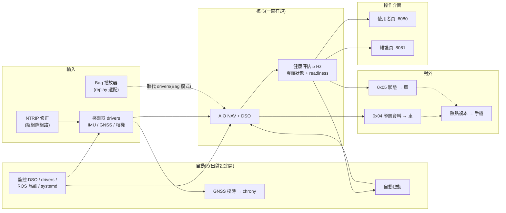

# 功能盤點與彼此的關係

目前有哪些功能、各自怎麼開關、彼此依賴什麼,以及**哪些功能互斥(一次只能用一個)**、哪些是**多個機制在管同一件事**。寫給要改功能或加功能的人:動手前先看這裡,確認不會踩到另一個功能。

最後整理:2026-11-17(HEAD 對照程式碼)。細節以 [README](../README.md)、[操作手冊](OPERATION.zh-TW.md)、[設定手冊](CONFIG.zh-TW.md)、[FLOWS](FLOWS.md) 為準;本文件只講關係。標 **⚠** 的是目前程式沒有處理的衝突,列在最後一節待決定。

---

## 1. 全貌

---

## 2. 功能清單

「預設」指出貨的 `config/dashboard.yaml`;和程式內建值不同時寫在括號裡。

### 2.1 核心(沒有開關)

| 功能 | 位置 | 程式 |
|------|------|------|
| 0x04 接收與解碼 | 全部頁面 | `collectors/nav_udp.py`、`nav/decoder.py` |
| 健康評估(頁面 6 種狀態、10 種階段) | 全部頁面、自動啟動 | `state/health.py`、`state/readiness.py`(只用名稱,不含數字代碼) |
| 系統 / 服務 / 網路 / ROS 監看 | 維護頁 | `collectors/` |
| 軌跡、資料下載 | 使用者頁 導航、資料 | `nav/trajectory.py`、`data_access/` |

### 2.2 可開關的功能

| 功能 | 位置 | 開關 | 預設 | 依賴 |
|------|------|------|------|------|
| 頁面啟動 / 停止 AIO NAV | 使用者頁 總覽、導航 | `nav.allow_control` | 開(內建關) | `services.*.launch` |
| 自動啟動 | 背景;設定頁顯示 | `autostart.enabled` | 開 | **`nav.allow_control`**、靜止偵測、GNSS 校時(等時鐘) |
| 0x05 狀態封包 | 背景;設定頁「車輛連線」 | `status_udp.enabled` | 開 | 目的地 = `aio_nav.yaml` 的 `output_udp` |
| 環境偵測(網路、RTK、車輛) | 設定頁「環境」卡片、維護 Overview | 沒有開關(`state/environment.py`);RTK、車輛可在頁面改,存 `state/environment.json` | 開 | `network.internet_check`、預設路由、GNSS 診斷(`gnss_diag`)、`aio_nav.yaml` 的 `output_udp` |
| READY 需要 RTK | 設定頁「環境」卡片、維護 Overview | `readiness.require_rtk`(`auto` / `true` / `false`);頁面選擇存 `state/environment.json`(舊的 `state/readiness.json` 在被取代前仍有效) | `auto`:環境有 RTK 才需要(未知 = 需要) | 環境偵測 → GNSS 燈(NavSatFix)→ 接收機 → NTRIP → 網際網路 |
| 其他 READY 條件 | — | `readiness.require` | 無 | 各條件的來源;`dso` 只在 `Odometry.vupt` 開時算 |
| 靜止偵測 | 維護 Still detection | `autostart.require_still`,門檻存 `state/still_limits.json` | 開 | IMU、接收機速度 |
| GNSS 校時 | 背景 | `gnss_time.enabled` | 開 | IMU 時間戳、chrony(安裝程式設定) |
| DSO 監控 | 維護 ROS 2 | `dso_watchdog.enabled` | 開(內建關) | `/dso/odometry` |
| Driver 監控 | 背景(只有事件) | `driver_watchdog.enabled` | 開 | driver 是 `user_unit`、**Live 模式** |
| ROS 隔離檢查(重啟儀表板) | 背景 | `ros.isolation_restart` | 開(內建關) | driver 行程在同一個 ROS domain |
| ROS 高頻主題取樣 | 維護 ROS 2 | `ros.sampling.enabled` | 開(內建關) | 靜止偵測、校時跟著取樣窗收資料 |
| GNSS / RTK 診斷頁 | 維護 GNSS / RTK | 無(有 `gnss_diag.topic`) | 開 | 接收機 diagnostics 主題 |
| 槓桿臂設定 | 使用者頁 Setup | `product.edit_lever_arms` | 開 | 寫入 Live 的 `aio_nav.yaml` |
| AIO NAV 設定編輯器 | 維護 AIO NAV config | 無;`maintenance.config_test_start` | 開 | 寫入 `aio_nav.yaml` |
| 終端機 | 維護 Terminal | 無 | 開 | 密碼 |
| 維護頁密碼範圍 | 維護頁 | `maintenance.lock`:`all` / `tools` | `all` | `aio-dashboard password` |
| 來源 IP 限制 | 兩個頁面 | `access.allowed_clients` | 外部電腦 + 本機 | 熱點的手機另外放行(`allow_clients`) |
| 相機 / LiDAR 預覽 | 維護 Camera / LiDAR | `devices.<名稱>.preview` | 只有相機 | numpy |
| Fake 模式 | 開發 | `fake.enabled`、`--fake` | 關 | 關掉所有 ROS 監看、校時、監控 |

### 2.3 選配部分(安裝程式)

| 部分 | 加了什麼 | 開關 | 依賴 |
|------|----------|------|------|
| `replay` | Live / Bag 切換、Bag 播放器 | `modules.replay.enabled` | 兩份 aio-nav-ros 設定檔(live / bag) |
| `sysmon` | 系統黑盒子(獨立 service) | 無 | — |
| `wifi` | 讓服務使用者改 Wi-Fi 的權限 | `wifi.enabled`(只管面板顯示) | NetworkManager |
| `hotspot` | 把 Wi-Fi 變成熱點、封包複本 | `wifi.hotspot.enabled: auto`、`relay_udp` | **`wifi`**、dnsmasq、nft / iptables |

---

## 3. 互斥:一次只能用一個

### 3.1 誰負責 AIO NAV

| 選項 | 怎麼啟用 |
|------|----------|
| A. 儀表板(頁面按鈕 + 自動啟動) | `nav.allow_control: true`(出貨設定) |
| B. systemd `aio-nav.service` | `install.sh --with-aio-nav PATH`,再 `systemctl enable` |
| C. AIO Nav 桌面 App(aio-nav-ui) | 手動開 |

**為什麼互斥:** 兩個管理者會各啟動一份 AIO NAV,或一個停、另一個馬上又啟動。

**目前的防護:**
- 儀表板啟動前會先找同名行程,已經在跑就接手(adopt),不會再啟動一份。
- 偵測到 AIO NAV 跑兩份,或自動啟動開著時 `aio-nav.service` 也設成開機啟動,就判 FAULT(`OWNERSHIP_CONFLICT`)。
- 安裝程式在自動啟動開著時,不會把 `aio-nav.service` 設成開機啟動。

**缺口(推測,未實測):** 「該不該在跑」只由儀表板自己的啟動 / 停止記錄。所以用桌面 App 停掉 AIO NAV 時,儀表板應該會當成當機,自動再啟動。

### 3.2 Live 與 Bag 重播(只有 replay 選配)

| 選項 | ROS 環境 | 資料來源 |
|------|----------|----------|
| Live | `aio_nav.yaml`(domain 10,只限本機) | 真的感測器 |
| Bag 重播 | `aio_nav_bag.yaml`(domain 13,網路) | Bag 播放器 |

**為什麼互斥:** AIO NAV、DSO 和儀表板自己的 ROS 連線必須在同一個 domain。切換時會停掉 AIO NAV、重啟儀表板。下次開機一定回到 Live。

**已經知道 Bag 模式的:** driver 監控在 Bag 模式不動作;播放器檢查 drivers 不在 bag 的 domain 裡發資料。

**⚠ 不知道 Bag 模式的**(程式裡沒有任何判斷,已用 grep 確認):
- **0x05 狀態封包照送。** 目的地是 *目前* 設定檔的 `output_udp`。如果 `aio_nav_bag.yaml` 也指向車輛,車輛會收到根據重播資料算出來的 READY。
- **自動啟動照跑**,也照樣要求「靜止」。沒有在播放時 IMU 是空的,推測會一直等,等太久就報 FAULT。
- **GNSS 校時照收 IMU 時間戳。** 重播的時間戳是錄製當時的時間,推測會把舊時間餵給 chrony。需要在實機確認。

### 3.3 Wi-Fi 連線與熱點

| 選項 | 結果 |
|------|------|
| Wi-Fi 連到外部網路 | 有網際網路(可能是 NTRIP 的路徑) |
| Wi-Fi 當熱點 | 手機、平板可以連進來看頁面、收封包複本;**這台機器沒有 Wi-Fi 網際網路** |

**為什麼互斥:** 只有一個無線網卡。熱點一旦開啟,每次開機都會自己起來,直到有人關掉。

**連鎖影響:** 網際網路只走 Wi-Fi 的機器開熱點會斷掉 NTRIP,於是沒有 RTK。如果這次上電還沒有過 RTK,環境會判斷「沒有網路 → 沒有 RTK」,READY 不等 RTK。但在有 RTK 的地方(這次上電已收到 RTK 修正資料或 RTK 定位),這個結果會鎖住到下次上電,RTK 仍然需要:開熱點後就**到不了 READY**(READY 之後則變成 DEGRADED)。啟動熱點時頁面只會提醒「網際網路路由（RTK 修正資料）經由 Wi-Fi」,確認後照樣開。

### 3.4 本機 UDP 9000 的接收者

`aio_nav_node` 一定送到 `127.0.0.1:9000`,而這個埠只能有一個程式綁定。目前是儀表板;舊的 aio-nav-ui 也會綁這個埠。誰先綁誰收得到,儀表板沒綁到就顯示 FAULT「收不到導航輸出」。要讓兩邊同時收,得讓 AIO NAV 多送一份(見 [IDEAS 7](IDEAS.md#7-aio-nav-本身的配合))。

### 3.5 其他二選一的設定

| 設定 | 選項 | 影響 |
|------|------|------|
| `maintenance.lock` | `all`:整個維護頁要密碼;`tools`:看免密碼,改東西才要密碼 | 安全性和現場方便 |
| `fake.enabled` | 真實機器 / 開發示範 | Fake 模式關掉校時、ROS 監看、DSO / driver 監控、ROS 隔離檢查 |

---

## 4. 重疊:多個機制管同一件事

| 同一件事 | 機制 | 關係 | 說明在哪 |
|----------|------|------|----------|
| 重啟出問題的部分 | 自動啟動、DSO 監控、driver 監控、ROS 隔離檢查、systemd watchdog | 各管各的對象。**⚠ driver 監控和 ROS 隔離檢查會對同一個症狀反應,沒有協調** | [FLOWS 7](FLOWS.md#7-who-restarts-what) |
| GNSS 好不好 | GNSS 燈(NavSatFix)、GNSS / RTK 頁(diagnostics)、導航頁的 GNSS 輔助燈(0x04 旗標) | 只有 GNSS 燈直接影響 READY;diagnostics 用來判斷環境有沒有 RTK(也就是 READY 要不要 RTK)。**⚠ 三者可能說法不同,沒有對照** | [設定手冊 4.7b / 4.7c](CONFIG.zh-TW.md) |
| READY 要不要 GNSS 品質 | 環境的 RTK(偵測,頁面可改)、`readiness.require_rtk`、`readiness.require: [gnss_quality]` | 兩條路各自獨立:在頁面選「這裡沒有 RTK」,`require` 裡的 `gnss_quality` 還是有效 | [FLOWS 8](FLOWS.md#8-where-a-setting-comes-from) |
| 修改 `aio_nav.yaml` | 使用者頁 Setup(槓桿臂)、維護頁設定編輯器 | 兩邊都會試啟動並做版本檢查,不會互相覆蓋。**⚠ Setup 不用密碼,設定編輯器要** | 操作手冊 3.6、8 |
| Wi-Fi 與環境(RTK、車輛) | 使用者頁 Settings、維護頁 Network / Overview | 同一段程式。使用者頁不用密碼,但 Wi-Fi 只接受用網路線連進來的瀏覽器 | [FLOWS 5](FLOWS.md#5-wi-fi-change) |
| 狀態 | 頁面狀態(6 種)、readiness(10 種)、頁面顯示(`_health_view` 再轉換) | 同一個快照,只是轉成不同的呈現 | [FLOWS 2–3](FLOWS.md#2-one-health-tick-5-hz) |
| 啟動 drivers | 自動啟動的 `start_services`、driver 監控、維護頁按鈕 | 都尊重操作員的停止 | [FLOWS 4、7](FLOWS.md) |

---

## 5. 依賴鏈(關掉 A 會讓 B 失效)

- `nav.allow_control` 關掉 → 頁面按鈕、自動啟動、Setup 存檔後的重啟全部失效。
- 網際網路(Wi-Fi 或有線)→ NTRIP → RTK → READY(需要 RTK 時,也就是環境有 RTK 的地方)。熱點、Wi-Fi 變更、網路線都在這條鏈上。網路和 GNSS 診斷也決定環境偵測的「有沒有 RTK」。
- IMU → GNSS 校時 → 自動啟動(先等時鐘)→ AIO NAV。
- IMU → 靜止偵測 → 自動啟動(要靜止才啟動)。
- `output_udp`(設定編輯器可改)→ 0x04 的目的地,**也是** 0x05 的目的地(`status_udp.destination: auto`)。
- `hotspot` 選配 → 需要 `wifi` 選配;封包複本只在熱點開著時送。
- Bag 播放器 → 需要 Bag 模式 → 需要 `replay` 選配。
- `readiness.require` 裡的 `dso` → 只在 `aio_nav.yaml` 的 `Odometry.vupt` 開著時有效。

---

## 6. 待決定

| # | 問題 | 可能的做法 |
|---|------|------------|
| 1 | Bag 模式下仍然送 0x05、仍然自動啟動、仍然校時(3.2) | Bag 模式時 0x05 固定送 MAINTENANCE(或停送)、自動啟動不啟動、校時停餵;或規定 `aio_nav_bag.yaml` 不得指向車輛 |
| 2 | 熱點會切斷 Wi-Fi 網際網路,連帶切斷 RTK(3.3) | 部分解決(2026-11-19):沒有網路時環境判斷沒有 RTK,READY 不等 RTK。剩下的是有 RTK 的地方(這次上電已有 RTK,鎖住):開熱點時要求加強確認;或規定 NTRIP 只走有線 |
| 3 | 桌面 App 停掉 AIO NAV 會被當成當機(3.1) | 出貨機不裝桌面 App;或偵測外部停止並當成操作員停止 |
| 4 | driver 監控和 ROS 隔離檢查沒有協調(4) | 看不到任何其他節點時,driver 監控不動作 |
| 5 | GNSS 三個來源說法可能不同(4) | GNSS / RTK 頁顯示燈號的判斷,不一致時提示 |
| 6 | Setup 不用密碼就能改 `aio_nav.yaml`(4) | 維持(現場操作員要能改),或加 `product.edit_lever_arms: false` 給出貨機 |
| 7 | VUPT 的意思:文件寫車速 / 輪速里程計,程式把 `Odometry.*` 當成 DSO | 和導航團隊確認後統一 |
