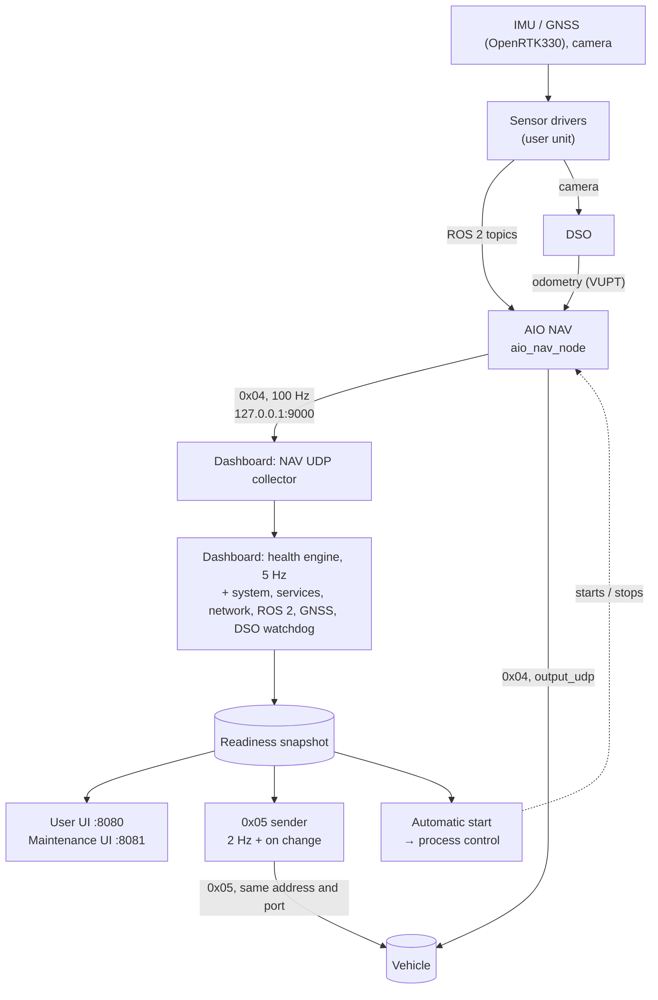
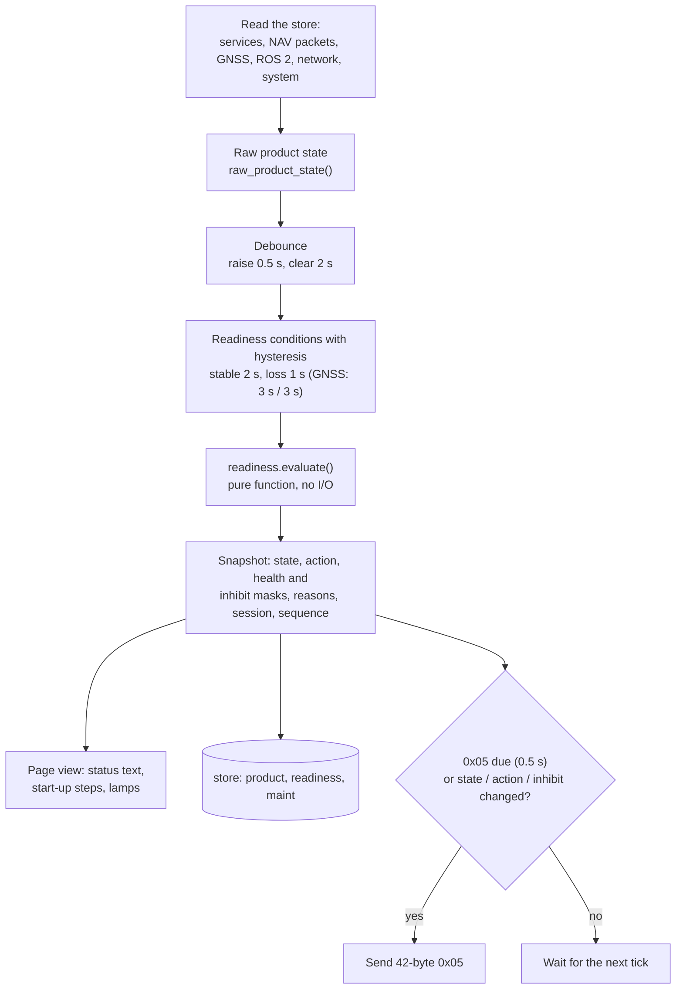
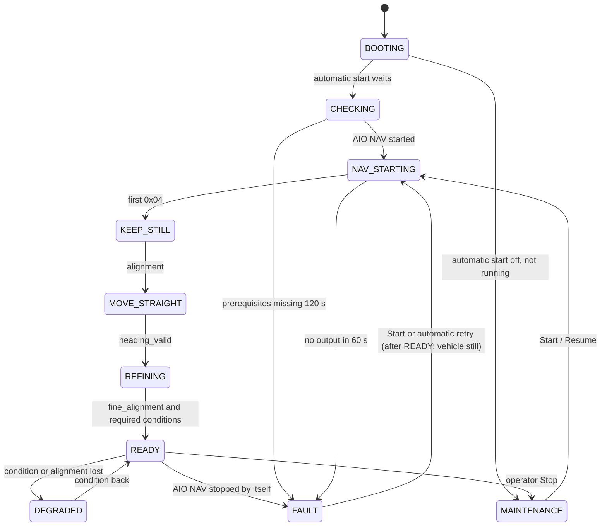
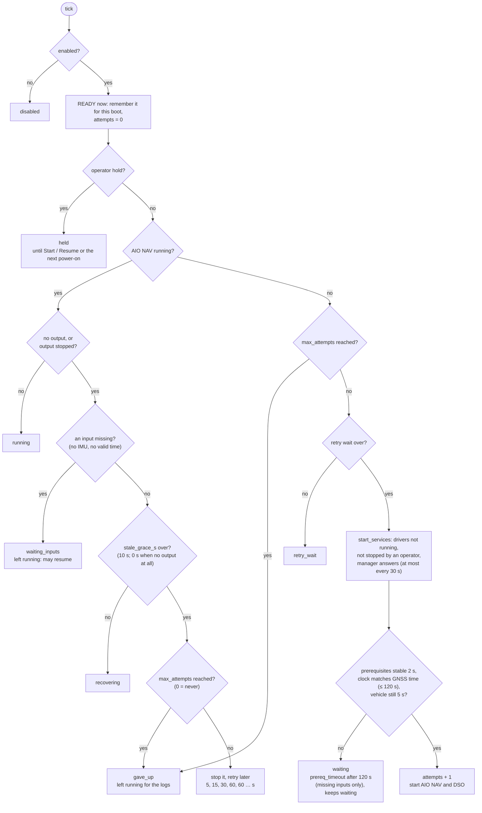
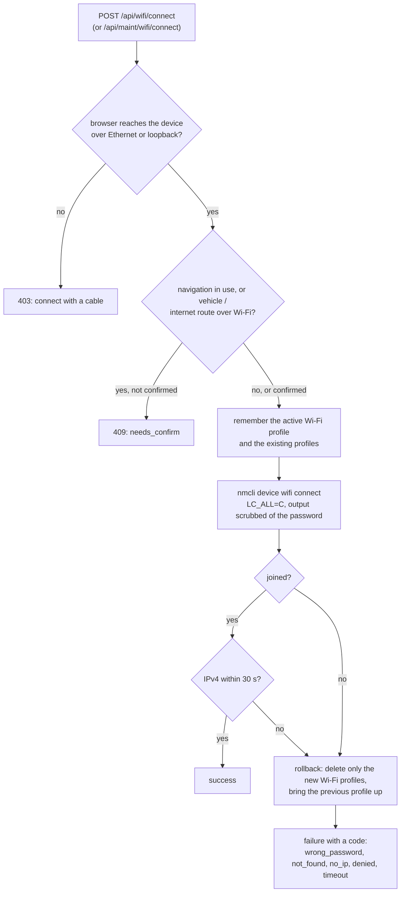
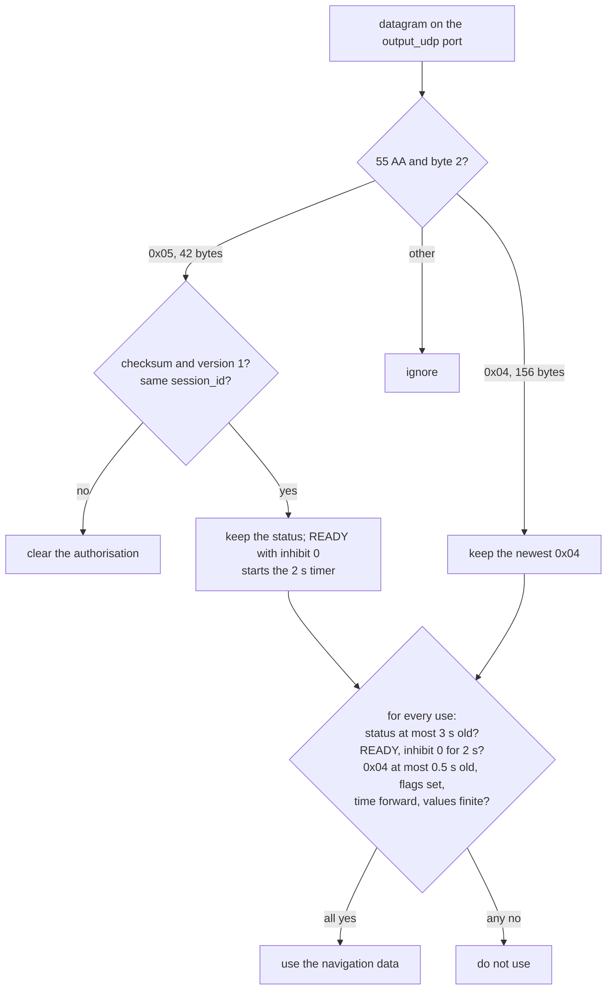

# AIO System Dashboard — Engineering Flows

Short diagrams of how the parts work together. They are Mermaid: GitHub draws them, and they are
plain text, so update them in the same commit as the code they describe. The operator view of the
same sequence (what the page and the vehicle show at each step) is in the
[Operation manual, section 4.2](OPERATION.md).

1. [System and data flow](#1-system-and-data-flow)
2. [One health tick (5 Hz)](#2-one-health-tick-5-hz)
3. [Readiness states](#3-readiness-states)
4. [Automatic start (every 1 s)](#4-automatic-start-every-1-s)
5. [Wi-Fi change](#5-wi-fi-change)
6. [Vehicle side](#6-vehicle-side)

## 1. System and data flow

What runs on the Jetson, and what goes over which port. Solid lines are data, the dotted line is
control.

- One snapshot (`state/readiness.py`) feeds the pages, `/api/readiness` and the 0x05 packet, so
  they never disagree.
- The dashboard is the only listener on 127.0.0.1:9000; `output_udp` in `aio_nav.yaml` is the
  vehicle. 0x05 goes to that same address and port (`status_udp.destination: auto`).
- Process control starts and stops AIO NAV and DSO together (`nav.control_group`); the automatic
  start also starts the sensor drivers first (`autostart.start_services`).
- AIO NAV keeps running if the dashboard stops; the dashboard adopts it when it comes back.

## 2. One health tick (5 Hz)

`HealthEngine.step()` in `state/health.py`.

- Not READY always has at least one inhibit bit; READY always has none (tested exhaustively).
- The READY latch is per AIO NAV process: after a crash it says SAFE_STOP, not "starting".

## 3. Readiness states

The main transitions of `readiness.evaluate()`. Codes are the 0x05 `state` values.

| State | Requested action | Notes |
|-------|------------------|-------|
| BOOTING, CHECKING, NAV_STARTING | HOLD_STILL | |
| KEEP_STILL / MOVE_STRAIGHT / REFINING | HOLD_STILL / DRIVE_STRAIGHT / KEEP_DRIVING | from the first missing alignment flag |
| READY | NONE | inhibit_flags = 0 |
| DEGRADED | SAFE_STOP | only after READY in this AIO NAV run |
| FAULT | SERVICE_REQUIRED, or SAFE_STOP after READY | also: AIO NAV running twice, or `aio-nav.service` enabled with automatic start (OWNERSHIP_CONFLICT) |
| MAINTENANCE | MAINTENANCE_HOLD | operator Stop (until Resume or the next power-on) or nobody asked it to run |

## 4. Automatic start (every 1 s)

`StartupCoordinator.tick()` in `actions/autostart.py`. It judges success by AIO NAV only; DSO
failing never restarts a working AIO NAV.

- The hold, the attempt count and "READY reached" are stored with
  `/proc/sys/kernel/random/boot_id` (`state/autostart.json`, or `/dev/shm` if `state/` cannot be
  written): a dashboard restart keeps them, the next power-on starts afresh.
- After READY the same path restarts AIO NAV; meanwhile readiness says FAULT / SAFE_STOP, and the
  start waits for the vehicle to be still.
- An operator Stop sets the hold; Start / Resume clears it and resets the attempts. A busy process
  slot (the DSO watchdog starting DSO) is not an attempt: it tries again in 2 s.

## 5. Wi-Fi change

`register_settings()` in `web/settings_api.py` and `WifiManager.connect()` in `actions/wifi.py`.
Same code for the user page (no password) and the Maintenance page (password).

- Runs without root after a one-time `sudo deploy/install.sh --with-wifi` (polkit rule for the
  service user only).
- One change at a time (a lock in the one `WifiManager` both apps share).

## 6. Vehicle side

The reference receiver, `nav/vehicle_gate.py` (`tools/vehicle_gate.py` runs it on live UDP).

