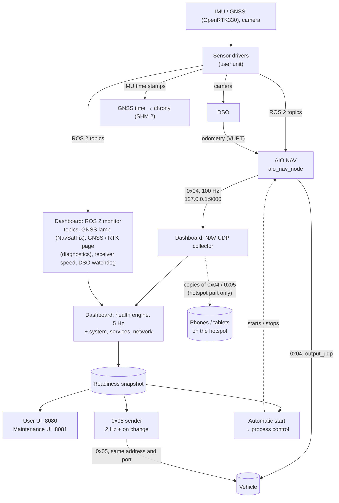
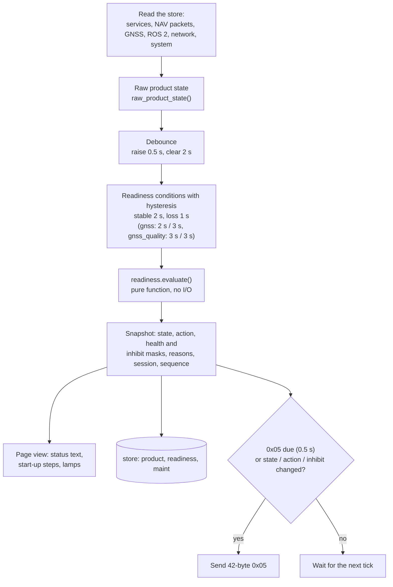
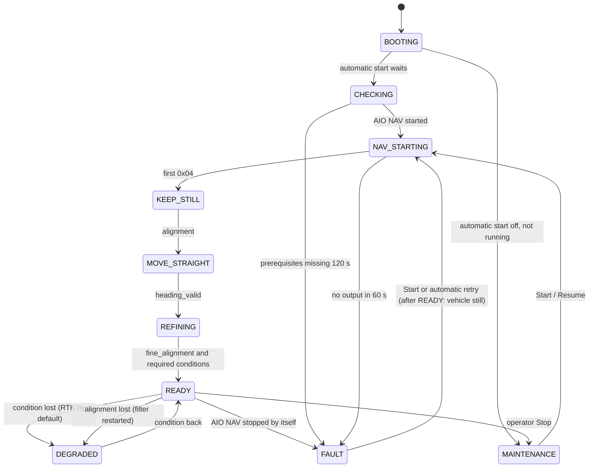
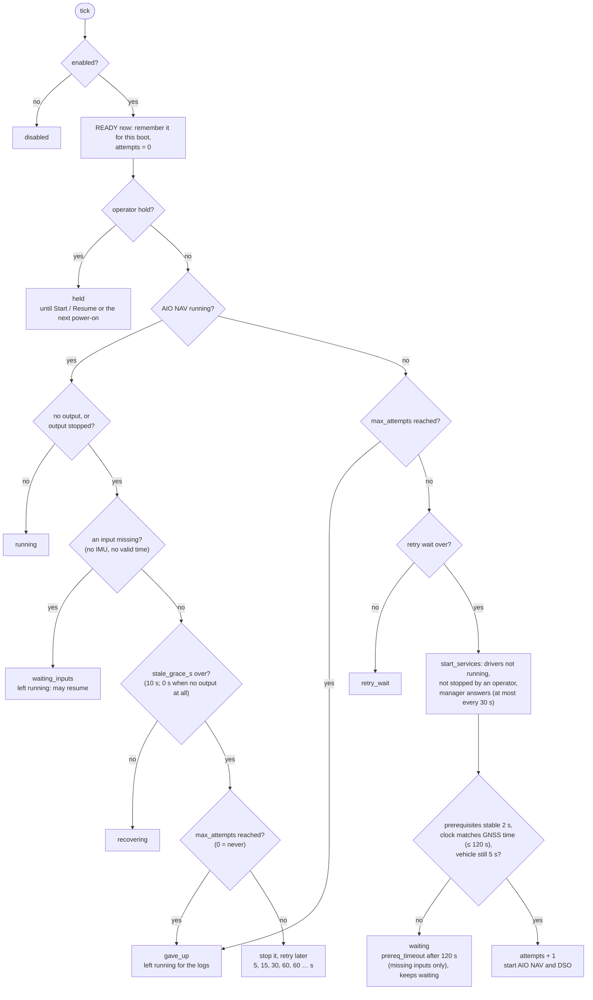
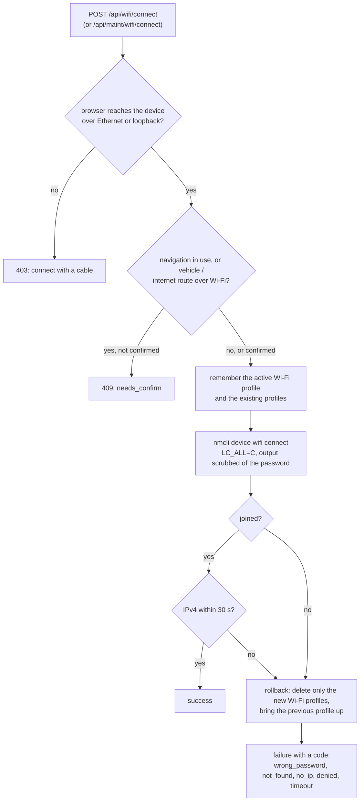
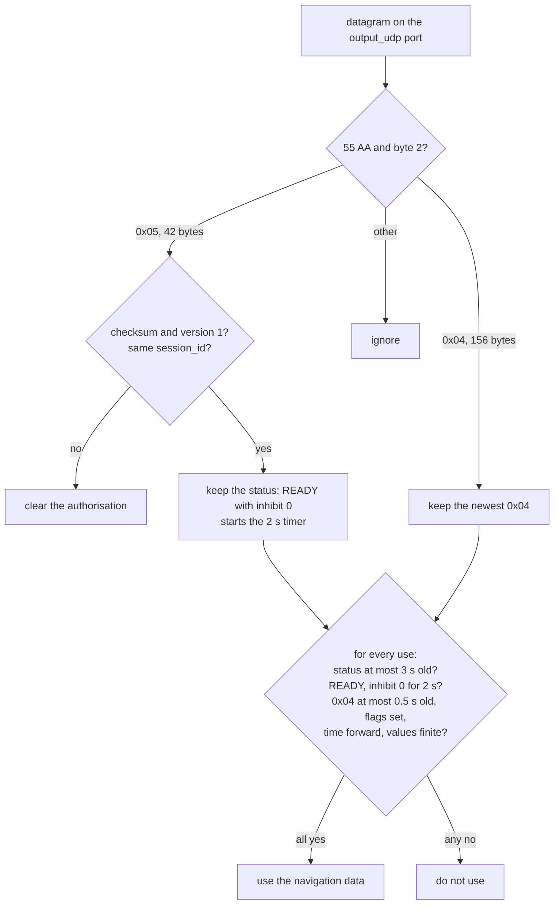

# AIO System Dashboard — Engineering Flows

Short diagrams of how the parts work together. They are Mermaid: GitHub draws them, and they are
plain text, so update them in the same commit as the code they describe. The operator view of the
same sequence (what the page and the vehicle show at each step) is in the
[Operation manual, section 4.2](OPERATION.md).

1. [System and data flow](#1-system-and-data-flow)
2. [One health tick (5 Hz)](#2-one-health-tick-5-hz)
3. [Readiness states](#3-readiness-states)
4. [Automatic start (every 1 s)](#4-automatic-start-every-1-s)
5. [Wi-Fi change](#5-wi-fi-change)
6. [Vehicle side](#6-vehicle-side)
7. [Who restarts what](#7-who-restarts-what)
8. [Where a setting comes from](#8-where-a-setting-comes-from)

## 1. System and data flow

What runs on the Jetson, and what goes over which port. Solid lines are data, the dotted line is
control.

- One snapshot (`state/readiness.py`, by name) feeds the pages, `/api/readiness`, the automatic
  start and the 0x05 packet, so they never disagree. The 0x05 side is its own layer
  (`vehicle/`): it listens to the health step, adds the wire numbers and sends; the core never
  imports it.
- The dashboard is the only listener on 127.0.0.1:9000; `output_udp` in `aio_nav.yaml` is the
  vehicle. 0x05 goes to that same address and port (`status_udp.destination: auto`).
- Process control starts and stops AIO NAV and DSO together (`nav.control_group`); the automatic
  start also starts the sensor drivers first (`autostart.start_services`).
- AIO NAV keeps running if the dashboard stops; the dashboard adopts it when it comes back.
- The GNSS lamp and READY use the NavSatFix topic (`gnss.topic`). The Maintenance GNSS / RTK page
  uses the receiver's diagnostics (`gnss_diag.topic`) and may say something else; it is for
  troubleshooting only and never changes READY.

## 2. One health tick (5 Hz)

`HealthEngine.step()` in `state/health.py`.

- Not READY always has at least one inhibit bit; READY always has none (tested exhaustively).
- The READY latch is per AIO NAV process: after a crash it says SAFE_STOP, not "starting".

## 3. Readiness states

The main transitions of `readiness.evaluate()`. Codes are the 0x05 `state` values.

| State | Requested action | Notes |
|-------|------------------|-------|
| BOOTING, CHECKING, NAV_STARTING | HOLD_STILL | |
| KEEP_STILL / MOVE_STRAIGHT / REFINING | HOLD_STILL / DRIVE_STRAIGHT / KEEP_DRIVING | from the first missing alignment flag |
| READY | NONE | inhibit_flags = 0 |
| DEGRADED | SAFE_STOP | only after READY in this AIO NAV run |
| FAULT | SERVICE_REQUIRED; HOLD_STILL while the automatic start restarts it; SAFE_STOP after READY | also: AIO NAV running twice, or `aio-nav.service` enabled with automatic start (OWNERSHIP_CONFLICT) |
| MAINTENANCE | MAINTENANCE_HOLD | operator Stop (until Resume or the next power-on) or nobody asked it to run |

## 4. Automatic start (every 1 s)

`StartupCoordinator.tick()` in `actions/autostart.py`. It judges success by AIO NAV only; DSO
failing never restarts a working AIO NAV.

- The hold, the attempt count and "READY reached" are stored with
  `/proc/sys/kernel/random/boot_id` (`state/autostart.json`, or `/dev/shm` if `state/` cannot be
  written): a dashboard restart keeps them, the next power-on starts afresh.
- After READY the same path restarts AIO NAV; meanwhile readiness says FAULT / SAFE_STOP, and the
  start waits for the vehicle to be still.
- An operator Stop sets the hold; Start / Resume clears it and resets the attempts. A busy process
  slot (the DSO watchdog starting DSO) is not an attempt: it tries again in 2 s.

## 5. Wi-Fi change

`register_settings()` in `web/settings_api.py` and `WifiManager.connect()` in `actions/wifi.py`.
Same code for the user page (no password) and the Maintenance page (password).

- Runs without root after a one-time `sudo deploy/install.sh --with-wifi` (polkit rule for the
  service user only).
- One change at a time (a lock in the one `WifiManager` both apps share).

## 6. Vehicle side

The reference receiver, `vehicle/gate.py` (`tools/vehicle_gate.py` runs it on live UDP).

## 7. Who restarts what

Several watchers can restart a part. Each touches only its own part; this table is the place
to check before adding another one.

| Watcher | Code | Acts when | Does | Limits |
|---------|------|-----------|------|--------|
| Automatic start | `actions/autostart.py` | AIO NAV should run but is not running, or sends nothing | starts AIO NAV + DSO (`nav.control_group`); first starts the drivers if they are not running (`autostart.start_services`) | waits 5, 15, 30, 60 … s; after READY only with the vehicle still; an operator Stop holds it |
| DSO watchdog | `collectors/dso_watchdog.py` | `/dso/odometry` NaN; DSO should run but is gone; DSO memory too high | restarts or starts **DSO only**, never AIO NAV | waits `retry_s` (30 s), doubling up to `retry_max_s` (300 s) while it keeps exiting |
| Driver watchdog | `actions/driver_watchdog.py` | Live mode, driver unit active, IMU topic missing or stale for 45 s | `systemctl --user restart` of the driver unit | 60, 120, 300 s between restarts; an operator Stop of the drivers is respected |
| ROS isolation guard | `collectors/ros_guard.py` | the driver process runs in the dashboard's ROS domain, but no other node has been visible for 30 s | restarts the **dashboard** (systemd starts it again) | at most once per 600 s (kept on disk), only after 60 s of uptime |
| systemd | `deploy/aio-dashboard.service` | the dashboard stops answering for 60 s (`WatchdogSec`) | restarts the dashboard | AIO NAV and DSO keep running (`KillMode=process`) |

Known overlap: when the dashboard's own ROS discovery is stuck, the IMU also looks *missing*, so
the driver watchdog may restart the drivers (after 45 s) while the guard restarts the dashboard
(after 30 s). The guard usually acts first and the dashboard comes back with a working ROS
connection. During the guard's 600 s cooldown the driver watchdog can still restart drivers that
are healthy. Not coordinated yet.

## 8. Where a setting comes from

Some settings can be changed on the pages. The page's choice is kept in `state/` and wins over
`config/dashboard.yaml`:

| Setting | In the config | Changed on | Kept in | How long the page's choice holds |
|---------|---------------|------------|---------|-----------------------------------|
| RTK required for READY | `readiness.require_rtk` (`true`) | Settings page, Maintenance > Overview | `state/readiness.json` | until changed again |
| Live / Bag replay | `ros.mode` (`live`) | Maintenance > Replay (replay part only) | `state/ros_mode.json` | until the next power-on |
| Operator Stop (hold) | — | Stop / Start / Resume | `state/autostart.json` | until Start / Resume or the next power-on |
| Still limits | `readiness.still_*` | Maintenance > Still detection | `state/still_limits.json` | until reset |

`readiness.require: [gnss_quality]` is a second way to require GNSS quality; it is independent of
the RTK switch (switching RTK off does not remove it).
