# AIO Navigation — Maintenance Guide

This guide is for the **engineers** who look after AIO navigation devices: find out why something
does not work, and fix it. It covers the Maintenance view (`:8081`), how the device runs on its own,
and troubleshooting by symptom. What users see is in the [User Guide](USER_GUIDE.md); installing and
settings are in the [Installation Guide](INSTALL.md) and the [Configuration Reference](CONFIG.md).

Contents:

1. [Before you start](#1-before-you-start)
2. [The Maintenance pages](#2-the-maintenance-pages)
3. [How the device runs on its own](#3-how-the-device-runs-on-its-own)
4. [Still detection](#4-still-detection)
5. [Network: Wi-Fi and the hotspot](#5-network-wi-fi-and-the-hotspot)
6. [Bag replay](#6-bag-replay)
7. [Troubleshooting by symptom](#7-troubleshooting-by-symptom)
8. [The `aio-dashboard` command](#8-the-aio-dashboard-command)
9. [After a freeze or a power cut](#9-after-a-freeze-or-a-power-cut)

---

## 1. Before you start

Open `http://<device-ip>:8081`. The Maintenance view can change the device, so it asks for a
password.

- **Setting the password.** On the device: `aio-dashboard password`. There is no default password;
  until one is set, the Maintenance view stays locked and its sign-in page says how to set one.
- **What the password protects** (`maintenance.lock`). With `all` (the default) every Maintenance
  page asks for it. With `tools` the pages open without it, and only changes need it: the AIO NAV
  config editor, the terminal, still detection, and changing Wi-Fi, the hotspot or the environment.
  `tools` lets users follow the *View in Maintenance (read only)* links of the user pages.
- **Signing out.** After 15 minutes without use (opening pages and pressing buttons count; the pages
  refreshing themselves do not), or with **Sign out** at the bottom of the sidebar.
- **Who may connect.** Only the computers in `access.allowed_clients`; others get **403 Forbidden**.

Sign-ins, failed attempts, saved settings, restarts and opened terminals are recorded in the event
log (Diagnostics page, and `logs/events.jsonl`).

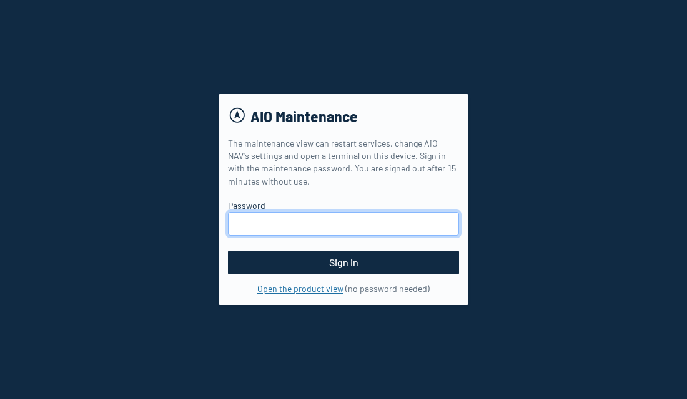

## 2. The Maintenance pages

The sidebar lamps show which page has a problem. The tool pages (Still detection, AIO NAV config,
Terminal, Replay) have no lamp.

### 2.1 Overview

The four layers (System, Services, Data flow, Network) and the list of active issues; each issue
links to the page that explains it.

**Readiness for the vehicle** shows the device's own verdict: the state and requested action, the
reasons, the bit masks sent to the vehicle (0x05, [Integration Guide](INTEGRATION.md)), each
readiness condition, and the automatic start.

**RTK required for Ready** says *Yes* or *No* and where that comes from: *environment* (detected),
*set on a page*, or *config* (`readiness.require_rtk`). **Turn on** / **Turn off** set it by hand;
**Automatic** goes back to the detection. The **Environment** row shows network · RTK · vehicle;
hover over it to see how each was detected. These are the same answers as the Environment card of
the user Settings page.

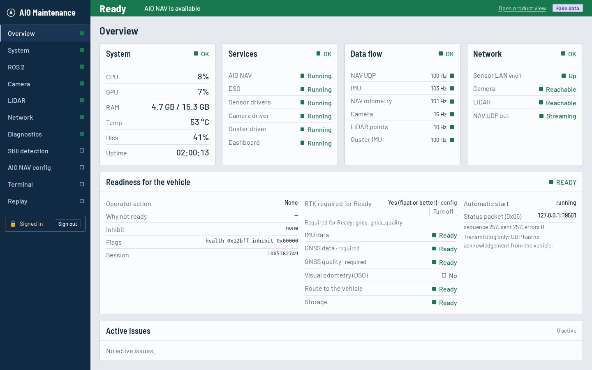

### 2.2 System

CPU, GPU, memory, disks, temperatures, systemd services and network interfaces. Look here first
when the device is slow, a disk is full, or a service does not run.

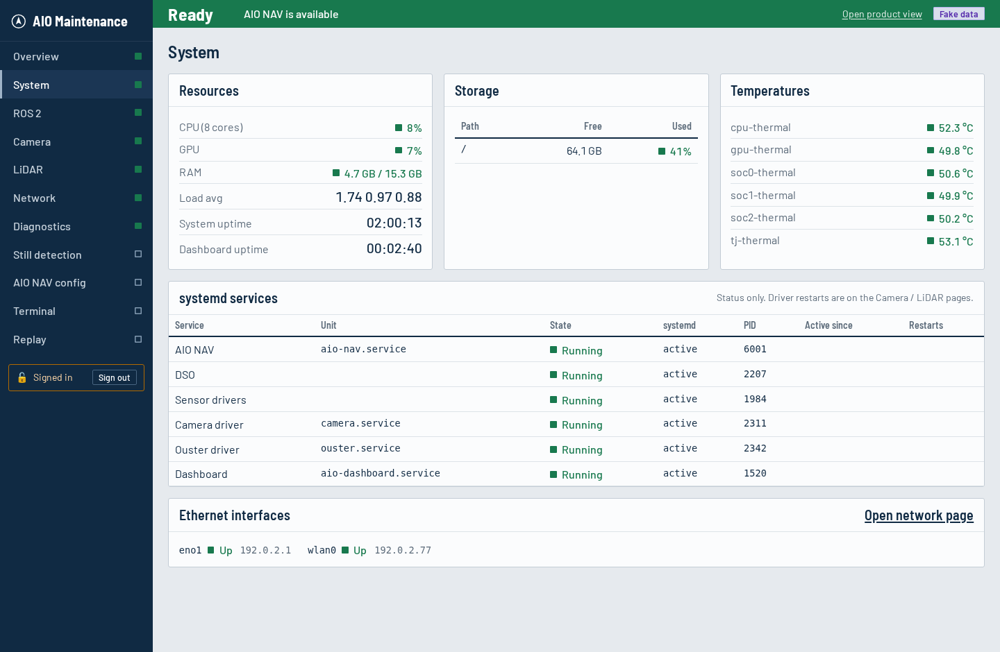

### 2.3 ROS 2

The ROS environment in use (domain, Live or Bag replay), the required nodes, the watched topics
(rate, freshness, publishers, subscribers) and all topics.

**Sensor drivers** has **Start**, **Stop** and **Restart** for the camera and IMU/GNSS drivers. A
**Stop** here is kept: neither the automatic start nor the driver watchdog starts them again until
someone presses **Start**.

The **DSO watchdog** panel shows what it did last ([section 3.3](#33-who-restarts-what)).

High-rate topics such as the 100 Hz IMU are listened to for 1.5 s out of every 5 s to save CPU;
their rate is then marked *sampled*.

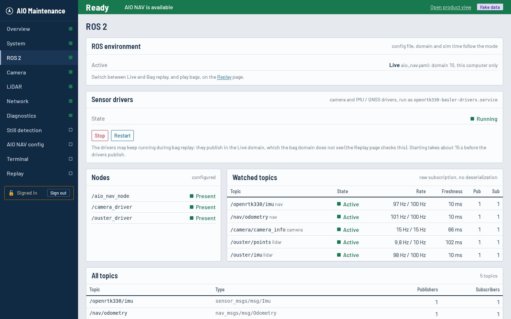

### 2.4 GNSS / RTK

Why the receiver has no RTK. **Diagnosis** checks in order: the receiver, the antenna signal, the
corrections, and whether the receiver uses them, and names the likely cause. Below it: the
**Receiver solution**, the **Antenna signal** (satellites and signal strength per constellation),
the **RTK corrections (NTRIP)** and a chart of the **Last 10 minutes**.

The data comes from the receiver driver's diagnostics topic (`gnss_diag.topic`). The GNSS step and
lamp of the user pages come from its position topic (`gnss.topic`, NavSatFix), so the two can
disagree for a few seconds.

### 2.5 Camera / LiDAR

Reachability, driver state, topic health, and **Live view**: the camera image, or the LiDAR point
cloud as a top or 3D view. The Live view reads the topic only while the page is open. **Run
diagnostic** checks the device on the network; **Restart driver** restarts its driver (asks first).

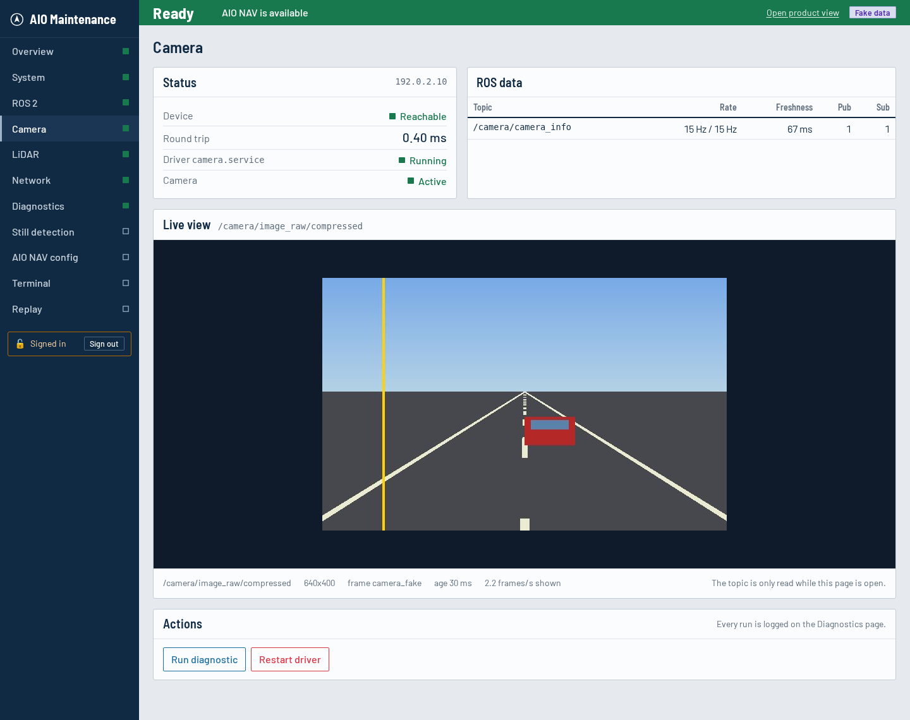

### 2.6 Network

Interfaces and addresses, sensor reachability, where the navigation output goes and whether there
is a route. **Wi-Fi** and **Hotspot**: [section 5](#5-network-wi-fi-and-the-hotspot).

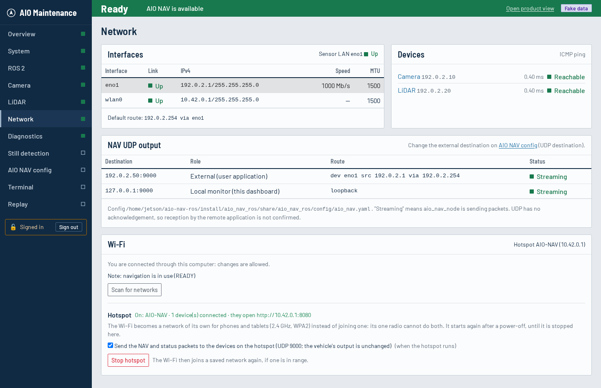

### 2.7 Diagnostics

Active faults and warnings, the results of diagnostics and restarts, and the event history. Events
of the first minute after power-on, before the clock was set from GNSS time, are shown at their real
time once it is set.

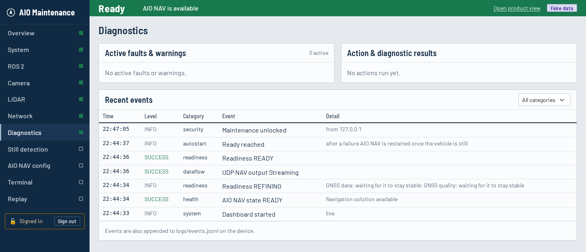

### 2.8 Still detection

Whether the vehicle stands still, and measuring the limits on your vehicle:
[section 4](#4-still-detection).

### 2.9 AIO NAV config

Edits AIO NAV's own settings files: `aio_nav.yaml` (Live) and `aio_nav_bag.yaml` (Bag replay).

- **Settings** is a form of the values most often changed: output, ROS, logs, alignment, aiding,
  lever arms. **Edit file** shows the whole file. Comments in the file are kept.
- **Review changes** checks the file and shows exactly which lines change. A removed or empty
  setting, a decimal written as a whole number, or a list of another length is refused.
- **Save** keeps the change for AIO NAV's next start; **Save and restart AIO NAV** applies it at
  once (AIO NAV aligns again).
- Before saving, AIO NAV is started on the new file for a moment, cut off from the network. A file
  it would not start with is refused (*not saved: AIO NAV does not start with this file: …*), and
  the file on disk stays as it was.
- Every save keeps the previous version: **Earlier versions** goes back.

The vehicle address (`output_udp`) is set here.

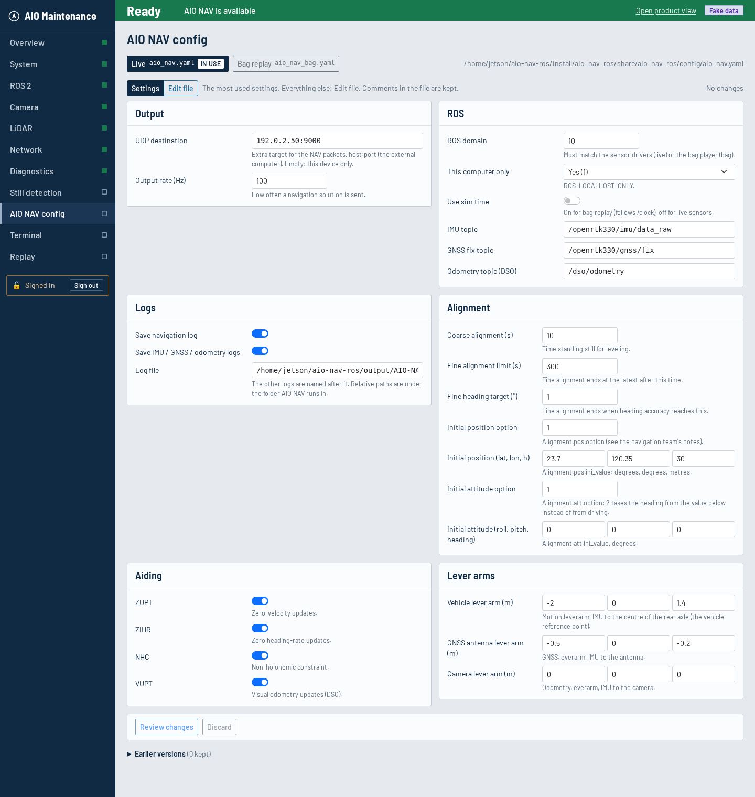
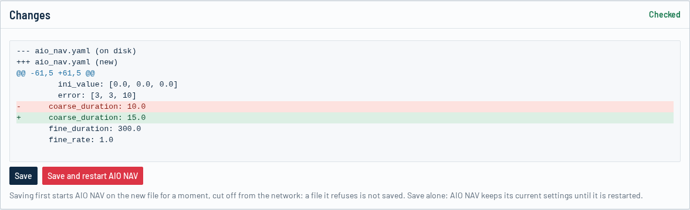

### 2.10 Terminal

A shell on the device, in the browser, for quick checks (`ros2 topic hz …`, `journalctl …`,
`top`). It runs as the dashboard's user and loads its `.bashrc`, so ROS is set up; **Use active
ROS domain** types the export line for the mode in use. Up to 3 terminals at once; each closes after
30 minutes without typing. It is a real shell: keep the password strong.

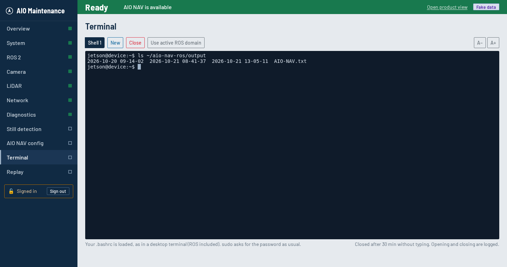

### 2.11 Replay

Only with the `replay` part. Live / Bag replay switch and the bag player:
[section 6](#6-bag-replay).

## 3. How the device runs on its own

With the shipped settings nobody has to press Start: the dashboard starts AIO NAV, restarts it after
a failure, and looks after the sensor drivers and DSO. AIO NAV runs in its own process group: it
keeps running when the dashboard restarts or a browser closes.

### 3.1 Power-on

| Step | Status on the user pages | Sent to the vehicle (0x05) |
|------|--------------------------|----------------------------|
| 1. Dashboard starts | **Unknown** → **Starting** | `BOOTING`, then `CHECKING` |
| 2. Sensor drivers started if needed; wait for IMU data, for the clock to match GNSS time (at most 2 min) and for the vehicle to be still for 5 s | **Starting** — *Starting automatically: Waiting for …* | `CHECKING` / `HOLD_STILL` |
| 3. AIO NAV and DSO started | **Starting** | `NAV_STARTING` / `HOLD_STILL` |
| 4. Alignment | **Initializing**, stage 1 → 2 → 3 | `KEEP_STILL` → `MOVE_STRAIGHT` → `REFINING` |
| 5. RTK float or better where RTK is required, stable 3 s | **Ready** | `READY`, inhibit 0 |

If the sensors are still missing after 2 minutes, the state becomes **Fault** and names them (for
example *IMU data not available after 120 s*); it still starts as soon as they come. Waiting for the
vehicle to be still or for the clock is never a fault.

### 3.2 After a failure

- **Before Ready**: AIO NAV that does not start, exits or sends nothing is started again after 5,
  15, 30 and then every 60 s. It never gives up (unless `autostart.max_attempts` is set).
- **Running but no output**: if an input is missing (no IMU data, no valid time) AIO NAV is left
  running, because it may resume; with the inputs fine it gets 10 s, then it is restarted.
- **After Ready**: the vehicle is told at once to stop using navigation (`SAFE_STOP`). AIO NAV starts
  again only once the vehicle has stood still for 5 s, then aligns again.
- **Operator Stop**: AIO NAV stays stopped (the button reads **Resume**) until someone presses
  Resume or Start, or until the next power-on. A dashboard restart keeps the hold.
- **Power-off while running**: normal, not reported as a crash.

### 3.3 Who restarts what

Each watcher touches only its own part.

| Watcher | Acts when | Does | Limits |
|---------|-----------|------|--------|
| Automatic start | AIO NAV should run but does not, or sends nothing | starts AIO NAV and DSO; first starts the sensor drivers if they are not running | waits 5, 15, 30, 60 … s; after Ready only with the vehicle still; respects an operator Stop |
| DSO watchdog | `/dso/odometry` turns NaN; DSO should run but is gone; DSO uses too much memory | restarts or starts **DSO only**, never AIO NAV | waits 30 s, doubling up to 300 s while it keeps failing |
| Driver watchdog | Live mode, driver unit active, IMU topic missing or stale for 45 s | restarts the driver unit | 60, 120, 300 s between restarts; respects an operator Stop of the drivers |
| ROS isolation guard | the drivers run in the dashboard's ROS domain, yet no other node has been visible for 30 s | restarts the **dashboard** | at most once per 10 minutes |
| systemd | the dashboard stops answering for 60 s | restarts the dashboard | AIO NAV and DSO keep running |

Known overlap: when the dashboard's own ROS connection is stuck, the IMU also looks missing, so the
driver watchdog may restart healthy drivers while the guard restarts the dashboard. The guard usually
acts first. Details: [docs/dev/FLOWS.md](dev/FLOWS.md#7-who-restarts-what).

## 4. Still detection

Every automatic start waits until the vehicle has stood still for 5 s, and **Save and restart** on
the user Setup page needs it too: AIO NAV's first alignment stage needs a still vehicle, and a start
may follow a crash while driving. "Still" means all three values are below their limits:

| Value | From | Default limit |
|-------|------|---------------|
| **Rotation** | The largest IMU rotation rate in the last 2 s | 0.05 rad/s |
| **Shake** | The spread of the IMU acceleration in the last 2 s | 0.15 m/s² |
| **GNSS speed** | The receiver's speed, only while it has a position | 0.3 m/s |

**Now** shows each value against its limit, whether the vehicle is *Still* or *Moving* and why, and
where the limits come from (*Default limits*, *Measured …* or *Set by hand …*). The defaults were
measured on one vehicle; measure yours:

1. **Measure still** (60 s): park, engine running, nobody gets in or out. If the vehicle moves, the
   measurement stops and says so. The proposed limits are twice the largest values seen.
2. **Check while driving** (optional, 30 s, walking pace is enough): says how many readings the
   proposed limits would wrongly call still.
3. Check the numbers, then **Apply these limits**. They apply at once and are kept across restarts
   and updates. The values can also be typed by hand. **Back to defaults** returns to the settings
   file's values.

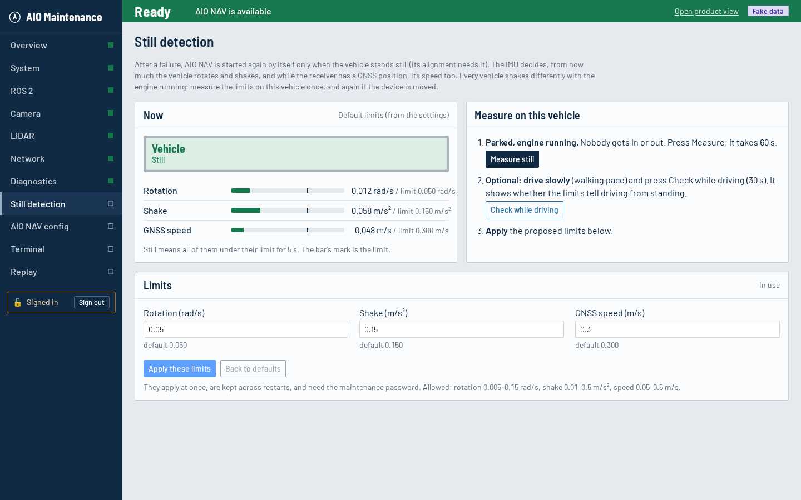

## 5. Network: Wi-Fi and the hotspot

### 5.1 Wi-Fi

Maintenance → Network → **Wi-Fi** (also on the user Settings page): scan, choose a network, enter the
password, **Connect**. If the new network fails, the previous one comes back within about a minute.
Changes are accepted only from a browser connected **by cable** (or on the device itself), so a
change cannot cut off the page that made it. While navigation is in use, or when the vehicle or the
Internet route goes over Wi-Fi, the page asks before changing anything. Wi-Fi needs the `wifi`
installer part ([Installation Guide](INSTALL.md)).

### 5.2 Hotspot

With the `hotspot` installer part, **Hotspot** turns the device's Wi-Fi into a network of its own, so
phones and tablets can join in the field. The one radio cannot join another network at the same
time.

- **Start hotspot**: a name (default `AIO-NAV`) and a password (8–63 characters); 2.4 GHz, WPA2. If it
  does not start, the previous network comes back. It **comes back after a power-off** until it is
  stopped here.
- Phones open **`http://10.42.0.1:8080`**. The page shows how many devices are connected.
- **Stop hotspot**: asks first if devices are connected; the Wi-Fi then joins a saved network in
  range.
- **UDP copies**: while the hotspot runs, every device on it receives a copy of each navigation packet
  (0x04) and status packet (0x05) on UDP port 9000. The vehicle's output is unchanged. A switch turns
  this off and on.
- **Closed network**: devices on the hotspot reach this device only, never the vehicle's network or
  the Internet through it.
- Starting and stopping need the password and a browser connected by cable: a phone on the hotspot
  cannot switch it off.

A device that gets its Internet over Wi-Fi loses it while the hotspot runs, and with it the RTK
corrections.

## 6. Bag replay

Only with the `replay` installer part; without it the device always runs **Live**. Everything is on
Maintenance → **Replay**.

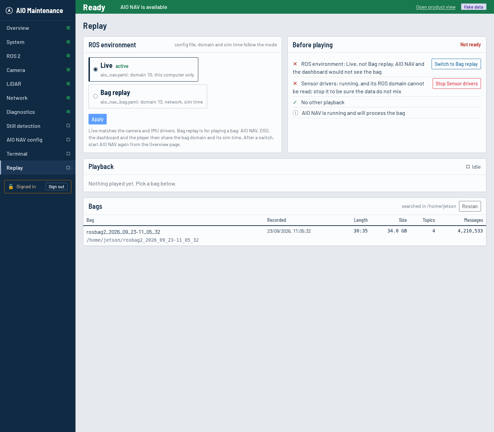

1. **Before playing** lists what has to be true, each with a button that fixes it:
   - The ROS environment is **Bag replay** (*Switch to Bag replay*: AIO NAV and DSO are stopped and
     the dashboard restarts). Bag replay uses `aio_nav_bag.yaml` (ROS domain 13, simulated time)
     instead of `aio_nav.yaml` (domain 10, this computer only). The choice lasts until the next
     power-on.
   - The sensor drivers do not publish into the bag's domain. They normally run in domain 10, which
     domain 13 does not see, so they may keep running.
   - No other bag is playing.
2. AIO NAV must run to process the bag. With automatic start on it starts by itself in the new mode;
   otherwise press **Start** on the user Overview.
3. Under **Bags**, choose a bag (found in the configured folders, default the home folder, two levels
   deep).
4. Tick the **topics** to play (none: all), set **Rate**, **Start at**, **Loop**, **Start paused**.
   **Advanced** has every other `ros2 bag play` option. The exact command is shown underneath.
5. **Play**. **Playback** shows the estimated position, with **Pause** / **Resume**, a **Rate** change
   and **Stop**; the player's output is under *Player output*.
6. **Save preset** keeps a bag with its topics and options under a name.
7. Back to live use: **Stop** the playback, switch to **Live** on the same page, start the sensor
   drivers if they were stopped.

> In Bag replay the device still sends the 0x05 status packet, computed from the replayed data, and
> still passes the IMU time stamps (from the bag, so from the time of the recording) to the clock
> source. Do not replay on a device connected to a vehicle.

From a terminal, use the bag's domain and the clock:

```bash
ROS_DOMAIN_ID=13 ROS_LOCALHOST_ONLY=0 ros2 bag play <bag folder> --clock 100
```

## 7. Troubleshooting by symptom

Common user-side situations are in the [User Guide](USER_GUIDE.md#8-common-situations). The
Diagnostics page lists the active issues and what the device did about them; start there.

### 7.1 The pages

| Symptom | Likely cause | What to do |
|---------|--------------|------------|
| Page does not open | Wrong address, network, or the dashboard is not running | `aio-dashboard urls` and `aio-dashboard status` on the device; check the cable. |
| **403 Forbidden** | The computer is not in `access.allowed_clients` | Add its IP or network to the setting ([Configuration Reference](CONFIG.md)). |
| Sign-in page says no password is set | No maintenance password yet | `aio-dashboard password`, then reload. |
| Back on the sign-in page | Signed out after 15 minutes without use | Sign in again; the page you were on opens afterwards. |
| A page looks unstyled or shows *Unknown* after an update | The browser has old page files | Reload with **Ctrl+Shift+R**. |

### 7.2 AIO NAV

| Symptom | Likely cause | What to do |
|---------|--------------|------------|
| **Fault**: *AIO NAV stopped unexpectedly* | AIO NAV exited by itself | With automatic start it starts again by itself. If it keeps stopping, collect `/opt/aio-dashboard/logs/aio_nav.log` for the navigation team. |
| *AIO NAV did not start: …* / *AIO NAV exited right after starting: …* under the buttons | AIO NAV could not start; the message gives the reason | Start again; if it repeats, collect `aio_nav.log`. A settings file it refuses: AIO NAV config → Earlier versions. |
| **Fault**: AIO NAV runs but sends no navigation output | Nothing within 60 s of starting | Check the IMU/GNSS driver (ROS 2 page); Restart AIO NAV. |
| **Fault**: *Navigation output stopped* or *frozen* | The filter or its sensors stopped; *frozen*: packets come but their time does not move | Check the drivers (ROS 2 page); Restart AIO NAV. |
| **Fault**: *Cannot receive navigation output* | Another program holds the dashboard's UDP port (`127.0.0.1:9000`) | Find and stop it (`ss -ulpn \| grep 9000` in the Terminal). |
| **Fault**: *AIO NAV is running twice (pids …)* | Two AIO NAV processes | Stop (it stops all of them), then Start. If one comes back, find what starts it (System page, services). |
| **Fault**: *aio-nav.service also starts AIO NAV at boot* | Two managers: the automatic start and `aio-nav.service` | Run the command the message gives (`sudo systemctl disable aio-nav.service`). |
| **Fault**: *Automatic start gave up* | `autostart.max_attempts` is set and every attempt failed | Press Start; check the reason shown. |
| **Fault**: *AIO NAV is not installed on this device* | The aio-nav-ros `install/` folder is missing or incomplete | Reinstall aio-nav-ros. |
| **Starting**: *Waiting for the vehicle to be still* for a long time | The vehicle moves, or the limits are too tight for this vehicle | Measure the limits ([section 4](#4-still-detection)). |
| **Starting**: *Waiting for the system clock to match GNSS time* | The receiver has no GNSS time yet | Wait; after 2 minutes AIO NAV starts anyway (event *System clock not corrected*). |

### 7.3 Sensors and GNSS

| Symptom | Likely cause | What to do |
|---------|--------------|------------|
| No camera or IMU data (Live) | The sensor drivers are stopped; an operator Stop is kept | ROS 2 → Sensor drivers → **Start**; wait about 15 s. |
| Event *Sensor drivers restarted* | The driver unit ran but the IMU sent nothing for 45 s | Nothing to do if it recovers; if it repeats, check the IMU cable and power. |
| GNSS amber or red (*RTK float*, *SPP*, *No signal*) | Sky view, no corrections, antenna or receiver | The GNSS / RTK page names the likely cause. |
| *GNSS: No signal* with *no GNSS message for …* | The receiver driver publishes no position | Check antenna and sky; restart the sensor drivers; driver log `~/openrtk330-basler-driver.log`. |
| The environment says *No RTK* where there is RTK (or the other way) | NTRIP not set up in the receiver driver, or no network | GNSS / RTK page, RTK corrections; set RTK by hand on the Overview if needed. |
| Camera / LiDAR **Not connected** | Power, cable or IP address | Camera / LiDAR page → **Run diagnostic**. |
| **Low rate** / **Stale** topics | The device is overloaded, or an input stopped | System page (CPU, temperature) and ROS 2 page. |
| Events *DSO used too much memory* / *DSO odometry is NaN* / *DSO is not running* | DSO grew, lost tracking or crashed; the watchdog restarted it | Nothing to do if it recovers; AIO NAV keeps running. If it repeats, check the camera view and report it to the DSO maintainers. |

### 7.4 Recording and storage

| Symptom | Likely cause | What to do |
|---------|--------------|------------|
| **Recording**: *Not writing* (red) | Navigation is in use but no log is written: the disk is full, or the log folder is not the one AIO NAV writes to | Check **Storage**; check `fusion_txt_path` and `save_fusion_txt` on AIO NAV config. |
| **Recording**: *Off* | `save_fusion_txt` and `save_parsed_txt` are `false` | Turn them on in AIO NAV config. |
| **Storage**: *Almost full* or *Full* | The data disk fills up | Let the user download what they need, then clear old logs (Terminal, or the System page for the disks). |

### 7.5 Network and output

| Symptom | Likely cause | What to do |
|---------|--------------|------------|
| The receiving application gets nothing, but **Navigation output** shows a rate and an address | Wrong destination or a firewall | Check `output_udp` (AIO NAV config) and the receiver's firewall ([Integration Guide](INTEGRATION.md)). |
| A phone does not see the hotspot | Hotspot off, or out of range | Network page → Hotspot; it uses 2.4 GHz. |
| Wi-Fi change refused | The browser is not connected by cable | Connect by cable, or use the device itself. |

### 7.6 Settings files

| Symptom | Likely cause | What to do |
|---------|--------------|------------|
| Fault *Settings file has an error* | A YAML mistake in `dashboard.yaml`; the dashboard runs with the last good settings | `aio-dashboard check`, fix the file, restart. |
| Fault *Settings with an invalid value: defaults used* | A value of the wrong kind | `aio-dashboard check` names the key. |
| A change has no effect | The wrong file was edited, or the dashboard was not restarted | Edit `/opt/aio-dashboard/config/dashboard.yaml`, then `aio-dashboard restart`. |
| Restart driver fails with a sudo error | A system unit's name changed after installing | Run the installer again. |
| *aio_nav.yaml not found* | AIO NAV's settings file is not in a usual place | Set `nav.aio_nav_config` to its full path. |

### 7.7 Bag replay

| Symptom | Likely cause | What to do |
|---------|--------------|------------|
| AIO NAV receives no data | The bag plays in another ROS domain, or AIO NAV was not started | Play from the Replay page (it uses the right domain); start AIO NAV. |

## 8. The `aio-dashboard` command

On the device:

| Command | Does |
|---------|------|
| `aio-dashboard status` | Service state and the web addresses |
| `aio-dashboard start` / `stop` / `restart` | Control the dashboard service (AIO NAV keeps running) |
| `aio-dashboard logs` | Follow the dashboard's log |
| `aio-dashboard config` | Edit `dashboard.yaml`, check it, offer a restart |
| `aio-dashboard check` | Check `dashboard.yaml` the way the dashboard reads it |
| `aio-dashboard urls` | The web addresses |
| `aio-dashboard version` | The installed version |
| `aio-dashboard password` | Set the maintenance password |

Logs: the dashboard's in the system journal (`aio-dashboard logs`), AIO NAV's in
`/opt/aio-dashboard/logs/aio_nav.log`, the event log in `/opt/aio-dashboard/logs/events.jsonl`.

## 9. After a freeze or a power cut

With the `sysmon` installer part, the **system recorder** keeps a power-loss-safe record of how the
machine was doing. After a freeze, a very slow period or a power cut:

```bash
aio-sysmon last-crash
```

says how the previous run ended and, after an unclean stop, the likely cause: the input voltage fell,
overheating, memory running out, the disk stalling, or a stop without warning. For a slow (not
frozen) machine: `aio-sysmon report --hours 3`. Everything else is in the
[System Recorder guide](SYSMON.md).
