# AIO Navigation System — Operation Manual

[繁體中文版](OPERATION.zh-TW.md) · Settings: [Configuration manual](CONFIG.md)

This manual is for the people who **operate** the AIO navigation system (start it, align
it, watch it, collect data) and the people who **integrate** its navigation output into
their own software. Installation and settings are covered in the
[configuration manual](CONFIG.md).

Contents:

1. [What the system provides](#1-what-the-system-provides)
2. [Opening the dashboard](#2-opening-the-dashboard)
3. [Reading the dashboard](#3-reading-the-dashboard)
4. [Daily operation](#4-daily-operation)
5. [Alignment SOP](#5-alignment-sop)
6. [Navigation output over UDP (data integration)](#6-navigation-output-over-udp-data-integration)
7. [Other outputs: ROS 2 topics and log files](#7-other-outputs-ros-2-topics-and-log-files)
8. [Maintenance view (engineers)](#8-maintenance-view-engineers)
9. [Troubleshooting](#9-troubleshooting)
10. [Glossary](#10-glossary)

---

## 1. What the system provides

The device runs **AIO NAV**, an inertial navigation filter (IMU + GNSS, optionally
odometry). It produces a navigation solution (position, velocity, attitude) at 100 Hz.
The **web dashboard** on the same device lets you start the filter, align it, watch its
state, and download its logs.

| Service | Where | For | What it does |
|---------|-------|-----|--------------|
| **Navigation output** | UDP, binary, 100 Hz | Your application | The product output: position, velocity, attitude, accuracy and status flags (section 6). |
| **Product view** | `http://<device-ip>:8080` | Operators | Overview, Navigation and Data pages: is navigation usable, where is the vehicle, is the output streaming. |
| **AIO NAV control** | Overview page | Operators | Start, stop and restart the navigation filter (if enabled on this device). |
| **Data download** | Product view, Data page | Operators | Download AIO NAV log files to your computer. |
| **Maintenance view** | `http://<device-ip>:8081` (password) | Engineers | Pinpoint whether a problem is in the system, a service, ROS, a sensor or the network; live camera and LiDAR view; driver diagnostics and restarts; starting and stopping the sensor drivers; editing AIO NAV's settings; a terminal; bag replay (optional module). |
| **`aio-dashboard` command** | Device terminal | Engineers | Start, stop, check and configure the dashboard itself. |

The dashboard starts and stops AIO NAV (when enabled) and watches everything else. AIO NAV
runs on its own: navigation keeps running even if the dashboard stops or restarts, or a browser
is closed.

## 2. Opening the dashboard

1. Connect your computer to the same network as the device (usually a direct Ethernet
   cable or the sensor switch).
2. Open a browser (Chrome, Edge or Firefox) at `http://<device-ip>:8080`.
   On the device itself, `aio-dashboard urls` prints the addresses.
3. If the page does not open, or shows **403 Forbidden**, this device only accepts
   specific computers (`access.allowed_clients` in the settings). Ask the administrator
   to add your computer's IP address.

The map background needs Internet access on **your** computer. Without it, the vehicle
position and track are still shown on a blank background.

**Language.** The menu at the top right switches the user pages between **English** and
**繁體中文**. The browser remembers the choice; without one, a browser set to Chinese gets
Chinese. The Maintenance view, the logs and the packets to the vehicle are always in English.

## 3. Reading the dashboard

### 3.1 The status area

A dark blue panel across the top of every page answers one question: *can I use the
navigation output right now?* On the Overview it shows:

- the **state** in its color, and how long it has been in it (*for 0:12*);
- in large letters, **what to do now** whenever something is asked of the operator: *Keep still*,
  *Drive straight*, *Keep driving*, *Stop using navigation*, *Maintenance needed* (or *Ready to
  use*). This is the same request the vehicle receives in the status packet (section 6.8), so
  the page and the vehicle never disagree;
- a line saying what is happening and a line with the details;
- a **ring** on the left: its five arcs are the five start-up steps (section 3.2), green when
  done, amber while waiting, red for a problem. In the middle is an icon for what to do (hand,
  arrow, curved arrow, stop sign, wrench) or, once Ready, the vehicle's heading;
- the **Start** (**Resume** after an operator stop), **Restart** and **Stop** buttons.

On the other pages the panel is a single line with a small ring. It turns **dark red** when
navigation must not be used (Fault, Degraded); red is kept for that.

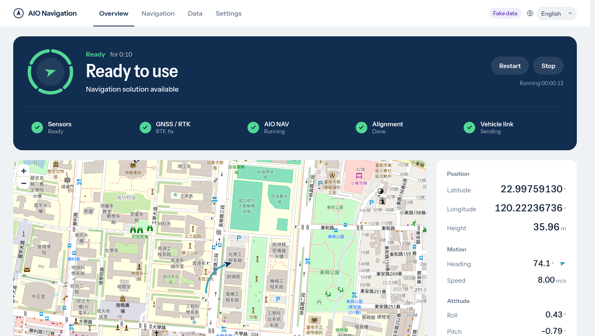
*The Overview page: the status panel with its ring, the AIO NAV buttons and the start-up steps; the
map with the recent track; position, motion and attitude.*

| State | Shown as | Meaning | What to do |
|-------|-------|---------|------------|
| **Stopped** | Grey label, slate panel | AIO NAV is not running and nobody asked it to run. This is normal, not a problem. | Click **Start** when you want navigation. |
| **Starting** | Teal label | AIO NAV was started and is getting ready; no navigation output yet. | Wait. If nothing comes out within 60 s it becomes **Fault**. |
| **Initializing** | Amber label | AIO NAV is running and sends output, but alignment is not finished. It shows the current step and what to do, for example *Step 1 of 3: Alignment — Keep the vehicle completely still*. | Follow the instruction ([Alignment SOP](#5-alignment-sop)). Do not use the output yet. |
| **Ready** | Green label, closed green ring | AIO NAV is running, data is fresh, and alignment is complete. The output can be used. | Operate normally. |
| **Degraded** | Dark red panel | The output *was* Ready in this run, but a required condition (for example RTK) or the alignment is lost. It never goes back to the alignment prompts while the vehicle may be moving. | Stop using navigation as the vehicle's safety procedure says. Restart AIO NAV only with the vehicle standing still. |
| **Fault** | Dark red panel | AIO NAV has a problem: it stopped although nobody pressed Stop, it runs but has sent nothing for 60 s after starting, or its output stopped for more than 2 s. The reason is shown. | See [Troubleshooting](#9-troubleshooting). |
| **Unknown** / **Offline** | Grey label, slate panel | The dashboard just started, or your browser lost its connection to the device. | Wait a few seconds; check the network if it persists. |

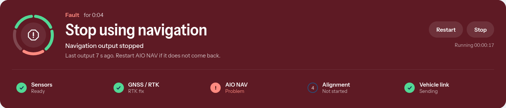
*A fault always says what happened and what to do.*

A state only changes after the condition has lasted about a second, and only returns to
Ready after about 2 stable seconds. A single lost packet never makes it flicker. While AIO
NAV runs, the panel also shows how long it has been running, and **Bag replay** when it
processes a recorded bag instead of the live sensors.

### 3.2 Start-up progress

At the bottom of the status panel, the Overview page lists the power-on sequence as five steps
(the same five as the arcs of the ring):

| Step | Done (green tick) when | Opens to show |
|------|------------------------|---------------|
| **Sensors** | The sensor drivers run and IMU data arrives. | Each driver, IMU data |
| **GNSS / RTK** | A GNSS position, and RTK when Ready requires it (the default). | GNSS position, the current quality, whether RTK is required |
| **AIO NAV** | AIO NAV runs and sends output. | AIO NAV, output rate, visual odometry (DSO: information only, never needed for Ready) |
| **Alignment** | All three alignment steps are done. | *Keep still*, *Drive straight*, *Fine alignment* with Done / In progress / Waiting, and the instruction for the current step |
| **Vehicle link** | The navigation data and the Ready signal are being sent to the vehicle address. | The vehicle address, what is being sent |

A done step has a green tick, a step still waiting an amber outline, a problem is red, and a step
that cannot start yet is grey. **Select a step** to see why; select it again to close.
On a phone the steps are listed one under the other.

### 3.3 Status dots

Under the map, one quiet line says what the device talks to; the Navigation page adds the
alignment, GNSS and aiding. Each item is a name, a colored dot and a word:

| Dot | Meaning |
|-----|---------|
| Green | Normal, done, or (aiding) active right now |
| Amber | Needs attention or still in progress |
| Red | Fault |
| Hollow grey | No data, idle, or not set up |

| Item | Shows |
|------|-------|
| **Navigation output** | Whether the navigation output (UDP, section 6) is sent, at what rate and to where, for example *100 Hz to 192.0.2.50:9000*. Grey when AIO NAV is stopped (normal), amber for *Low rate* (under 80% of the expected rate) or *Stale* (no packet for 0.5 s), red when nothing was sent for 2 s while it should (the state becomes Fault). UDP has no acknowledgement: it confirms that the device sends, not that your application receives. |
| **Camera / LiDAR** (if fitted) | The sensor answers on the network. "Not set up" means no IP is configured; this is normal if not needed. |
| **Sensor network** | The sensor network link is up. |
| **Alignment**, **Initial heading**, **Fine alignment** (Navigation page) | The three alignment steps in order: **Done**, **In progress** (the current step), **Waiting** (a later step), or **—** while AIO NAV sends no output. |
| **GNSS** (Navigation page) | Position quality of the GNSS receiver: green = *RTK fix* (centimeter level), amber = *RTK float* (about 10 cm) or *Fix (type unknown)*, red = *SPP* (single-point positioning, meters) or *No signal*. Amber and red are warnings only: inertial navigation continues, but accuracy slowly degrades. |
| **ZUPT / ZIHR / NHC / VUPT** (Navigation page) | Which aiding the filter is using at the moment (see the [glossary](#10-glossary)). Idle is normal. |

GNSS, camera, LiDAR and network problems are also shown as **advisories** (amber notes under the
line). They never change the state from Ready to Fault, because the navigation solution is still
usable.

### 3.4 Language

See section 2: the menu at the top right switches the user pages between English and 繁體中文.

### 3.5 Pages

- **Overview**: the status panel with the AIO NAV buttons and the start-up steps, a map with the
  last 60 s of track, position, heading (with an arrow; up = north), speed, roll and pitch,
  the status dots, advisories, storage. The bottom line also shows *Ready signal #…, session …,
  updated …*: the numbers in the status packet, for comparing with the vehicle's log.
- **Navigation**: large map with the whole track of this run, and every value with its
  accuracy (±): position, velocity north/east/up, speed, attitude, NAV time. Alignment, GNSS and
  aiding dots and the navigation output (with the packet count) are at the bottom.
  **Show whole trajectory** zooms to the full track; **Follow vehicle** re-centers.
- **Data**: AIO NAV log folders. Click a folder to open it and **Download** to save a
  file. Nothing on the device can be changed from this page.
- **Settings**: Wi-Fi, the RTK requirement, automatic start and the vehicle link (section 3.6).

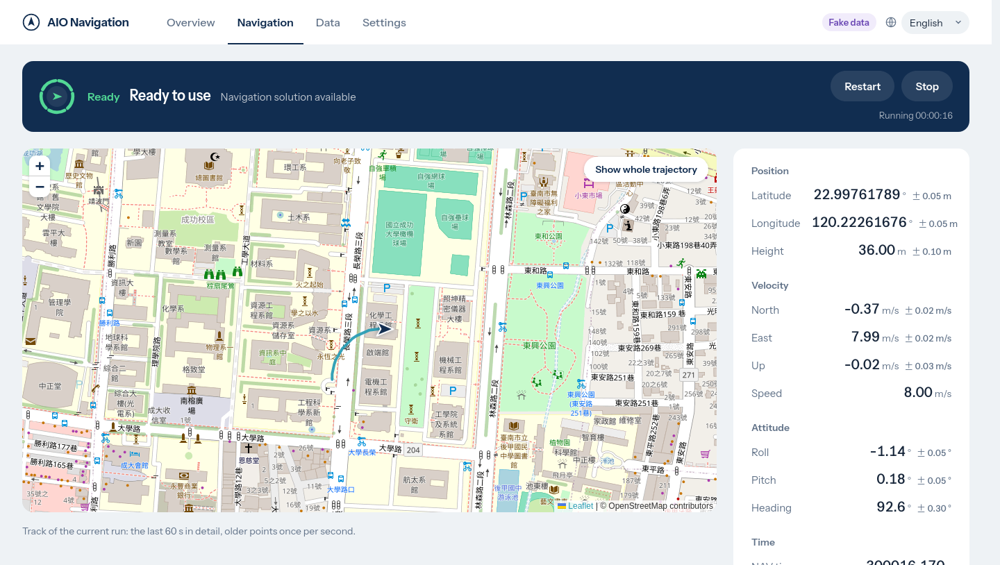
*Navigation page: the whole track of this run, every value with its accuracy.*

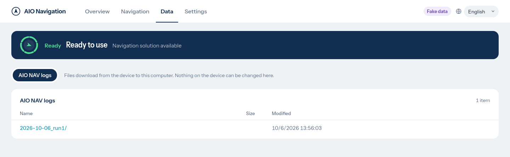
*Data page: download the AIO NAV logs.*

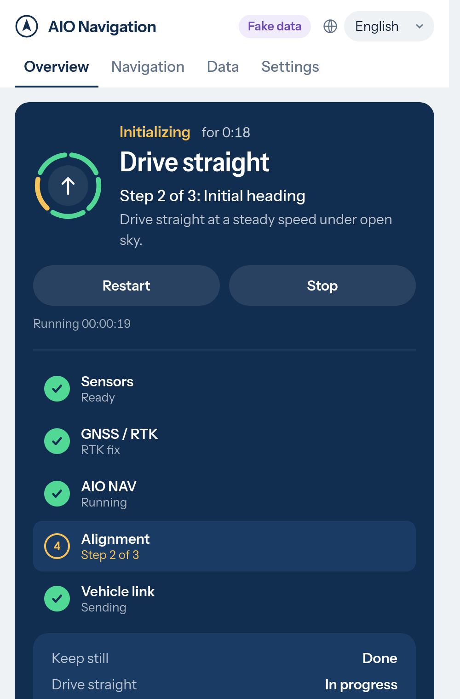

*The pages also work on a phone or tablet.*

### 3.6 Settings page

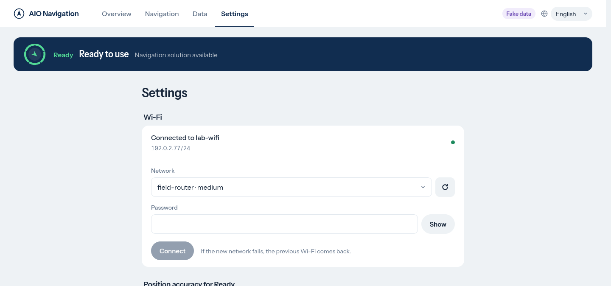
*Settings: one card per task.*

| Card | What you can do |
|------|-----------------|
| **Wi-Fi** | See the network in use. Choose a network from the list (strongest first; *Other network (hidden)…* to type a name), enter the password, **Connect**. The result is said in plain words: *Connected to …*, or *The password was not accepted. Back on …*. A failed attempt always returns to the previous Wi-Fi within about a minute. |
| **Position accuracy for Ready** | The switch **Require RTK before Ready** (on by default, recommended). Turning it off asks for confirmation, because Ready can then be given with a position accurate to only a few metres. The time of the last change is shown, and every change is recorded in the event log. |
| **Automatic start** | *On*: AIO NAV starts by itself after power-on. *Paused*: an operator pressed Stop; **Resume** starts it again. *Off*: press Start on the Overview page. |
| **Vehicle link** | The vehicle address, and that the navigation data (0x04) and the Ready signal (0x05) go there on the same port. Read only: the address is set on Maintenance → AIO NAV config. |

Wi-Fi can be changed only from a computer connected to the device **by cable** (or on the
device itself): changing Wi-Fi from a computer that is itself on Wi-Fi could cut it off. Such a
computer sees *Connect with a network cable to change Wi-Fi.* While navigation is in use, or when
the vehicle or the internet route (RTK corrections) goes over Wi-Fi, the page asks before it
changes anything. These settings need no password on the user pages; the same settings are on the
Maintenance view too. Wi-Fi needs a one-time setup by the installer (configuration manual 4.5a).

## 4. Daily operation

### 4.1 Before starting

- [ ] The device is powered and the GNSS antenna has a clear view of the sky.
- [ ] The vehicle is parked in its starting position and will stay **completely still**
      for the first part of alignment.
- [ ] Live use: the mode is **Live** and the sensor drivers are running (section 4.6; Maintenance → ROS 2).
- [ ] Your computer opens the product view (section 2).
- [ ] The status area shows **Stopped** (or a running state), not Unknown/Offline: the dashboard is connected.

### 4.2 Starting AIO NAV

The **Start** button is in the status area at the top of the Overview and Navigation pages.

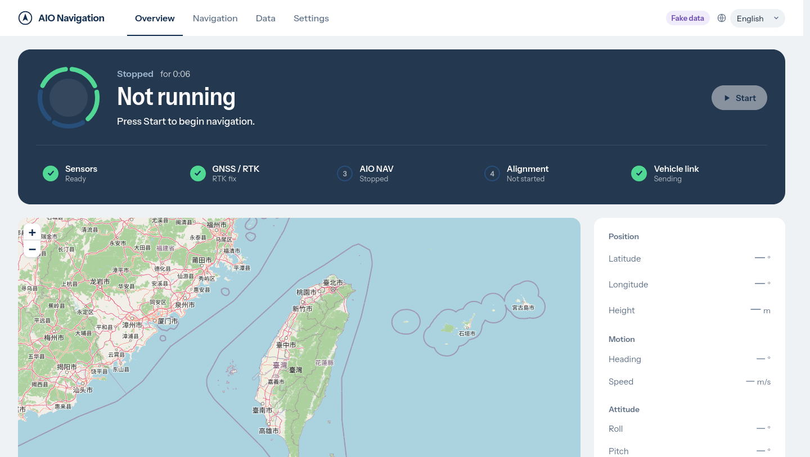
*Stopped: nothing is wrong, AIO NAV simply is not running. Click Start.*

1. Click **Start**. The state becomes **Starting** (teal), then **Initializing** (amber) as
   soon as AIO NAV sends output; **Navigation output** under the map changes from *Nothing is sent* to the rate and address.
2. Follow the step shown in the status area ([Alignment SOP](#5-alignment-sop)).

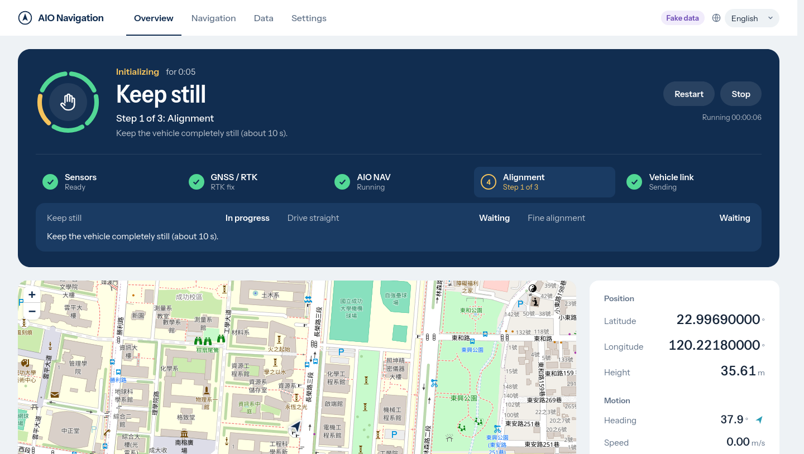
*Initializing: the status area says what to do (Keep still) and names the alignment step; the
Alignment step of the start-up progress is opened to show the three phases.*

**Automatic start (power-on).** With `autostart` on (the shipped setting, [configuration
manual 4.2b](CONFIG.md)) nobody presses Start. After power-on the system goes through:

| Step | Status area | The vehicle receives (0x05) | Operator |
|---|---|---|---|
| 1. Dashboard starts | **Unknown** → **Starting** | `BOOTING`, then `CHECKING` | Keep the vehicle still |
| 2. Sensor drivers started if needed; wait for IMU data and a GNSS position | **Starting** — *Starting automatically: Waiting for …* | `CHECKING` / `HOLD_STILL` | Keep the vehicle still |
| 3. AIO NAV (and DSO) started | **Starting** | `NAV_STARTING` / `HOLD_STILL` | Keep the vehicle still |
| 4. Alignment ([SOP](#5-alignment-sop)) | **Initializing**, step 1 → 2 → 3 | `KEEP_STILL` → `MOVE_STRAIGHT` → `REFINING` | Follow the step shown |
| 5. RTK float or better, stable 3 s | **Ready** | `READY`, inhibit 0 | Use navigation |

The **start-up progress** (section 3.2) shows which step it is on and what it is waiting for. If
the sensors do not come within 2 minutes the state becomes **Fault** naming them (for example
*IMU data not available after 120 s*); it still starts by itself as soon as they pass. If AIO NAV
does not start or sends nothing, it is tried again a few times. After you press **Stop**, it stays
stopped (also after a reboot) and the button reads **Resume** until someone presses it. Once Ready
was reached it is never restarted automatically until the next power-on: if AIO NAV stops while
driving, the state is **Fault** with *stop using navigation*.

RTK is required for Ready by default. At a site without RTK it can be switched off on the
**Settings** page (with a confirmation; recorded), or on Maintenance → Overview.

If the state becomes **Fault** with *AIO NAV stopped unexpectedly*, or the message under the
buttons reads *AIO NAV did not start: …*, see [Troubleshooting](#9-troubleshooting). If there
are no buttons, control from the web page is turned off on this device (`nav.allow_control`);
ask the administrator to enable it. AIO NAV that was started in another way is detected too.

### 4.3 During operation

- Keep an eye on the status area. **Ready** means the output can be used.
- Amber advisories (such as *GNSS: SPP* or *GNSS: No signal*) do not stop navigation, but plan
  for reduced accuracy. Check the ± values on the Navigation page.
- If the state becomes **Fault**, follow the reason shown in the status area
  ([Troubleshooting](#9-troubleshooting)).

### 4.4 Restarting or stopping

- **Restart** (asks for confirmation: choose **Restart now**, or **Cancel** / Esc): stops and starts AIO NAV. **Alignment starts over**,
  so only restart while the vehicle can stand still.
- **Stop** (asks for confirmation: choose **Stop now**, or **Cancel** / Esc): ends the navigation output. Your application stops
  receiving data. With automatic start on, AIO NAV then stays stopped, also after a power cycle,
  until someone presses **Resume**.

### 4.5 After the run

1. Stop the vehicle and click **Stop** if no more navigation output is needed.
2. Open the **Data** page and download the log files of the run (section 7.2).

### 4.6 Replaying a recorded bag (engineers)

Bag replay is part of the optional **replay module** (installed with
`sudo deploy/install.sh --user <you> --with-replay`). Without it the machine always runs **Live**
and the steps below are not available.

Everything is on Maintenance → **Replay**:

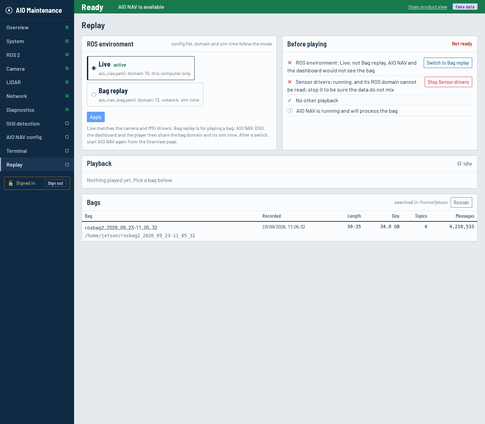
*Replay page: ROS environment, the checks before playing, the bags found, and the playback settings
with the exact command.*

1. **Before playing** lists what has to be true, each with a button that fixes it:
   - the ROS environment is **Bag replay** (button *Switch to Bag replay*: AIO NAV and DSO are
     stopped and the dashboard restarts, a few seconds). Bag replay uses `aio_nav_bag.yaml`
     (ROS domain 13, simulated time) instead of `aio_nav.yaml` (domain 10, this computer only);
   - the sensor drivers do not publish into the bag's domain. They normally run in the Live domain
     (10), which the bag domain (13) does not see, so they may keep running (they still use CPU
     and camera bandwidth). Only if they run in the bag's domain, or their domain cannot be read,
     do they have to be stopped (button *Stop Sensor drivers*);
   - no other bag is playing.
2. On the Overview page click **Start** so AIO NAV processes the bag (the player works without it,
   but nothing is computed).
3. Under **Bags**, click a bag. The list shows every bag found in the configured folders
   (default: the home folder, two levels deep), with recording time, length, size and topics.
4. Tick the **topics** to play (none ticked: all), then set **Rate**, **Start at**, **Loop** and
   **Start paused**. **Advanced** has every other `ros2 bag play` option (`/clock` rate, delay,
   read-ahead queue, topic remapping, storage plugin, QoS overrides file, storage config file, wait
   for all acked, loaned messages, log level). The exact command is shown underneath; it can also
   be pasted into a terminal.
5. Click **Play**. **Playback** shows the estimated position, and has **Pause** / **Resume**, a
   **Rate** change while playing, and **Stop**. The player's output is under *Player output*.
6. **Save preset** keeps a bag with its topics and options under a name; pick it from **Presets…**
   next time. The last settings used with each bag are also remembered.
7. Back to live use: **Stop** the playback, switch the ROS environment to **Live** on the same
   page, start the sensor drivers if they were stopped (Maintenance → ROS 2; they publish after
   about 15 s), then click **Start** on the Overview page.

Playing from a terminal instead: use the bag domain and the clock, because a terminal may default
to another domain (`echo $ROS_DOMAIN_ID`):
```bash
ROS_DOMAIN_ID=13 ROS_LOCALHOST_ONLY=0 ros2 bag play <bag folder> --clock 100
```

## 5. Alignment SOP

Alignment is how the filter finds its initial attitude (roll, pitch, heading) and position
before the output can be trusted. It has three stages, shown by three lamps.

### 5.1 Stages

| Stage | Lamp turns green | What the filter does | Operator action |
|-------|------------------|----------------------|-----------------|
| 1. Coarse alignment (leveling) | **Alignment** | Measures gravity to find roll and pitch. Takes the initial position from GNSS. | Keep the vehicle **completely still**, engine running is fine, nobody moving in or on it. Default duration: 10 s. |
| 2. Initial heading | **Initial heading** | Finds the heading. With the default setting, heading comes from GNSS while the vehicle moves. | When **Alignment** is green, drive off **straight** at a steady speed under open sky until the lamp turns green. |
| 3. Fine alignment | **Fine alignment** | Refines heading and sensor errors until heading accuracy is within 1°, or until the fine-alignment time limit passes (default 300 s). | Keep driving normally with GNSS available. Include a few turns and speed changes. |

When all lamps required on this device are green (by default all three), the status area
turns **Ready**.

### 5.2 Step by step

1. Park the vehicle at the start point under open sky. Wait until the GNSS lamp shows
   **RTK fix** (green): the initial position comes from GNSS. **RTK float** (amber) works but
   starts less accurately.
2. On the Overview page, click **Start**. After **Starting**, the state becomes
   **Initializing**: *Step 1 of 3: Alignment — Keep the vehicle completely still*.
3. **Do not move** for at least 10 s, until the **Alignment** step is done (green).
   While stationary, the Navigation page shows **ZUPT** active; this is expected.
4. Drive straight ahead at a steady speed. Watch **Initial heading** turn green.
5. Keep driving with some turns until **Fine alignment** turns green. Check on the
   Navigation page that heading ± is about 1° or better.
6. The status area shows **Ready**. Navigation output can be used.

### 5.3 If alignment goes wrong

| Situation | Action |
|-----------|--------|
| The vehicle moved during stage 1 | Stop the vehicle, click **Restart**, and repeat from step 3. |
| **Alignment** stays amber for well over 10 s | Check the GNSS lamp (initial position comes from GNSS; it should not be red) and that the vehicle is really still. Then restart. |
| **Initial heading** does not turn green while driving | GNSS may be blocked (trees, buildings, tunnel). Drive in an open area. |
| **Fine alignment** takes long | It completes at the latest when the fine-alignment time limit passes (default 300 s). Keep driving in open sky. |
| GNSS is lost after Ready | Navigation continues on inertial sensors (advisory only). Accuracy degrades over time; watch the ± values. |

> The alignment method and times are set in AIO NAV's own settings file (`aio_nav.yaml`,
> section `Alignment`): `coarse_duration` (default 10 s), `fine_duration` (300 s),
> `fine_heading_std_threshold` (1°) and the attitude option (all on Maintenance → **AIO NAV
> config**). With `att.option: 2`
> the heading comes from the settings file instead of from driving, and stage 2 needs no
> motion. Which lamps are required for Ready is set by `nav.ready_requires` in the
> dashboard settings. The minimum speed and distance needed for the heading depend on the
> navigation library. Confirm the values for your vehicle with the navigation team.

## 6. Navigation output over UDP (data integration)

### 6.1 Overview

| Item | Value |
|------|-------|
| Transport | UDP over IPv4, one packet per epoch, no acknowledgement |
| Rate | `output_rate` in `aio_nav.yaml` (default 100 Hz) |
| Packet | 156 bytes, binary, little-endian |
| Destinations | `127.0.0.1:9000` on the device (used by the dashboard) **and** one external `host:port` (`output_udp` in `aio_nav.yaml`) |
| Starts | As soon as AIO NAV runs, **before** alignment completes. Use the flags to know when the data is valid. |

Each destination gets its own copy of every packet. Your receiver and the dashboard do
not compete for data. The dashboard is the only program that listens on `127.0.0.1:9000`:
only one program can hold that address, so do not run another listener there (for example the
old AIO Nav desktop app), or the dashboard would show no data.

### 6.2 Setting the destination

1. Set **UDP destination** to your computer's IP and port (for example `192.0.2.50:9000`) on
   Maintenance → **AIO NAV config** (section 8), in the file of the mode you use: `aio_nav.yaml`
   (Live) and `aio_nav_bag.yaml` (Bag replay); change both if you use both. Or edit the file on
   the device:
   ```bash
   nano ~/aio-nav-ros/install/aio_nav_ros/share/aio_nav_ros/config/aio_nav.yaml
   ```
   ```yaml
   output_udp: "192.0.2.50:9000"     # your computer's IP and port
   ```
2. Restart AIO NAV (**Save and restart AIO NAV** on the config page, or **Restart** on the
   Overview page). The dashboard's **Output** line follows the file by itself within a few seconds.
3. On the receiving computer, allow incoming UDP on that port in the firewall.

Only **one** external destination is supported, and it must be a unicast IPv4 address.
To feed several applications, receive on one computer and forward from there.

### 6.3 Packet layout

| Bytes | Field | Type | Value |
|-------|-------|------|-------|
| 0–1 | Sync | 2 × uint8 | `0x55 0xAA` |
| 2 | Message ID | uint8 | `0x04` (navigation solution) |
| 3–4 | Payload length | uint16 | `150` |
| 5–154 | Payload | 150 bytes | See 6.4 |
| 155 | Checksum | uint8 | Sum of bytes 2–154, modulo 256 |

Discard any packet whose sync, ID, length or checksum does not match.

### 6.4 Payload fields

Offsets are from the start of the packet (payload starts at byte 5).
Python `struct` format of the payload: `<Qdd28fH3f`.

| Offset | Field | Type | Unit | Notes |
|-------:|-------|------|------|-------|
| 5 | time | uint64 | µs | GPS time of week × 10⁶ (resets each week). In bag replay, follows the replay clock. |
| 13 | latitude | float64 | deg | WGS84 |
| 21 | longitude | float64 | deg | WGS84 |
| 29 | height | float32 | m | Height of AIO NAV's position solution |
| 33 | velocity north | float32 | m/s | |
| 37 | velocity east | float32 | m/s | |
| 41 | velocity up | float32 | m/s | **Up** is positive |
| 45 | roll | float32 | deg | |
| 49 | pitch | float32 | deg | |
| 53 | heading | float32 | deg | 0 = north, 90 = east (clockwise). May be sent as −180…180; add 360 to negative values for 0…360. |
| 57 / 61 / 65 | position σ north / east / down | float32 | m | 1-sigma accuracy |
| 69 / 73 / 77 | velocity σ north / east / down | float32 | m/s | 1-sigma accuracy |
| 81 / 85 / 89 | roll σ / pitch σ / heading σ | float32 | deg | 1-sigma accuracy |
| 93 / 97 / 101 | gyro bias x / y / z | float32 | deg/h | Estimated IMU errors |
| 105 / 109 / 113 | accelerometer bias x / y / z | float32 | mg | |
| 117 / 121 / 125 | gyro scale factor x / y / z | float32 | ppm | |
| 129 / 133 / 137 | accelerometer scale factor x / y / z | float32 | ppm | |
| 141 | flags | uint16 | — | Status bits, see 6.5 |
| 143 | odometer scale | float32 | — | Used when odometry aiding is configured |
| 147 | mount pitch | float32 | deg | Estimated sensor mounting angles |
| 151 | mount yaw | float32 | deg | |

### 6.5 Status flags

Only the low byte of `flags` is used, and it is sent **bit-reversed**. Reverse the 8 bits
first, then read:

| Bit (after reversing) | Bit on the wire | Name | Meaning when 1 |
|----:|----:|------|----------------|
| 0 | 7 | ZUPT | Zero-velocity update applied (vehicle stationary) |
| 1 | 6 | ZIHR | Zero heading-rate update applied |
| 2 | 5 | NHC | Non-holonomic constraint applied (no sideways/vertical slip) |
| 3 | 4 | GNSS | GNSS measurement applied in this epoch |
| 4 | 3 | VUPT | Odometry / vehicle velocity update applied |
| 5 | 2 | ALIGN | Coarse alignment complete |
| 6 | 1 | HEADING | Initial heading valid |
| 7 | 0 | FINE | Fine alignment complete |

**When is the data valid?** Use the solution only when ALIGN, HEADING and FINE are all 1
(the same rule as the dashboard's **Ready**). ZUPT, ZIHR, NHC, GNSS and VUPT change from
epoch to epoch and only report which aiding was used; GNSS updates arrive at the GNSS
rate, so the GNSS bit is set only in some packets.

### 6.6 Receiver example (Python 3, no extra packages)

```python
import socket
import struct

PORT = 9000                                   # the port in output_udp
PAYLOAD = struct.Struct("<Qdd28fH3f")         # 150 bytes, little-endian
FLAG_NAMES = ["ZUPT", "ZIHR", "NHC", "GNSS", "VUPT", "ALIGN", "HEADING", "FINE"]

def reverse_bits8(x):
    return int(f"{x & 0xFF:08b}"[::-1], 2)

sock = socket.socket(socket.AF_INET, socket.SOCK_DGRAM)
sock.bind(("0.0.0.0", PORT))
while True:
    pkt, _ = sock.recvfrom(2048)
    if len(pkt) != 156 or pkt[:3] != b"\x55\xaa\x04" or pkt[155] != sum(pkt[2:155]) & 0xFF:
        continue                              # not a valid NAV packet
    f = PAYLOAD.unpack_from(pkt, 5)
    flags = reverse_bits8(f[31])
    active = [n for i, n in enumerate(FLAG_NAMES) if flags >> i & 1]
    print(f"t={f[0] / 1e6:.3f} lat={f[1]:.8f} lon={f[2]:.8f} h={f[3]:.2f} "
          f"vn={f[4]:.2f} ve={f[5]:.2f} vu={f[6]:.2f} hdg={f[9]:.1f} {' '.join(active)}")
```

For C/C++, use a packed struct (`#pragma pack(push, 1)`) with the field order of 6.4:
`uint64_t time_us; double lat, lon; float alt, vn, ve, vu, roll, pitch, heading, 9 × σ,
12 × IMU errors; uint16_t flags; float odo_scale, mount_pitch, mount_yaw;` (150 bytes).

### 6.7 Checking the integration

1. On the dashboard, the **Output** line shows **Streaming** and your computer's address and
   port.
2. Your receiver prints packets at the expected rate (100 per second by default).
3. Latitude, longitude and heading match the Navigation page.
4. The flags show ALIGN, HEADING and FINE when the dashboard shows **Ready**.

### 6.8 Status packet (0x05)

The 0x04 packet starts **before** alignment is complete, so receiving it does not mean the
data may be used. When `status_udp` is on ([configuration manual 4.2c](CONFIG.md)) the
dashboard also sends a **0x05 status packet**, twice a second and at once on every change, to
the **same address and port as 0x04**. It carries the same readiness snapshot as the pages:
the state, what the operator should do, and every reason the output must not be used. It
keeps coming after READY: silence means "do not use".

> 0x05 is reserved for this packet; AIO NAV itself only sends 0x04.

**Receiving both on one port.** UDP lets any number of senders send to one port; only the
vehicle binds it. So the vehicle keeps its one socket and its `55 AA` frame parser, and
dispatches on the message ID (byte 2): `0x04` = navigation (156 bytes), `0x05` = status
(42 bytes). A parser must check the ID and the length and skip any other frame; one that
read every frame as 0x04 would misread the status packet. If the vehicle prefers a separate
socket, set `status_udp.destination` to that address and port.

**Frame**: same as 0x04: `55 AA`, message id `0x05`, payload length `36` (uint16 LE), payload,
checksum (sum of the bytes from the message id to the end of the payload, modulo 256).
42 bytes in all. Little-endian. Python `struct`: `<BBBBIIQIIBBHHH`.

| Offset (payload) | Field | Type | Meaning |
|---:|---|---|---|
| 0 | protocol_version | uint8 | `1` |
| 1 | state | uint8 | Table below |
| 2 | requested_action | uint8 | Table below |
| 3 | gnss_quality | uint8 | 0 unknown, 1 none, 2 SPP, 3 RTK float, 4 RTK fix |
| 4 | session_id | uint32 | New at every dashboard start |
| 8 | sequence | uint32 | +1 per packet, wraps to 0 |
| 12 | uptime_ms | uint64 | Dashboard uptime |
| 20 | health_flags | uint32 | Conditions that hold (bits below) |
| 24 | inhibit_flags | uint32 | Reasons not to use 0x04 (bits below); **any bit set = do not use** |
| 28 | nav_flags | uint8 | The 0x04 flags in normal bit order (**not** bit-reversed) |
| 29 | reserved | uint8 | 0 |
| 30 | nav_rate_dhz | uint16 | Navigation output rate × 10 |
| 32 | nav_age_ms | uint16 | Age of the last 0x04; 65535 = none or older |
| 34 | reserved | uint16 | 0 |

| Code | State | Meaning |
|---:|---|---|
| 0 | `BOOTING` | Dashboard just started |
| 1 | `CHECKING` | Waiting for prerequisites or for the automatic start |
| 2 | `NAV_STARTING` | AIO NAV started, no valid output yet |
| 3 | `KEEP_STILL` | Alignment stage 1 (output flows, not aligned) |
| 4 | `MOVE_STRAIGHT` | Alignment stage 2 (no valid heading yet) |
| 5 | `REFINING` | Alignment stage 3, or aligned while a required condition is missing |
| 6 | `READY` | May be used (inhibit_flags is 0) |
| 7 | `DEGRADED` | Was READY in this run; a required condition or the alignment is lost |
| 8 | `FAULT` | AIO NAV, its output or its ownership has a problem |
| 9 | `MAINTENANCE` | Stopped (operator Stop, or not started) |

| Code | Requested action | Operator text |
|---:|---|---|
| 0 | `NONE` | Nothing to do. |
| 1 | `HOLD_STILL` | Keep the vehicle completely still. |
| 2 | `DRIVE_STRAIGHT` | Drive straight at a steady speed in a safe, open area. |
| 3 | `KEEP_DRIVING` | Keep driving normally with GNSS available. |
| 4 | `SAFE_STOP` | Stop using navigation and follow the vehicle's safety procedure. |
| 5 | `SERVICE_REQUIRED` | Maintenance is needed. |
| 6 | `MAINTENANCE_HOLD` | Stopped. Press Start to resume. |

| Bit | health_flags | inhibit_flags |
|---:|---|---|
| 0 | `DASHBOARD_OK` | `BOOT_IN_PROGRESS` |
| 1 | `CONFIG_OK` | `CONFIG_INVALID` |
| 2 | `IMU_STREAM_OK` | `IMU_MISSING_OR_STALE` |
| 3 | `GNSS_STREAM_OK` | `GNSS_MISSING_OR_STALE` |
| 4 | `GNSS_QUALITY_OK` | `GNSS_QUALITY_LOW` |
| 5 | `NAV_PROCESS_OK` | `NAV_NOT_RUNNING` |
| 6 | `NAV_OUTPUT_OK` | `NAV_OUTPUT_STALE` |
| 7 | `ALIGNMENT_OK` | `KEEP_STILL_REQUIRED` |
| 8 | `HEADING_OK` | `MOVE_STRAIGHT_REQUIRED` |
| 9 | `FINE_ALIGNMENT_OK` | `FINE_ALIGNMENT_REQUIRED` |
| 10 | `DSO_OK` | `DSO_NOT_READY` |
| 11 | `EXTERNAL_ROUTE_OK` | `EXTERNAL_ROUTE_DOWN` |
| 12 | `RTK_CORRECTION_OK` | `RTK_CORRECTION_LOST` |
| 13 | `STORAGE_OK` | `STORAGE_NOT_WRITABLE` |
| 14 | `VEHICLE_ACK_OK` | `MAINTENANCE_HOLD` |
| 15 | `TIME_SYNC_OK` | `STARTUP_TIMEOUT` |
| 16 | `NO_DUPLICATE_PROCESS` | `OWNERSHIP_CONFLICT` |
| 17 | `WIFI_OK` | `INTERNAL_FAULT` |

Bits that are not implemented stay 0 (for example `VEHICLE_ACK_OK`, `RTK_CORRECTION_OK`,
`TIME_SYNC_OK`, `WIFI_OK`); receivers ignore unknown bits.

**Receiver rules** (the reference implementation is `aio_system_dashboard/nav/vehicle_gate.py`):

1. Start blocked. Block at once when no valid 0x05 arrived for 3 s, on a bad checksum or an
   unknown version, and when `session_id` changes (the dashboard restarted).
2. Allow only when `state` is READY (6) **and** `inhibit_flags` is 0, continuously for 2 s in
   the same session.
3. Also check the 0x04 itself: at most 0.5 s old, the ALIGN, HEADING and FINE flags set, a time
   stamp that moves forward, and only finite values.
4. A lost status packet alone never blocks (the sequence number counts losses); only the
   time-outs do.

To watch the rules work where the vehicle listens, from a checkout of this repository (the release package does not include `tools/`): `python3 tools/vehicle_gate.py --port 9000`
(0x04 and 0x05 both on 9000; `--status-port` if 0x05 is sent to another port).

**Golden vector** (any implementation must encode and decode exactly this): READY, action
NONE, RTK float, session `0x12345678`, sequence 482, uptime 123456789 ms, health `0x10FFF`,
inhibit 0, nav flags `0xE8`, 100.0 Hz, age 12 ms:

```
55aa0524000106000378563412e201000015cd5b0700000000ff0f010000000000e800e8030c0000005c
```

The same snapshot is available as JSON at `http://<device-ip>:8080/api/readiness`.

## 7. Other outputs: ROS 2 topics and log files

### 7.1 ROS 2 topics (development interface)

AIO NAV also publishes on ROS 2. These topics are meant for internal development; the UDP
output is the product interface. They are published **only after coarse alignment**.

| Topic | Type | Content |
|-------|------|---------|
| `/nav/fix` | `sensor_msgs/NavSatFix` | WGS84 position; `status.service` carries the flags (not bit-reversed) |
| `/nav/odometry` | `nav_msgs/Odometry` | TWD97 position, ENU velocity, covariances |
| `/nav/path` | `nav_msgs/Path` | Recent track |
| TF `map` → `imu_link` | — | Pose in the TWD97 map frame |

ROS domain and network settings must match AIO NAV's: **Live** uses domain 10 (this computer only), **Bag replay** uses domain 13 (network). Maintenance → ROS 2 shows the one in use; the Overview shows a **Bag replay** label when it is not Live.

### 7.2 Log files (Data page)

When enabled in `aio_nav.yaml` (`save_fusion_txt`, `save_parsed_txt`), AIO NAV writes
tab-separated text logs once alignment is complete, in the `output/` folder of aio-nav-ros (next to `install/`; both settings files point there):

| File | Content |
|------|---------|
| `AIO-NAV.txt` (the name set by `fusion_txt_path`) | Navigation solution at the output rate: time, position, velocity, attitude, accuracy, IMU errors, flags |
| `AIO-NAV_imu.txt`, `AIO-NAV_gnss.txt`, `AIO-NAV_odom.txt` | The raw sensor inputs, parsed (`save_parsed_txt`) |

Download them from the **Data** page of the product view.

## 8. Maintenance view (engineers)

`http://<device-ip>:8081`. The sidebar lamps show at a glance which page has a problem.

| Page | Use it to |
|------|-----------|
| **Overview** | See the four layers (System, Services, Data flow, Network) and the list of active issues. Each issue links to the page that explains it. **Readiness for the vehicle**: what the vehicle is told (state, action, reasons, bit masks), the condition table, the automatic start, the 0x05 counters, and the **RTK required** switch (also on the user Settings page). |
| **System** | CPU, GPU, memory, disk, temperatures, systemd services, network interfaces. |
| **ROS 2** | Required nodes, monitored topics (rate, freshness, publishers, subscribers), all topics. Also here: **Sensor drivers** (Start / Stop / Restart the camera and IMU/GNSS drivers) and the ROS environment in use. |
| **Replay** (replay module only) | Switch between Live and Bag replay, and play bags with any `ros2 bag play` option (section 4.6). |
| **Camera / LiDAR** (if fitted) | Reachability, driver state, topic health, **Live view** (camera image; LiDAR point cloud with top/3D view), **Run diagnostic**, **Restart driver** (asks for confirmation). |
| **Network** | Interfaces and addresses, sensor reachability, the NAV output destinations and their route. **Wi-Fi**: scan and connect (from a browser connected by cable only; the previous Wi-Fi comes back if the new one fails; see [configuration manual 4.5a](CONFIG.md)). |
| **Diagnostics** | Active faults and warnings, results of diagnostics and restarts, and the event history. |
| **AIO NAV config** | Edit AIO NAV's settings files (`aio_nav.yaml` for Live, `aio_nav_bag.yaml` for Bag replay). **Settings** is a form of the most used values (output, ROS, logs, alignment, aiding, lever arms); **Edit file** is the whole file. Comments in the file are kept. **Review changes** checks the file and shows exactly what changes; then **Save**, or **Save and restart AIO NAV** so it takes effect at once. Every save keeps the previous version (**Earlier versions**, to go back). |
| **Terminal** | A shell on the device, in the browser, for quick checks (`ros2 topic hz …`, `journalctl …`, `top`). It runs as the dashboard's user and loads your `.bashrc`, like a desktop terminal (so ROS is set up); **Use active ROS domain** types the export line for the mode in use. Up to 3 at once; closed after 30 min without typing. |

The maintenance view can change the device, so it needs a password; the product view does not.
Set it on the device with `aio-dashboard password` (there is no default password: until one is set,
the maintenance view stays locked and its sign-in page says how to set one). Opening any
maintenance page shows the sign-in page first, then the page you asked for. You are signed out after
15 minutes without use (opening pages and taking actions count as use; the pages refreshing
themselves do not), or with **Sign out** at the bottom of the sidebar. Sign-ins, failed attempts,
saved settings and opened terminals are recorded in the event log (Diagnostics).

The Live view reads the sensor's ROS topic only while its page is open. A deliberately stopped
driver is not reported as a problem.

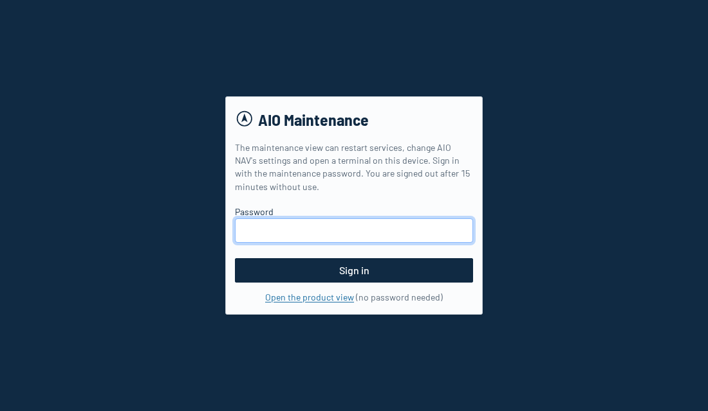
*Sign-in page of the maintenance view.*

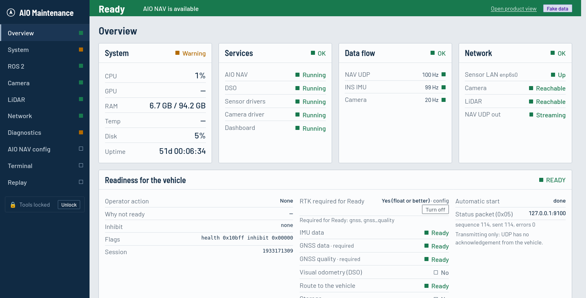
*Overview: the four layers and the active issues. The sidebar lamps point to the page with a problem;
the tool pages (AIO NAV config, Terminal, Replay) have no lamp.*

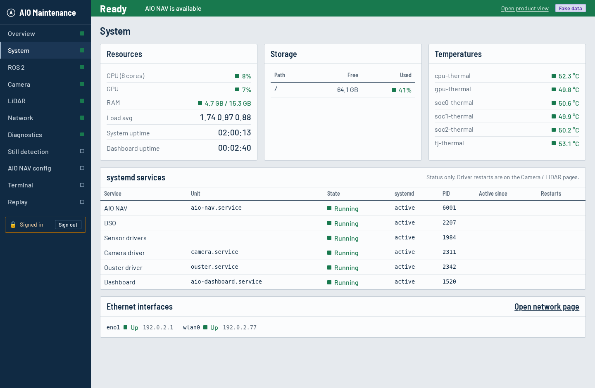
*System: resources, storage, temperatures and services.*

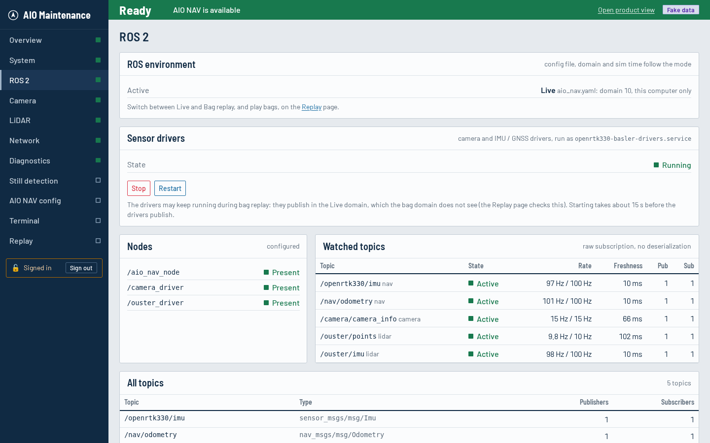
*ROS 2: the environment in use, the sensor drivers (Start / Stop / Restart), nodes and topics.*

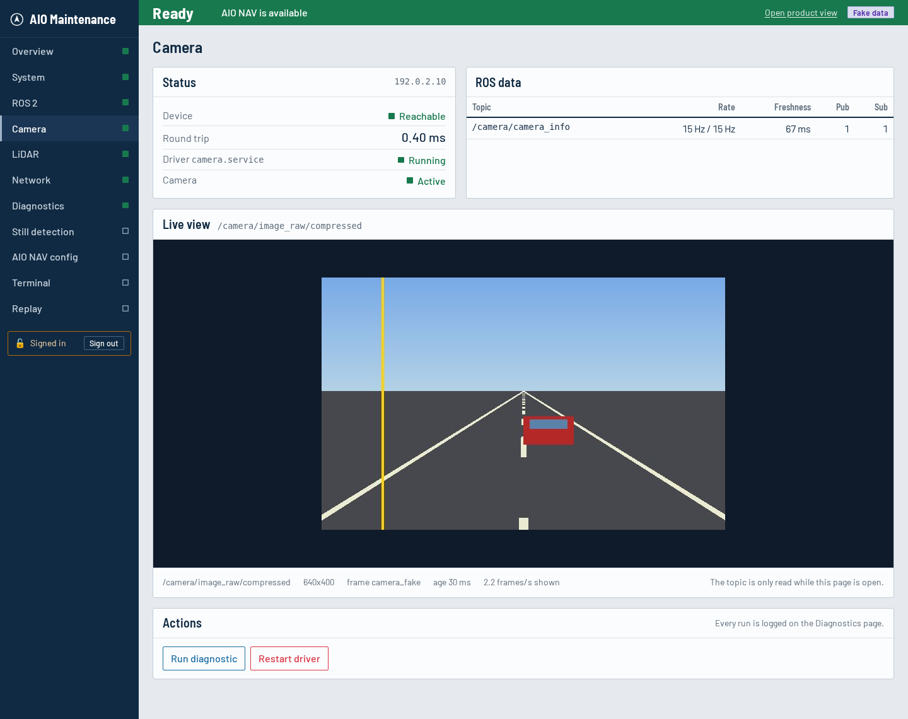
*Camera: reachability, driver, topic and the Live view (a simulated picture here).*

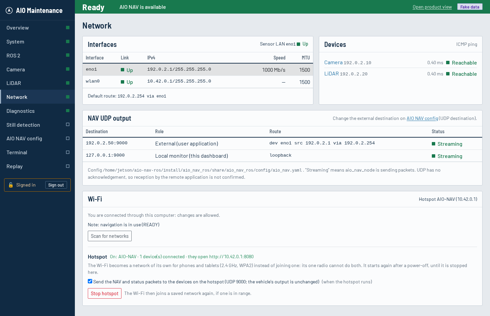
*Network: interfaces, sensor reachability and where the navigation output goes.*

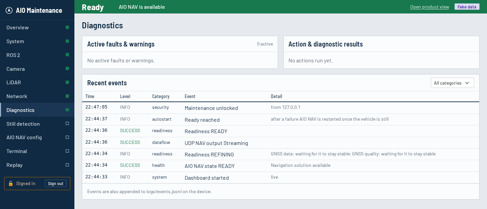
*Diagnostics: active issues, action results and the event history.*

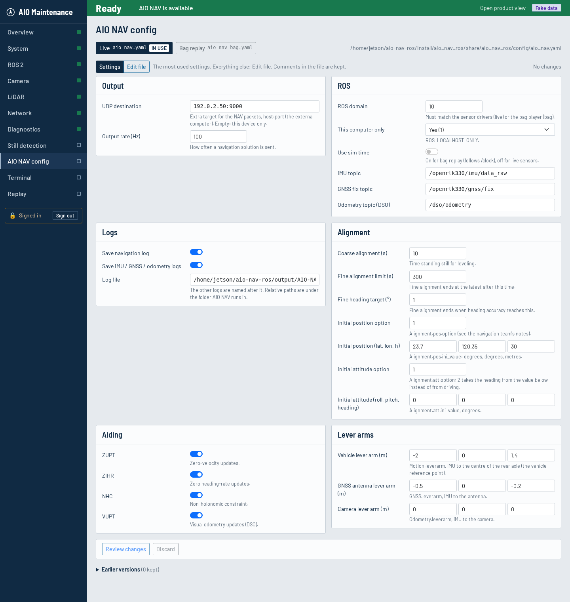
*AIO NAV config: the most used settings of the file in use; **Edit file** shows the whole file.*

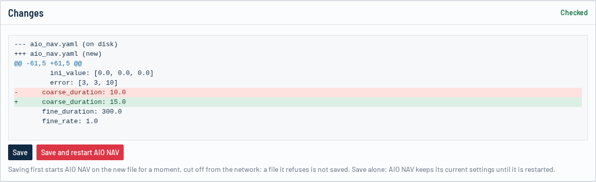
*Review changes: the exact lines that change, checked before saving.*

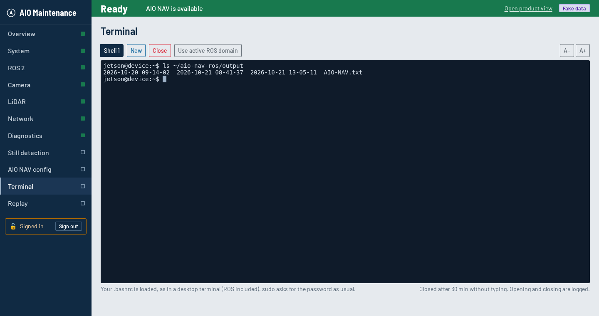
*Terminal: a shell on the device, for example to check a topic rate.*

Device commands:

```bash
aio-dashboard status     # service state and web addresses
aio-dashboard logs       # follow the log
aio-dashboard restart
aio-dashboard config     # edit settings, check, restart
aio-dashboard password   # set the maintenance password
```

## 9. Troubleshooting

| What you see | Likely cause | What to do |
|--------------|--------------|------------|
| Page does not open | Wrong address, network, or dashboard not running | Check the IP (`aio-dashboard urls` on the device) and the cable; run `aio-dashboard status`. |
| **403 Forbidden** | Your computer is not in the allowed list | Ask the administrator to add your IP (`access.allowed_clients`). |
| Maintenance view: sign-in page says no password is set | No maintenance password yet | On the device: `aio-dashboard password`, then reload the page. |
| Maintenance view: back on the sign-in page | Signed out after 15 minutes without use | Sign in again; the page you were on opens afterwards. |
| A page looks unstyled or shows *Unknown* right after an update | The browser still has the old page files | Reload with **Ctrl+Shift+R**. |
| **Offline**, "Lost connection to the dashboard" | Your browser cannot reach the device | Check the network; the page recovers by itself. |
| **Stopped** | AIO NAV is not running (normal) | Click **Start** (section 4.2). |
| **Fault**: AIO NAV stopped unexpectedly | AIO NAV exited by itself | Click **Start**. If it keeps stopping, collect `/opt/aio-dashboard/logs/aio_nav.log` for the navigation team (Maintenance view shows details). |
| **Fault**: AIO NAV is running but sends no navigation output | Nothing came out within 60 s of starting (`nav.startup_timeout_s`) | **Restart** AIO NAV; check its sensors (IMU/GNSS driver) on the Maintenance view. |
| **Fault**: Navigation output stopped | The filter froze or its sensors stopped | Check the IMU/GNSS driver on the Maintenance view; **Restart** AIO NAV. |
| Message *AIO NAV did not start: …* under the buttons | AIO NAV exited or could not start; the message gives the reason | Click **Start** again. If it repeats, collect `/opt/aio-dashboard/logs/aio_nav.log` for the navigation team. |
| **Fault**: AIO NAV is not installed on this device | The aio-nav-ros `install/` folder is missing or incomplete on this device | Ask the administrator to check that aio-nav-ros is installed. |
| Live: no camera or IMU data | The sensor drivers are stopped | Maintenance → ROS 2 → Sensor drivers → **Start**; wait about 15 s. |
| Bag replay: AIO NAV receives no data | The bag is played in another ROS domain, or AIO NAV was not started | Section 4.6: play from Maintenance → Replay (it uses the right domain), and click Start on the Overview page. From a terminal: `ROS_DOMAIN_ID=13 ROS_LOCALHOST_ONLY=0 ros2 bag play … --clock 100`. |
| Stuck at **Initializing** | Alignment not finished | Follow the [Alignment SOP](#5-alignment-sop) and 5.3. |
| Event *DSO used too much memory: restarting DSO* (Maintenance → Diagnostics) | DSO kept growing (it was seen keeping every camera frame); the watchdog restarted it before the machine ran out of memory | Nothing to do right away; AIO NAV keeps running. If it repeats, report it to the DSO maintainers. The limit is `dso_watchdog.max_memory_mb`. |
| **GNSS** lamp amber or red (*RTK float*, *SPP*, *No signal*) | Sky view blocked, no RTK correction data, antenna or GNSS receiver issue | Navigation continues; move to open sky; check the antenna and the correction link. |
| **GNSS: No signal** with *no GNSS message for …* | The receiver driver publishes no position at all (no sky view, or the receiver/driver needs a restart) | Check the antenna and sky view; restart the sensor drivers (Maintenance → ROS 2); the driver log is `~/openrtk330-basler-driver.log`. |
| **Low rate** / **Stale** | Device overloaded or filter input interrupted | Check the System page (CPU, temperature) and the ROS 2 page. |
| Camera/LiDAR **Not connected** | Sensor powered off, cable, or wrong IP | Check power and cable; Maintenance → Camera/LiDAR → **Run diagnostic**. |
| Your application receives nothing, dashboard says Streaming | Destination or firewall | Check that the address on the **Output** line matches your computer; open the UDP port in its firewall (section 6.7). |
| No files on the Data page | Logging is off or no run has been aligned yet | Enable `save_fusion_txt` in `aio_nav.yaml`; logs start after alignment. |

## 10. Glossary

| Term | Meaning |
|------|---------|
| AIO NAV | The navigation filter that runs on the device (`aio_nav_node`). |
| Alignment | Finding the initial attitude and position before navigation. |
| GNSS | Satellite positioning (GPS, Galileo, BeiDou, …). |
| RTK fix / RTK float | Receiver solutions that use correction data: *fix* is centimeter level, *float* is about a decimeter. |
| SPP | Single-point positioning without corrections: meter-level accuracy. |
| Live / Bag replay | The two modes of the system: live sensors (ROS domain 10) or a recorded bag (domain 13). |
| IMU | Inertial measurement unit: gyroscopes and accelerometers. |
| ZUPT | Zero-velocity update: the filter uses "the vehicle is not moving". |
| ZIHR | Zero integrated heading rate: the filter uses "the heading is not changing" while stationary. |
| NHC | Non-holonomic constraint: a car does not slide sideways or jump vertically. |
| VUPT | Vehicle velocity update from odometry. |
| σ (sigma), ± | Estimated 1-sigma accuracy of a value. |
| TWD97 | Taiwan's national map coordinate system, used by the ROS outputs. |
| GPS time of week | Seconds since the start of the GPS week (Sunday 00:00 GPS time). |
