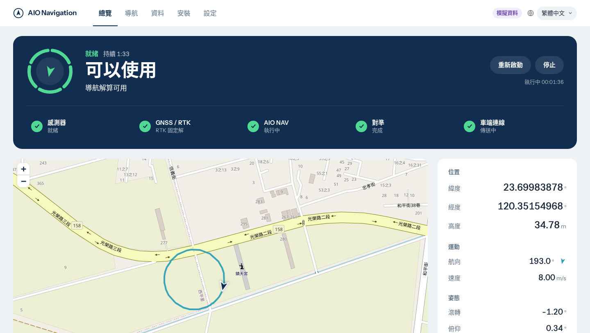
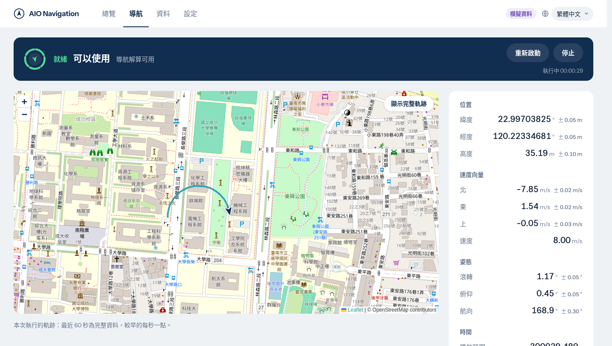
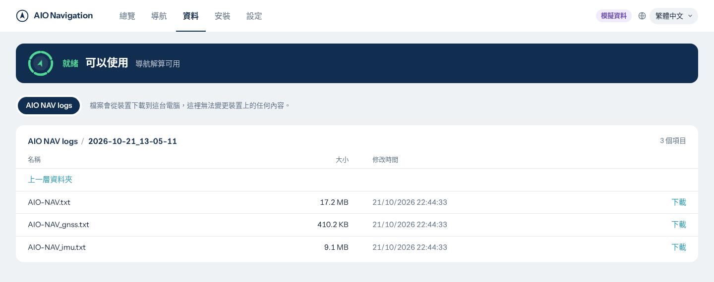
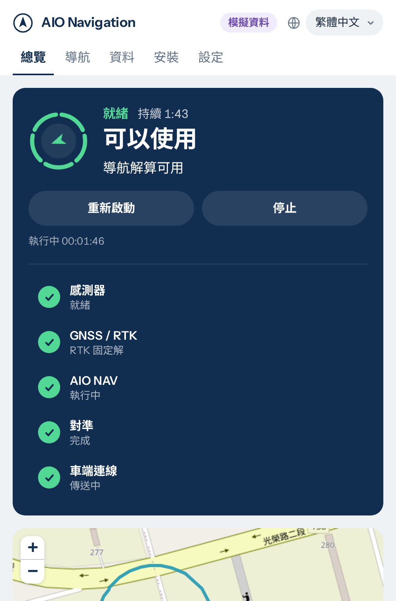
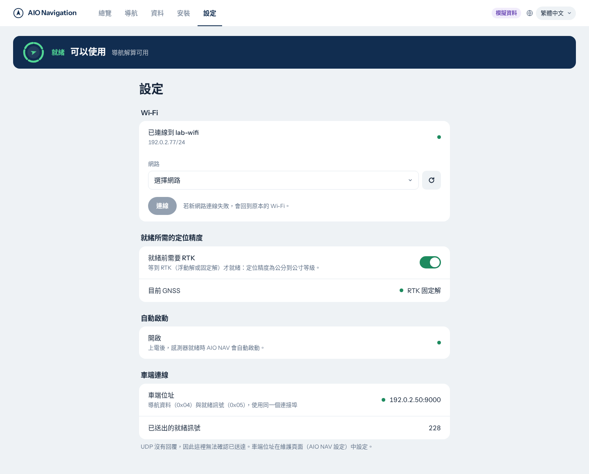
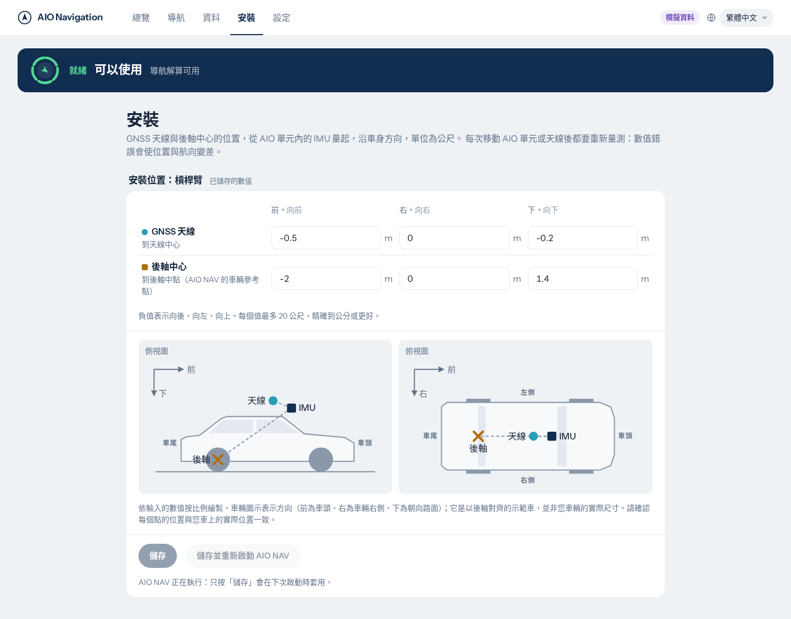
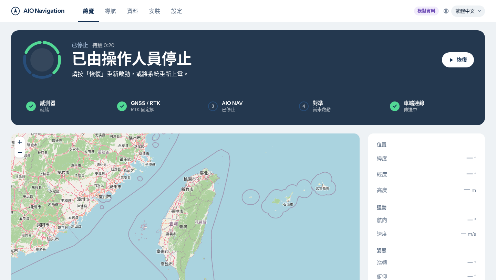
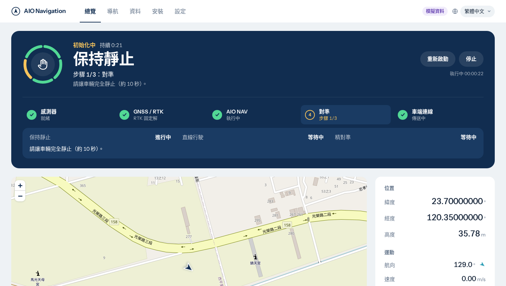
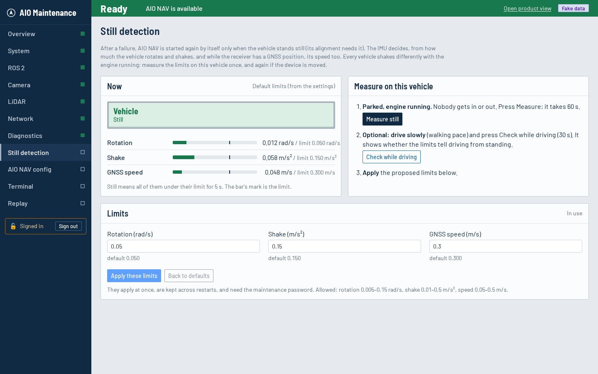

# AIO 導航系統操作手冊

[English version](OPERATION.md) · 設定說明：[設定手冊](CONFIG.zh-TW.md)

本手冊寫給兩類讀者：**操作**AIO 導航系統的人（啟動、對準、監看、收資料），以及要把導航輸出**串接**到自己軟體的人。安裝與設定請見[設定手冊](CONFIG.zh-TW.md)。

> 產品頁面可切換為繁體中文，維護頁面只有英文。本手冊中部分介面文字（例如 **Ready**、**Start**、**Alignment**）附上英文原文，方便對照英文畫面。

目錄：

1. [系統提供的服務](#sec1)
2. [開啟儀表板](#sec2)
3. [看懂儀表板](#sec3)
4. [日常操作](#sec4)
5. [對準（Alignment）SOP](#sec5)
6. [UDP 導航輸出（資料串接）](#sec6)
7. [其他輸出：ROS 2 topic 與紀錄檔](#sec7)
8. [維護頁面（工程人員）](#sec8)
9. [問題排除](#sec9)
10. [名詞解釋](#sec10)

---

<a id="sec1"></a>
## 1. 系統提供的服務

裝置上執行的是 **AIO NAV**，一套慣性導航濾波器（IMU + GNSS，可選配里程計），以 100 Hz 輸出導航解（位置、速度、姿態）。同一台裝置上的**網頁儀表板**可以用來啟動濾波器、進行對準、監看狀態，以及下載紀錄檔。

| 服務 | 位置 | 對象 | 用途 |
|------|------|------|------|
| **導航輸出** | UDP，二進位，100 Hz | 您的應用程式 | 產品的主要輸出：位置、速度、姿態、不確定度（σ）與狀態旗標（第 6 節）。 |
| **產品頁面** | `http://<裝置IP>:8080` | 操作人員 | 總覽、導航、資料、安裝、設定五個頁面：導航能不能用、現在該做什麼、車輛在哪裡、輸出是否正常送出；桿臂、Wi-Fi 與 RTK 要求的設定。可切換英文／繁體中文。 |
| **AIO NAV 控制** | Overview 頁面 | 操作人員 | AIO NAV 會自動啟動；需要時手動停止、恢復或重新啟動。 |
| **資料下載** | 產品頁面的 Data 頁 | 操作人員 | 把 AIO NAV 的紀錄檔下載到您的電腦。 |
| **Wi-Fi 熱點**（選配） | `http://10.42.0.1:8080` | 手機與平板 | 裝置自己的 Wi-Fi 網路：開啟頁面，並接收導航封包的副本（第 8.2 節）。 |
| **維護頁面** | `http://<裝置IP>:8081`（需要密碼） | 工程人員 | 判斷問題出在系統、服務、ROS、感測器還是網路；相機與光達（LiDAR）的即時畫面；驅動程式診斷與重新啟動；啟動與停止感測器驅動；靜止偵測；Wi-Fi 與熱點；編輯 AIO NAV 設定；終端機；bag 重播（選配模組）。 |
| **`aio-dashboard` 指令** | 裝置終端機 | 工程人員 | 啟動、停止、檢查與設定儀表板本身。 |

**AIO NAV 不需要操作人員。** 上電後儀表板會啟動它（與 DSO），失敗後重新啟動，而且永不放棄；就緒之後只有在車輛靜止時才會重新啟動（第 4.2 節）。必要時它也會啟動感測器驅動；IMU 沒有資料時，watchdog 會重新啟動驅動，DSO 當掉或記憶體過大時也會重新啟動 DSO。AIO NAV 是獨立執行的：即使儀表板停止、重新啟動或瀏覽器關閉，導航仍會繼續運作。AIO NAV 執行中直接關機是正常的，不算故障。

<a id="sec2"></a>
## 2. 開啟儀表板

1. 把您的電腦接到與裝置相同的網路（通常是網路線直連，或接在感測器交換器上）。
2. 用瀏覽器（Chrome、Edge 或 Firefox）開啟 `http://<裝置IP>:8080`。在裝置上執行 `aio-dashboard urls` 可以列出網址。
3. 如果頁面打不開或顯示 **403 Forbidden**，代表這台裝置只接受特定電腦連線（設定中的 `access.allowed_clients`）。請管理員把您電腦的 IP 加入。

**用手機或平板：** 裝置的 Wi-Fi 熱點開啟時（第 8.2 節），連上它的網路（預設名稱 `AIO-NAV`，密碼請向管理員索取），開啟 `http://10.42.0.1:8080`。

地圖底圖需要**您的電腦**能連上網際網路。沒有網路時，車輛位置與軌跡仍會顯示，只是底圖空白。

**語言。** 右上角的選單可把產品頁面切換為 **English** 或 **繁體中文**，瀏覽器會記住選擇；未選擇時，瀏覽器語言為中文就顯示中文。維護頁面、紀錄檔與送給車端的封包一律是英文。本手冊中產品頁面的名稱以中文介面為準，部分附上英文介面的名稱；維護頁面只有英文。

<a id="sec3"></a>
## 3. 看懂儀表板

### 3.1 狀態區

每個頁面最上方的深藍色面板只回答一個問題：*現在能不能使用導航輸出？* 在總覽頁面上它顯示：

- 以顏色標示的**狀態**，以及已持續多久（「持續 0:12」）；
- 需要操作人員動作時，以大字顯示**現在該做什麼**：「保持靜止」「直線行駛」「繼續行駛」「停止使用導航」「需要維護」（或「可以使用」）。這與車端在狀態封包中收到的要求相同（第 6.8 節），所以頁面與車端永遠一致；
- 一行說明發生什麼事，一行說明細節；
- 左側的**圓環**：五段圓弧就是五個啟動步驟（第 3.2 節），完成為綠色、等待中為琥珀色、有問題為紅色。圓環中央是該做什麼的圖示（手掌、箭頭、彎曲箭頭、停止標誌、扳手），就緒後則顯示車輛航向；
- **啟動**（操作人員停止後顯示為**恢復**）、**重新啟動**、**停止** 按鈕。

其他頁面的面板只有一行，搭配小圓環。不能使用導航時（故障、降級），面板會變成**深紅色**；紅色只用在這種情況。


*總覽頁面：狀態面板（圓環、AIO NAV 按鈕、啟動步驟）、最近軌跡的地圖、位置、運動與姿態。*


| 狀態 | 顯示方式 | 意義 | 該怎麼做 |
|------|------|------|----------|
| **已停止**（Stopped） | 灰色字、石板色面板 | AIO NAV 沒有執行，也沒有人要求它執行。這是正常狀態，不是問題。 | 需要導航時按 **Start**。 |
| **啟動中**（Starting） | 藍綠色字 | AIO NAV 已啟動、正在準備，還沒有導航輸出。 | 等待。60 秒內都沒有輸出就會變成 **Fault**。 |
| **初始化中**（Initializing） | 琥珀色字 | AIO NAV 正在執行並有輸出，但對準尚未完成。會顯示目前是第幾步與該做什麼，例如「對準第 1/3 階段：粗對準 — 請讓車輛完全靜止」。 | 照著指示操作（[對準 SOP](#sec5)），此時先不要使用輸出。 |
| **就緒**（Ready） | 綠色字、完整的綠色圓環 | AIO NAV 正在執行、資料即時，且對準已完成，輸出可以使用。 | 正常作業。 |
| **降級**（Degraded） | 深紅色面板 | 本次執行中輸出*曾經* Ready，但之後必要條件（例如 RTK）或對準失效。車輛可能正在行駛，所以不會再回到對準提示。 | 依車輛的安全程序停止使用導航。只在車輛靜止時才重新啟動 AIO NAV。 |
| **故障**（Fault） | 深紅色面板 | AIO NAV 出了問題：這次開機中沒有人按 Stop 它卻停了、啟動後 60 秒都沒有輸出，或輸出中斷超過 2 秒。會顯示原因。開啟自動啟動時，面板會說明正在做什麼（例如「若 AIO NAV 沒有恢復，8 秒後重新啟動」）。 | 通常不需處理：它會自動重新啟動。就緒之後請停止使用導航（第 4.2 節）。若一再發生，見[問題排除](#sec9)。 |
| **未知**／**離線**（Unknown／Offline） | 灰色字、石板色面板 | 儀表板剛啟動，或您的瀏覽器與裝置失去連線。 | 等幾秒；持續出現請檢查網路。 |


*故障時一定會說明發生什麼事，以及該怎麼做。*

狀態需要持續約 1 秒才會改變，回到 Ready 則需要穩定約 2 秒，因此偶爾掉一個封包不會讓畫面閃爍。AIO NAV 執行時，狀態區也會顯示已執行多久；處理錄好的 bag 而不是即時感測器時，會顯示 **Bag replay**。

### 3.2 啟動進度

總覽頁面在狀態區下方，以五個步驟顯示開機流程：

| 步驟 | 完成（綠色勾）的條件 | 點開後顯示 |
|------|----------------------|------------|
| **感測器** | 感測器驅動正在執行，且收到 IMU 資料。 | 各驅動程式、IMU 資料 |
| **GNSS / RTK** | 有 GNSS 位置；就緒需要 RTK 時（預設）也要有 RTK。 | GNSS 位置、目前品質、是否需要 RTK |
| **AIO NAV** | AIO NAV 正在執行並有輸出。 | AIO NAV、輸出頻率、視覺里程計（DSO：僅供參考，就緒不需要它） |
| **對準** | 三個對準階段都已完成。 | 「保持靜止」「直線行駛」「精對準」各為完成／進行中／等待中，以及目前這一步的指示 |
| **車端連線** | 導航資料與就緒訊號正送往車端位址。 | 車端位址、送出的內容 |

還在等待的步驟是琥珀色圓圈（該注意的那一步會閃動），有問題是紅色，還不能開始的是灰色。**點選步驟**可看原因，再點一次收起。在手機上，步驟會由上往下排列。

### 3.3 狀態圓點

地圖下方有一行簡潔的連線狀態；導航頁面另外顯示對準、GNSS 與輔助。每一項是名稱、彩色圓點與一個詞：

| 圓點 | 意義 |
|------|------|
| 綠 | 正常、已完成，或（輔助）正在作用 |
| 琥珀 | 需要注意，或仍在進行中 |
| 紅 | 故障 |
| 空心灰 | 沒有資料、閒置，或未設定 |

| 項目 | 代表 |
|------|------|
| **導航輸出** | 導航輸出（UDP，第 6 節）是否送出、頻率與目的地，例如「100 Hz 送往 192.0.2.50:9000」。AIO NAV 停止時為灰色（正常）；「頻率偏低」（低於預期的 80%）或「延遲」（0.5 秒沒有封包）為琥珀色；應該送出卻 2 秒沒有封包為紅色（狀態變成故障）。UDP 沒有確認回覆：只能確認裝置有送出，不代表您的應用程式已收到。 |
| **相機／LiDAR**（有安裝時） | 感測器在網路上有回應。「未設定」代表沒有設定 IP；不需要時屬正常。 |
| **感測器網路** | 感測器網路連線正常。 |
| **粗對準**、**初始航向**、**精對準**（導航頁面） | 依序的三個對準階段：**完成**、**進行中**（目前這一階段）、**等待中**（之後的階段），AIO NAV 沒有輸出時顯示 **—**。 |
| **GNSS**（導航頁面） | GNSS 接收機的定位品質：綠 =「RTK 固定解」（公分級）、琥珀 =「RTK 浮動解」（約 10 公分）或「定位（類型不明）」、紅 =「單點定位（SPP）」（公尺級）或「無定位」。琥珀與紅色只是警告：慣性導航會繼續，但準確度會慢慢下降。 |
| **ZUPT／ZIHR／NHC／VUPT**（導航頁面） | 濾波器此刻使用了哪些輔助（見[名詞解釋](#sec10)）。閒置是正常的。 |

GNSS、相機、LiDAR 與網路的問題也會以**提示**（下方的琥珀色說明）呈現，永遠不會讓狀態從就緒變成故障，因為導航解仍然可用。

### 3.4 語言

見第 2 節：右上角的選單可把產品頁面切換為 English 或繁體中文。

### 3.5 各頁面

- **總覽**（Overview）：狀態面板（AIO NAV 按鈕與啟動步驟）、顯示最近 60 秒軌跡的地圖、位置、航向（附箭頭，上方為北）、速率、滾轉角與俯仰角、狀態圓點、提示、儲存空間。最下方一行「就緒訊號 #…，工作階段 …，更新於 …」是狀態封包中的數字，用於與車端記錄比對。
- **導航**（Navigation）：顯示本次執行完整軌跡的大地圖，以及每個數值與其不確定度（±，1σ）：位置、速度（北、東、上）、速率、姿態、導航時間。下方是對準、GNSS、輔助的圓點與導航輸出（含封包數）。**顯示完整軌跡**會縮放到整條軌跡；**跟隨車輛**會重新跟隨車輛。
- **資料**（Data）：AIO NAV 的紀錄資料夾。點資料夾開啟，按**下載**存檔。此頁面無法更動裝置上的任何檔案。
- **安裝**（Setup）：GNSS 天線與後軸中心相對於 IMU 的位置（第 3.7 節）。
- **設定**（Settings）：Wi-Fi、RTK 要求、自動啟動與車端連線（第 3.6 節）。


*Navigation 頁面：本次執行的完整軌跡、每個數值與其不確定度。*


*Data 頁面：下載 AIO NAV 的紀錄檔。*



*頁面在手機與平板上也能使用。*

### 3.6 設定頁面


*設定：每個工作一張卡片。*

| 卡片 | 可以做什麼 |
|------|------------|
| **Wi-Fi** | 查看目前使用的網路。從清單選擇網路（訊號強的在前；選「其他網路（隱藏）…」可自行輸入名稱），輸入密碼，按**連線**。結果以白話顯示：「已連線到 …」，或「密碼不正確。已回到 …」（裝置從未離開原本的網路時為「仍連線在 …」）。連線失敗時，約一分鐘內一定會回到原本的 Wi-Fi。熱點開啟時，卡片顯示「熱點：…」與手機如何開啟頁面，此時無法在這裡加入網路（熱點在維護頁面 → Network 開關）。 |
| **就緒所需的定位準確度** | 開關「**就緒前需要 RTK**」（預設開啟，建議保持）。關閉時會先確認，因為關閉後定位準確度只有數公尺也可能就緒。會顯示上次變更的時間，每次變更都記錄在事件紀錄中。 |
| **自動啟動** | 「開啟」：上電後 AIO NAV 會自動啟動。「啟動中」：正在等待，並說明在等什麼（例如「等待車輛靜止」）。「已暫停」：操作人員按了停止；會保持停止，直到按下**恢復**或重新上電。「異常」：等待的感測器不存在。「關閉」：請在總覽頁面按啟動。 |
| **車端連線** | 車端位址，以及導航資料（0x04）與就緒訊號（0x05）以同一個連接埠送往該位址。僅供查看：位址在維護頁面 → AIO NAV config 設定。 |

只有**用網路線**連到裝置的電腦（或裝置本身）才能變更 Wi-Fi：若電腦本身經由 Wi-Fi 連線，變更 Wi-Fi 可能讓它斷線，此時頁面會顯示「請用網路線連接後再變更 Wi-Fi。」導航正在使用中，或車端、網際網路路由（RTK 修正）經由 Wi-Fi 時，頁面會先詢問再變更。產品頁面上的這些設定不需要密碼；維護頁面也有相同的設定。Wi-Fi 需要安裝程式做一次性設定（設定手冊 4.5a）。

### 3.7 安裝頁面：桿臂

**安裝**頁面記錄 GNSS 天線與後軸中心（AIO NAV 的車輛參考點）的位置，從 **AIO 單元內的 IMU** 量起。每次移動 AIO 單元或天線後都要重新量測：數值錯誤會使位置與航向變差。


*安裝：兩組桿臂，以及用來檢查數值的比例圖。*

| 欄位 | 意義 |
|------|------|
| **前**／**右**／**下** | 從 IMU 沿車身方向的公尺數：向前、向右、向下為正。負值表示向後、向左、向上。每個值最多 20 公尺，精確到公分或更好。 |
| **GNSS 天線** | 到天線中心。 |
| **後軸中心** | 到後軸中點。 |

表格旁的側視圖與俯視圖，會把 IMU、天線與後軸中心按比例畫在一台示範車上：請確認每個點的位置與您車上的實際位置一致（車輛圖示表示方向，不是您車輛的尺寸）。

- **儲存**：把數值寫入即時模式的設定檔（`aio_nav.yaml`），在 AIO NAV 下次啟動時套用。舊檔會保留（維護頁面 → AIO NAV config → Earlier versions），變更會記錄在事件紀錄中。
- **儲存並重新啟動 AIO NAV**（AIO NAV 執行中時）：立即套用。因為 AIO NAV 會重新對準，只有車輛靜止時才能使用，按下後會先確認。
- 與啟動／停止一樣不需要密碼。管理員可以把此頁設為唯讀（`product.edit_lever_arms`，設定手冊 4.1）。


<a id="sec4"></a>
## 4. 日常操作

### 4.1 開始前

- [ ] 裝置已通電，GNSS 天線上方視野開闊。
- [ ] 車輛停在起始位置，對準的第一階段會**完全靜止**。
- [ ] 即時作業：模式是 **Live**，且感測器驅動正在執行（第 4.6 節；維護頁面 → ROS 2）。
- [ ] 您的電腦可以開啟產品頁面（第 2 節）。
- [ ] 狀態區顯示 **Stopped**（或執行中的狀態），而不是 Unknown／Offline：儀表板已連線。

### 4.2 啟動 AIO NAV

**啟動**（Start）按鈕在總覽與導航頁面最上方的狀態區。


*已由操作人員停止：沒有任何問題，只是 AIO NAV 沒有執行。按鈕顯示為**恢復**（關閉自動啟動時顯示為**啟動**）。*


1. 按**啟動**。狀態先變成**啟動中**（藍綠），AIO NAV 一開始輸出就變成**初始化中**（琥珀）；地圖下方的**導航輸出**從「不會送出資料」變成頻率與位址。
2. 照著狀態區顯示的步驟操作（[對準 SOP](#sec5)）。


*初始化中：狀態區顯示該做什麼（保持靜止）與目前的對準步驟；啟動進度中的「對準」已點開，顯示三個階段。*


**自動啟動（開機）。** AIO NAV 是全自動的（預設，見[設定手冊 4.2b](CONFIG.zh-TW.md)），不需要按 Start。開機後系統依序進行：

| 步驟 | 狀態區 | 車端收到的 0x05 | 操作人員 |
|---|---|---|---|
| 1. 儀表板啟動 | **Unknown** → **Starting** | `BOOTING`，接著 `CHECKING` | 保持車輛靜止 |
| 2. 必要時啟動感測器驅動；等待 IMU 資料、系統時鐘與 GNSS 時間一致（最多 2 分鐘），以及車輛靜止 5 秒 | **Starting** —「Starting automatically: Waiting for …」 | `CHECKING`／`HOLD_STILL` | 保持車輛靜止 |
| 3. 啟動 AIO NAV（與 DSO） | **Starting** | `NAV_STARTING`／`HOLD_STILL` | 保持車輛靜止 |
| 4. 對準（[SOP](#sec5)） | **Initializing**，對準第 1 → 2 → 3 階段 | `KEEP_STILL` → `MOVE_STRAIGHT` → `REFINING` | 依畫面上的步驟操作 |
| 5. RTK 浮動解以上，並穩定 3 秒 | **Ready** | `READY`，inhibit 為 0 | 使用導航 |

**啟動進度**（第 3.2 節）會顯示目前在哪一步、正在等待什麼。若感測器 2 分鐘內都沒有就緒，狀態會變成**故障**並指出是哪一項（例如「IMU 資料在 120 秒後仍無法使用」）；一旦就緒仍會自動繼續啟動。等待車輛靜止或等待時鐘都不算故障。

失敗之後會怎樣：

- **就緒之前**：AIO NAV 沒有啟動、自行結束或沒有輸出時，會在 5、15、30 秒後，之後每 60 秒再啟動一次。永不放棄。
- **AIO NAV 在執行但輸出停止**：若有輸入缺少（沒有 IMU 資料、沒有有效時間）就讓它繼續執行，因為它可能自行恢復；輸入正常時給它 10 秒，之後重新啟動（「若 AIO NAV 沒有恢復，… 秒後重新啟動」）。
- **就緒之後**：立即告訴車端停止使用導航（**故障**、`SAFE_STOP`、「AIO NAV 在就緒後停止」）。車輛靜止 5 秒後才會再次啟動 AIO NAV，並重新對準。
- **停止**：按下**停止**後，AIO NAV 會保持停止，按鈕顯示為**恢復**，直到有人按下它，或下次上電。
- **執行中關機**：正常。下次上電會再啟動它，不會被當成當機。

預設需要 RTK 才會就緒。沒有 RTK 的場地，可在**設定**頁面關閉此要求（會先確認；會記錄），或在維護頁面 → Overview 關閉。

如果狀態變成 **Fault**「AIO NAV stopped unexpectedly」，或按鈕下方的訊息是「AIO NAV did not start: …」，請見[問題排除](#sec9)。如果沒有按鈕，代表此裝置關閉了網頁控制功能（`nav.allow_control`），請管理員開啟。用其他方式啟動的 AIO NAV 也偵測得到。

### 4.3 作業中

- 留意狀態區，**Ready** 代表輸出可以使用。
- 琥珀色提示（例如「GNSS: SPP」或「GNSS: No signal」）不會中斷導航，但定位準確度會下降。請到 Navigation 頁面查看 ± 值。
- 狀態變成 **Fault** 時，依狀態區顯示的原因處理（見[問題排除](#sec9)）。

### 4.4 重新啟動或停止

- **重新啟動**（會先確認：按**立即重新啟動**，或按**取消**／Esc）：停止後再啟動 AIO NAV。**對準會重新開始**，請在車輛可以靜止時才重新啟動。
- **停止**（會先確認：按**立即停止**，或按**取消**／Esc）：結束導航輸出，您的應用程式將收不到資料。開啟自動啟動時，AIO NAV 會保持停止，直到有人按**恢復**，或下次上電。

### 4.5 作業結束後

1. 停車；若不再需要導航輸出，按 **Stop**。
2. 開啟 **Data** 頁面，下載本次的紀錄檔（第 7.2 節）。

### 4.6 播放錄好的 bag（工程人員）

Bag 重播屬於選配的 **replay 模組**（安裝時加 `--with-replay`：`sudo deploy/install.sh --user <使用者> --with-replay`）。沒有安裝時，機器固定以 **Live** 執行，以下步驟不可用。

所有操作都在維護頁面 → **Replay**：


*Replay 頁面：ROS 環境、播放前的檢查、找到的 bag，以及播放設定與實際指令。*


1. **Before playing** 列出播放前必須滿足的條件，每一項都有一個處理按鈕：
   - ROS 環境是 **Bag replay**（按 *Switch to Bag replay*：AIO NAV 與 DSO 會被停止，儀表板會重新啟動，約幾秒鐘）。Bag replay 使用 `aio_nav_bag.yaml`（ROS domain 13、模擬時間），而不是 `aio_nav.yaml`（domain 10，僅限本機）；
   - 感測器驅動沒有在 bag 的 domain 發布資料。驅動平常在 Live 的 domain（10），bag 的 domain（13）看不到它們，所以可以繼續執行（只是仍會佔用 CPU 與相機頻寬）。只有當驅動在 bag 的 domain 執行、或讀不到它的 domain 時，才需要停止（按 *Stop Sensor drivers*）；
   - 目前沒有其他 bag 在播放。
2. 到 Overview 頁面按 **Start**，讓 AIO NAV 處理 bag 的資料（沒有啟動 AIO NAV 也能播放，但不會有任何計算結果）。
3. 在 **Bags** 點選一個 bag。清單列出設定的資料夾中找到的所有 bag（預設：家目錄，往下兩層），並顯示錄製時間、長度、大小與 topic。
4. 勾選要播放的 **topic**（都不勾：全部播放），再設定 **Rate**（播放倍率）、**Start at**（起始秒數）、**Loop**（循環）與 **Start paused**（暫停開始）。**Advanced** 裡有 `ros2 bag play` 的其他所有參數（`/clock` 頻率、延遲、預讀佇列、topic 重新對應、儲存外掛、QoS 覆寫檔、儲存設定檔、等待全部確認、loaned message、記錄層級）。下方會顯示實際執行的指令，也可以直接貼到終端機使用。
5. 按 **Play**。**Playback** 會顯示估計的播放位置，並提供 **Pause**／**Resume**、播放中調整 **Rate**，以及 **Stop**。播放器的輸出在 *Player output*。
6. **Save preset** 會把 bag 連同 topic 與參數存成一組常用設定，下次從 **Presets…** 選取即可。每個 bag 上次使用的設定也會自動記住。
7. 要回到即時作業：**Stop** 停止播放，在同一頁把 ROS 環境切回 **Live**，如果之前停了感測器驅動就再啟動（維護頁面 → ROS 2；約 15 秒後開始發布資料），再到 Overview 頁面按 **Start**。

改用終端機播放時，要指定 bag 的 domain 並帶上時鐘，因為終端機的預設環境可能是別的 domain（可用 `echo $ROS_DOMAIN_ID` 確認）：
```bash
ROS_DOMAIN_ID=13 ROS_LOCALHOST_ONLY=0 ros2 bag play <bag 資料夾> --clock 100
```

<a id="sec5"></a>
## 5. 對準（Alignment）SOP

對準是濾波器在輸出可信之前，求出初始姿態（滾轉、俯仰、航向）與位置的過程。共分三個階段，分別以三顆燈號（導航頁面）與啟動進度中的「對準」步驟顯示。以下用中文介面的名稱；英文介面依序為 Coarse alignment、Initial heading、Fine alignment。

### 5.1 三個階段

| 階段 | 轉綠的燈號 | 濾波器在做什麼 | 操作人員動作 |
|------|-----------|----------------|--------------|
| 1. 粗對準（調平） | **粗對準** | 量測重力以求出滾轉與俯仰；初始位置取自 GNSS。 | 車輛保持**完全靜止**（引擎可以發動，但車上車旁都不要有人走動）。預設時間 10 秒。 |
| 2. 初始航向 | **初始航向** | 求出航向。預設設定下，航向是在車輛移動時由 GNSS 求得。 | **粗對準** 轉綠後，在開闊天空下以穩定速度**直線**行駛，直到此燈轉綠。 |
| 3. 精對準 | **精對準** | 持續修正航向與感測器誤差，直到航向的標準差（σ）在 1° 以內，或超過精對準的時間上限（預設 300 秒）。 | 在有 GNSS 的環境正常行駛，包含幾次轉彎與加減速。 |

此裝置要求的燈號全部轉綠後（預設是三顆都要），狀態區就會變成 **就緒**。

### 5.2 操作步驟

1. 把車停在開闊天空下的起點。等 GNSS 燈顯示 **RTK 固定解**（綠色）再開始，因為初始位置取自 GNSS。**RTK 浮動解**（琥珀色）也可以，但起始位置的準確度較差。
2. 在總覽頁面按 **啟動**，經過 **啟動中** 後，狀態變成 **初始化中**：「對準第 1/3 階段：粗對準 — 請讓車輛完全靜止（約 10 秒）」。
3. **至少 10 秒不要移動**，直到**粗對準**完成（綠色）。靜止期間導航頁面的 **ZUPT** 會顯示作用中，這是正常的。
4. 直線前進，保持穩定速度，等 **初始航向** 轉綠。
5. 繼續行駛並轉幾個彎，直到 **精對準** 轉綠。到 導航頁面確認航向 ± 約在 1° 以內。
6. 狀態區顯示 **就緒**，導航輸出可以使用。

### 5.3 對準不順利時

| 狀況 | 處理方式 |
|------|----------|
| 第 1 階段時車輛移動了 | 停車，按 **重新啟動**，從步驟 3 重新開始。 |
| **粗對準** 超過 10 秒很久仍是琥珀色 | 檢查 GNSS 燈（初始位置來自 GNSS，不應為紅色），並確認車輛真的完全靜止，然後重新啟動。 |
| 行駛中 **初始航向** 一直沒有轉綠 | GNSS 可能被遮蔽（樹木、建築、隧道），請到開闊處行駛。 |
| **精對準** 很久才完成 | 最晚會在精對準時間上限（預設 300 秒）到達時完成。請持續在開闊天空下行駛。 |
| Ready 之後 GNSS 中斷 | 導航改由慣性感測器繼續（僅為提示），準確度會隨時間下降，請留意 ± 值。 |

> 對準方式與時間設定在 AIO NAV 自己的設定檔（`aio_nav.yaml` 的 `Alignment` 區段）：`coarse_duration`（預設 10 秒）、`fine_duration`（300 秒）、`fine_heading_std_threshold`（1°），以及姿態初始化選項（都可以在維護頁面 → **AIO NAV config** 修改）。若設定 `att.option: 2`，航向改由設定檔給定、不需行駛，第 2 階段便不需要移動。哪些燈號必須亮起才算 Ready，由儀表板設定中的 `nav.ready_requires` 決定。求出航向所需的最低速率與距離取決於導航函式庫，請向導航團隊確認您車輛適用的數值。

<a id="sec6"></a>
## 6. UDP 導航輸出（資料串接）

### 6.1 概要

| 項目 | 內容 |
|------|------|
| 傳輸方式 | IPv4 UDP，每個時刻一個封包，沒有回應確認 |
| 頻率 | `aio_nav.yaml` 的 `output_rate`（預設 100 Hz） |
| 封包 | 156 位元組，二進位，little-endian |
| 目的地 | 裝置本機的 `127.0.0.1:9000`（儀表板使用）**以及**一個外部 `host:port`（`aio_nav.yaml` 的 `output_udp`） |
| 開始時間 | AIO NAV 一執行就開始送，**在對準完成之前**就會送出。請用旗標判斷資料何時有效。 |

每個目的地都會收到一份完整的封包，您的接收程式和儀表板不會互搶資料。開啟 Wi-Fi 熱點時，儀表板還會把每個封包（以及 0x05 狀態封包）複製一份，送到熱點上的每台手機或平板的 UDP port 9000（第 8.2 節）。儀表板是 `127.0.0.1:9000` 唯一的監聽者：同一個位址只能有一個程式使用，所以請不要在那裡再跑別的接收程式（例如舊的 AIO Nav 桌面程式），否則儀表板會收不到資料。

### 6.2 設定目的地

1. 在維護頁面 → **AIO NAV config**（第 8 節）把 **UDP destination** 設成您電腦的 IP 與連接埠（例如 `192.0.2.50:9000`）。請改您使用的模式對應的檔案：`aio_nav.yaml`（Live）與 `aio_nav_bag.yaml`（Bag replay）；兩種都用的話，兩個檔案都要改。也可以直接在裝置上編輯檔案：
   ```bash
   nano ~/aio-nav-ros/install/aio_nav_ros/share/aio_nav_ros/config/aio_nav.yaml
   ```
   ```yaml
   output_udp: "192.0.2.50:9000"     # 您電腦的 IP 與連接埠
   ```
2. 重新啟動 AIO NAV（設定頁面的 **Save and restart AIO NAV**，或 Overview 頁面的 **Restart**）。儀表板的 **Output** 列會在幾秒內自動跟上檔案的內容。
3. 在接收端電腦的防火牆開放該 UDP 連接埠。

外部目的地**只能設定一個**，且必須是單一 IPv4 位址（unicast）。若有多個應用程式要使用，請由一台電腦接收後再轉送。

### 6.3 封包結構

| 位元組 | 欄位 | 型別 | 值 |
|--------|------|------|----|
| 0–1 | 同步碼 | 2 × uint8 | `0x55 0xAA` |
| 2 | 訊息 ID | uint8 | `0x04`（導航解） |
| 3–4 | 資料長度 | uint16 | `150` |
| 5–154 | 資料內容 | 150 位元組 | 見 6.4 |
| 155 | 檢查碼 | uint8 | 第 2–154 位元組的總和取 256 的餘數 |

同步碼、ID、長度或檢查碼任一不符的封包都應丟棄。

### 6.4 資料欄位

位移從封包開頭起算（資料內容從第 5 位元組開始）。資料內容的 Python `struct` 格式為 `<Qdd28fH3f`。

| 位移 | 欄位 | 型別 | 單位 | 說明 |
|-----:|------|------|------|------|
| 5 | 時間 | uint64 | µs | GPS 週秒 × 10⁶（每週歸零）。重播 bag 時跟隨重播時鐘。 |
| 13 | 緯度 | float64 | 度 | WGS84 |
| 21 | 經度 | float64 | 度 | WGS84 |
| 29 | 高度 | float32 | m | AIO NAV 位置解的高度 |
| 33 | 北向速度 | float32 | m/s | |
| 37 | 東向速度 | float32 | m/s | |
| 41 | 天向速度 | float32 | m/s | **向上**為正 |
| 45 | 滾轉角 | float32 | 度 | |
| 49 | 俯仰角 | float32 | 度 | |
| 53 | 航向 | float32 | 度 | 0 = 北，90 = 東（順時針）。可能以 −180…180 送出；負值加 360 即為 0…360。 |
| 57 / 61 / 65 | 位置 σ 北／東／地向 | float32 | m | 1σ 不確定度 |
| 69 / 73 / 77 | 速度 σ 北／東／地向 | float32 | m/s | 1σ 不確定度 |
| 81 / 85 / 89 | 滾轉 σ／俯仰 σ／航向 σ | float32 | 度 | 1σ 不確定度 |
| 93 / 97 / 101 | 陀螺儀偏差 x／y／z | float32 | deg/h | IMU 誤差估計值 |
| 105 / 109 / 113 | 加速度計偏差 x／y／z | float32 | mg | |
| 117 / 121 / 125 | 陀螺儀比例因子 x／y／z | float32 | ppm | |
| 129 / 133 / 137 | 加速度計比例因子 x／y／z | float32 | ppm | |
| 141 | 旗標 | uint16 | — | 狀態位元，見 6.5 |
| 143 | 里程計比例 | float32 | — | 設定里程計輔助時使用 |
| 147 | 安裝俯仰角 | float32 | 度 | 感測器安裝角估計值 |
| 151 | 安裝偏航角 | float32 | 度 | |

### 6.5 狀態旗標

`flags` 只使用低位元組，且以**位元反轉**的方式送出。請先把 8 個位元反轉，再依下表判讀：

| 位元（反轉後） | 封包中的位元 | 名稱 | 為 1 時的意義 |
|----:|----:|------|---------------|
| 0 | 7 | ZUPT | 已套用零速更新（車輛靜止） |
| 1 | 6 | ZIHR | 已套用零航向角速率更新 |
| 2 | 5 | NHC | 已套用非完整約束（車輛不會側滑或垂直跳動） |
| 3 | 4 | GNSS | 本時刻已套用 GNSS 量測 |
| 4 | 3 | VUPT | 已套用里程計／車速更新 |
| 5 | 2 | ALIGN | 粗對準完成 |
| 6 | 1 | HEADING | 初始航向有效 |
| 7 | 0 | FINE | 精對準完成 |

**資料什麼時候有效？** 只有在 ALIGN、HEADING、FINE 都為 1 時才使用導航解，這和儀表板 **Ready** 的規則相同。ZUPT、ZIHR、NHC、GNSS、VUPT 每個時刻都可能不同，只表示該時刻使用了哪些輔助；GNSS 更新依 GNSS 的頻率到達，所以只有部分封包的 GNSS 位元為 1。

### 6.6 接收範例（Python 3，不需安裝額外套件）

```python
import socket
import struct

PORT = 9000                                   # output_udp 中的連接埠
PAYLOAD = struct.Struct("<Qdd28fH3f")         # 150 位元組，little-endian
FLAG_NAMES = ["ZUPT", "ZIHR", "NHC", "GNSS", "VUPT", "ALIGN", "HEADING", "FINE"]

def reverse_bits8(x):
    return int(f"{x & 0xFF:08b}"[::-1], 2)

sock = socket.socket(socket.AF_INET, socket.SOCK_DGRAM)
sock.bind(("0.0.0.0", PORT))
while True:
    pkt, _ = sock.recvfrom(2048)
    if len(pkt) != 156 or pkt[:3] != b"\x55\xaa\x04" or pkt[155] != sum(pkt[2:155]) & 0xFF:
        continue                              # 不是有效的 NAV 封包
    f = PAYLOAD.unpack_from(pkt, 5)
    flags = reverse_bits8(f[31])
    active = [n for i, n in enumerate(FLAG_NAMES) if flags >> i & 1]
    print(f"t={f[0] / 1e6:.3f} lat={f[1]:.8f} lon={f[2]:.8f} h={f[3]:.2f} "
          f"vn={f[4]:.2f} ve={f[5]:.2f} vu={f[6]:.2f} hdg={f[9]:.1f} {' '.join(active)}")
```

C/C++ 請使用緊密排列的 struct（`#pragma pack(push, 1)`），欄位順序依 6.4：`uint64_t time_us; double lat, lon; float alt, vn, ve, vu, roll, pitch, heading, 9 個 σ, 12 個 IMU 誤差; uint16_t flags; float odo_scale, mount_pitch, mount_yaw;`（共 150 位元組）。

### 6.7 確認串接是否正確

1. 儀表板的 **Output** 列顯示 **Streaming**，以及您電腦的位址與連接埠。
2. 您的接收程式以預期頻率印出封包（預設每秒 100 個）。
3. 經緯度與航向和 Navigation 頁面一致。
4. 儀表板顯示 **Ready** 時，旗標中有 ALIGN、HEADING、FINE。

### 6.8 狀態封包（0x05）

0x04 封包在對準完成**之前**就會開始送出，所以收到它不代表資料可以使用。因此儀表板還會送出（`status_udp`，預設開啟，[設定手冊 4.2c](CONFIG.zh-TW.md)）**0x05 狀態封包**，每秒兩次、狀態一改變就立即送出，目的地與 0x04 **相同的位址與 port**。內容與網頁上的 readiness 快照相同：狀態、操作人員該做什麼，以及所有不可用原因。READY 之後仍會持續送出：收不到就代表「不要使用」。

> 0x05 專用於此封包；AIO NAV 本身只送 0x04。

**在同一個連接埠接收兩種封包。** UDP 允許多個發送端送到同一個連接埠，只有車端綁定該連接埠。因此車端維持原本一個 socket 與 `55 AA` 封包解析，依訊息 ID（第 2 個位元組）分派：`0x04` = 導航（156 位元組），`0x05` = 狀態（42 位元組）。解析程式必須檢查 ID 與長度並略過其他封包；若把每個封包都當成 0x04 讀取，會誤讀狀態封包。若車端希望使用另一個 socket，把 `status_udp.destination` 設為該位址與連接埠。

**封包框架**：與 0x04 相同：`55 AA`、訊息 ID `0x05`、資料長度 `36`（uint16 LE）、資料內容、檢查碼（從訊息 ID 到資料內容結尾各位元組的總和取 256 的餘數）。共 42 位元組，little-endian。Python `struct` 格式：`<BBBBIIQIIBBHHH`。

| 位移（資料內容） | 欄位 | 型別 | 意義 |
|---:|---|---|---|
| 0 | protocol_version | uint8 | `1` |
| 1 | state | uint8 | 見下表 |
| 2 | requested_action | uint8 | 見下表 |
| 3 | gnss_quality | uint8 | 0 未知、1 無定位、2 單點定位（SPP）、3 RTK 浮動解、4 RTK 固定解 |
| 4 | session_id | uint32 | 儀表板每次啟動都會換新 |
| 8 | sequence | uint32 | 每個封包加 1，溢位後回到 0 |
| 12 | uptime_ms | uint64 | 儀表板運作時間 |
| 20 | health_flags | uint32 | 成立條件：目前成立的條件（位元見下表） |
| 24 | inhibit_flags | uint32 | 不可用原因：不可使用 0x04 的原因（位元見下表）；**任一位元為 1 = 不可用** |
| 28 | nav_flags | uint8 | 0x04 的旗標，正常位元順序（**未**反轉） |
| 29 | reserved | uint8 | 0 |
| 30 | nav_rate_dhz | uint16 | 導航輸出頻率 × 10 |
| 32 | nav_age_ms | uint16 | 最後一個 0x04 的延遲；65535 = 沒有或更久 |
| 34 | reserved | uint16 | 0 |

| 代碼 | 狀態 | 車端顯示 | 意義 |
|---:|---|---|---|
| 0 | `BOOTING` | 開機中 | 儀表板剛開機 |
| 1 | `CHECKING` | 檢查中 | 等待前置條件或自動啟動 |
| 2 | `NAV_STARTING` | AIO NAV 啟動中 | AIO NAV 已啟動，尚無有效輸出 |
| 3 | `KEEP_STILL` | 保持靜止 | 對準第 1 階段：粗對準（有輸出，尚未對準） |
| 4 | `MOVE_STRAIGHT` | 直線行駛 | 對準第 2 階段：初始航向（尚無有效航向） |
| 5 | `REFINING` | 精對準 | 對準第 3 階段：精對準，或已對準但缺少必要條件 |
| 6 | `READY` | 就緒 | 可以使用（inhibit_flags 為 0） |
| 7 | `DEGRADED` | 降級 | 本次執行曾經 READY，之後必要條件或對準失效 |
| 8 | `FAULT` | 故障 | AIO NAV、其輸出或管理權（AIO NAV 只能由一個管理者負責）有問題 |
| 9 | `MAINTENANCE` | 已停止 | 操作人員按了停止，或 AIO NAV 尚未啟動 |

| 代碼 | 要求的動作 | 儀表板顯示 | 車端顯示 |
|---:|---|---|---|
| 0 | `NONE` | （不顯示） | 不需動作 |
| 1 | `HOLD_STILL` | 請讓車輛完全靜止。 | 讓車輛完全靜止 |
| 2 | `DRIVE_STRAIGHT` | 請在安全、空曠的區域以穩定速度直線行駛。 | 在安全、空曠的區域以穩定速度直線行駛 |
| 3 | `KEEP_DRIVING` | 請在有 GNSS 的環境下繼續正常行駛。 | 在有 GNSS 的環境下繼續正常行駛 |
| 4 | `SAFE_STOP` | 請停止使用導航，並依車輛安全程序處理。 | 停止使用導航，並依車輛安全程序處理 |
| 5 | `SERVICE_REQUIRED` | 需要維護。 | 需要維護 |
| 6 | `MAINTENANCE_HOLD` | 已停止。請在總覽頁面按「恢復」或「啟動」。 | 已停止，請在儀表板的總覽頁面按「恢復」或「啟動」 |

| 位元 | health_flags | 成立條件 | inhibit_flags | 不可用原因 |
|---:|---|---|---|---|
| 0 | `DASHBOARD_OK` | 儀表板正常 | `BOOT_IN_PROGRESS` | 開機中 |
| 1 | `CONFIG_OK` | 設定有效 | `CONFIG_INVALID` | 設定無效 |
| 2 | `IMU_STREAM_OK` | IMU 資料正常 | `IMU_MISSING_OR_STALE` | IMU 資料缺少或延遲 |
| 3 | `GNSS_STREAM_OK` | GNSS 資料正常 | `GNSS_MISSING_OR_STALE` | GNSS 資料缺少或延遲 |
| 4 | `GNSS_QUALITY_OK` | GNSS 品質足夠 | `GNSS_QUALITY_LOW` | GNSS 品質不足 |
| 5 | `NAV_PROCESS_OK` | AIO NAV 執行中 | `NAV_NOT_RUNNING` | AIO NAV 未執行 |
| 6 | `NAV_OUTPUT_OK` | 導航輸出正常 | `NAV_OUTPUT_STALE` | 導航輸出延遲 |
| 7 | `ALIGNMENT_OK` | 粗對準完成 | `KEEP_STILL_REQUIRED` | 需要保持靜止 |
| 8 | `HEADING_OK` | 初始航向完成 | `MOVE_STRAIGHT_REQUIRED` | 需要直線行駛 |
| 9 | `FINE_ALIGNMENT_OK` | 精對準完成 | `FINE_ALIGNMENT_REQUIRED` | 需要精對準 |
| 10 | `DSO_OK` | DSO 正常 | `DSO_NOT_READY` | DSO 尚未就緒 |
| 11 | `EXTERNAL_ROUTE_OK` | 到車端的路由正常 | `EXTERNAL_ROUTE_DOWN` | 沒有到車端的路由 |
| 12 | `RTK_CORRECTION_OK` | RTK 修正資料正常 | `RTK_CORRECTION_LOST` | RTK 修正資料中斷 |
| 13 | `STORAGE_OK` | 儲存空間可寫入 | `STORAGE_NOT_WRITABLE` | 儲存空間無法寫入 |
| 14 | `VEHICLE_ACK_OK` | 車端已確認接收 | `MAINTENANCE_HOLD` | 操作人員已停止 |
| 15 | `TIME_SYNC_OK` | 時間同步正常 | `STARTUP_TIMEOUT` | 啟動逾時 |
| 16 | `NO_DUPLICATE_PROCESS` | AIO NAV 沒有重複執行 | `OWNERSHIP_CONFLICT` | 管理權衝突 |
| 17 | `WIFI_OK` | Wi-Fi 正常 | `INTERNAL_FAULT` | 內部錯誤 |

尚未實作的位元維持 0（例如 `VEHICLE_ACK_OK`、`RTK_CORRECTION_OK`、`TIME_SYNC_OK`、`WIFI_OK`）；接收端應忽略未知位元。

**接收端規則**（參考實作：`aio_system_dashboard/nav/vehicle_gate.py`）：

1. 預設為不可用。3 秒內沒有收到有效的 0x05、檢查碼錯誤、版本不支援，或 `session_id` 改變（儀表板重新啟動）時，立即判定為不可用。
2. 只有在 `state` 為 READY（6）**且** `inhibit_flags` 為 0，並在同一個 session 中持續 2 秒，才判定為可用。
3. 也要檢查 0x04 本身：延遲不超過 0.5 秒、ALIGN／HEADING／FINE 旗標成立、時間戳記持續前進、數值皆為有限值。
4. 單獨遺失一個狀態封包不會造成不可用（sequence 用來計算遺失數）；只有逾時才會。

在車端接收的位置觀察規則運作（在本專案的原始碼目錄執行，發佈包不含 `tools/`）：`python3 tools/vehicle_gate.py --port 9000`（0x04 與 0x05 都在 9000；若 0x05 送到其他 port 則加 `--status-port`）。

**Golden vector**（任何實作都必須能編碼與解碼出完全相同的內容）：READY、動作 NONE、RTK float、session `0x12345678`、sequence 482、uptime 123456789 ms、health `0x10FFF`、inhibit 0、nav flags `0xE8`、100.0 Hz、延遲 12 ms：

```
55aa0524000106000378563412e201000015cd5b0700000000ff0f010000000000e800e8030c0000005c
```

同一份快照也可以用 JSON 取得：`http://<裝置IP>:8080/api/readiness`。

<a id="sec7"></a>
## 7. 其他輸出：ROS 2 topic 與紀錄檔

### 7.1 ROS 2 topic（開發用介面）

AIO NAV 也會發布 ROS 2 topic，這些是內部開發用的介面，產品介面是 UDP 輸出。這些 topic **在粗對準完成後才會發布**。

| Topic | 型別 | 內容 |
|-------|------|------|
| `/nav/fix` | `sensor_msgs/NavSatFix` | WGS84 位置；`status.service` 帶有旗標（未反轉） |
| `/nav/odometry` | `nav_msgs/Odometry` | TWD97 位置、ENU 速度、共變異數 |
| `/nav/path` | `nav_msgs/Path` | 最近的軌跡 |
| TF `map` → `imu_link` | — | TWD97 地圖座標系下的位姿 |

ROS domain 與網路設定必須和 AIO NAV 相同：**Live** 使用 domain 10（僅限本機），**Bag replay** 使用 domain 13（網路）。維護頁面 → ROS 2 會顯示目前使用的是哪一種；不是 Live 時，Overview 會顯示 **Bag replay** 標示。

### 7.2 紀錄檔（Data 頁面）

在 `aio_nav.yaml` 啟用（`save_fusion_txt`、`save_parsed_txt`）後，AIO NAV 會在對準完成後，把以 Tab 分隔的文字紀錄寫到 aio-nav-ros 的 `output/` 資料夾（在 `install/` 旁邊；兩個設定檔都指向這裡）：

| 檔案 | 內容 |
|------|------|
| `AIO-NAV.txt`（名稱由 `fusion_txt_path` 決定） | 依輸出頻率記錄的導航解：時間、位置、速度、姿態、不確定度（σ）、IMU 誤差、旗標 |
| `AIO-NAV_imu.txt`、`AIO-NAV_gnss.txt`、`AIO-NAV_odom.txt` | 解析後的原始感測器輸入（`save_parsed_txt`） |

可從產品頁面的 **Data** 頁下載。

<a id="sec8"></a>
## 8. 維護頁面（工程人員）

`http://<裝置IP>:8081`。側邊欄的燈號可以一眼看出哪個頁面有問題。

| 頁面 | 用途 |
|------|------|
| **Overview** | 查看四個層面（System、Services、Data flow、Network）與目前的問題清單。每個問題都連到說明它的頁面。**Readiness for the vehicle**：告訴車端的內容（狀態、動作、原因、位元遮罩）、條件表、自動啟動狀態、0x05 計數，以及 **RTK required** 開關（產品頁面的設定頁也有）。 |
| **System** | CPU、GPU、記憶體、磁碟、溫度、systemd 服務、網路介面。 |
| **ROS 2** | 必要節點、監看中的 topic（頻率、即時性、發布者、訂閱者）、所有 topic。此頁也有 **Sensor drivers**（啟動／停止／重新啟動相機與 IMU/GNSS 驅動），並顯示目前的 ROS 環境。 |
| **Replay**（僅安裝 replay 模組時） | 切換 Live 與 Bag replay，並以任意 `ros2 bag play` 參數播放 bag（見 4.6 節）。 |
| **Camera / LiDAR**（有安裝時） | 連線狀態、驅動程式狀態、topic 狀態、**Live view**（相機影像；LiDAR 點雲，可切換俯視／3D）、**Run diagnostic**、**Restart driver**（會先確認）。 |
| **Still detection** | 車輛是否靜止（每次自動啟動前與安裝頁的「儲存並重新啟動」都會用到），以及在車上量測門檻（第 8.1 節）。 |
| **Network** | 網路介面與位址、感測器連線狀態、導航輸出目的地與其路由。**Wi-Fi**：掃描與連線（只能從有線連線的瀏覽器操作；新網路失敗會恢復原本的 Wi-Fi；見[設定手冊 4.5a](CONFIG.zh-TW.md)）。**Hotspot**（有安裝時）：第 8.2 節。 |
| **Diagnostics** | 目前的故障與警告、診斷與重新啟動的結果，以及事件紀錄。開機後第一分鐘、時鐘還沒以 GNSS 時間設定前的事件，會在時鐘設定後顯示為實際時間（紀錄檔保留當時寫下的時間）。 |
| **AIO NAV config** | 編輯 AIO NAV 的設定檔（Live 用 `aio_nav.yaml`，Bag replay 用 `aio_nav_bag.yaml`）。**Settings** 是常用設定的表單（輸出、ROS、紀錄、對準、輔助、桿臂）；**Edit file** 是整份檔案。檔案中的註解會保留。**Review changes** 會檢查檔案並列出確切的變更（刪除或清空設定、小數寫成整數、清單長度改變都算錯誤）；接著按 **Save**，或 **Save and restart AIO NAV** 讓設定立即生效。儲存前會先讓 AIO NAV 以新檔案短暫啟動一次（與網路隔離）：AIO NAV 無法啟動的檔案會被拒絕（「not saved: AIO NAV does not start with this file: …」），磁碟上的檔案維持原樣。每次儲存都會保留前一版（**Earlier versions**，可還原）。 |
| **Terminal** | 在瀏覽器中開啟裝置上的 shell，方便快速檢查（`ros2 topic hz …`、`journalctl …`、`top`）。以儀表板的使用者身分執行，並像桌面終端機一樣載入您的 `.bashrc`（所以 ROS 已設定好）；**Use active ROS domain** 會輸入目前模式的 export 指令。最多同時 3 個；30 分鐘沒有輸入會自動關閉。 |

維護頁面可以更動裝置，所以需要密碼；產品頁面不需要。密碼在裝置上以 `aio-dashboard password` 設定（沒有預設密碼：設定之前維護頁面會一直鎖住，登入頁會說明如何設定）。開啟任何維護頁面都會先顯示登入頁，登入後再回到您要開的頁面。15 分鐘沒有使用會自動登出（開啟頁面與執行操作算使用，頁面自己的定時更新不算），也可以按側邊欄最下方的 **Sign out**。登入、密碼錯誤、儲存設定與開啟終端機都會記錄在事件紀錄（Diagnostics）中。

Live view 只在該頁面開啟時才讀取感測器的 ROS topic。刻意停止的驅動不會被當成問題。


*維護頁面的登入頁。*


*Overview：四個層面與目前的問題。側邊欄的燈號指出哪一頁有問題；工具頁（Still detection、AIO NAV config、Terminal、Replay）沒有燈號。*


*System：資源、儲存空間、溫度與服務。*


*ROS 2：目前的環境、感測器驅動（啟動／停止／重新啟動）、節點與 topic。*


*Camera：連線狀態、驅動、topic 與 Live view（這裡是模擬畫面）。*


*Network：網路介面、感測器連線、導航輸出送往何處，以及 Wi-Fi 熱點（圖中為開啟，且開啟了 UDP 副本）。*


*Still detection：三個數值與門檻的比較、在車上量測，以及目前使用的門檻（第 8.1 節）。*


*Diagnostics：目前的問題、操作結果與事件紀錄。*


*AIO NAV config：使用中設定檔的常用設定；**Edit file** 會顯示整份檔案。*


*Review changes：儲存前檢查並列出確切變更的行。*


*Terminal：裝置上的 shell，例如檢查 topic 的頻率。*

裝置上的指令：

```bash
aio-dashboard status     # 服務狀態與網址
aio-dashboard logs       # 即時查看 log
aio-dashboard restart
aio-dashboard config     # 編輯設定、檢查、重新啟動
aio-dashboard password   # 設定維護頁面的密碼
```

### 8.1 靜止偵測（Still detection）

每次自動啟動都會等車輛靜止 5 秒，安裝頁的**儲存並重新啟動**也需要靜止：AIO NAV 的第一個對準步驟需要車輛靜止，而且啟動可能發生在行駛中當機之後。「靜止」代表以下三個值都低於門檻：

| 數值 | 來源 | 預設門檻 |
|------|------|----------|
| **Rotation**（旋轉） | 最近 2 秒 IMU 的最大角速率 | 0.05 rad/s |
| **Shake**（晃動） | 最近 2 秒 IMU 加速度的離散程度 | 0.15 m/s² |
| **GNSS speed**（GNSS 速率） | 接收機回報的速率，只在有位置時使用（否則顯示 *not used: …*） | 0.3 m/s |

**Now** 區塊顯示每個數值與門檻的比較（門檻標記在長條的三分之二處）、車輛是 *Still* 還是 *Moving* 及原因，以及門檻的來源（*Default limits*、*Measured …* 或 *Set by hand …*）。預設值是在一台車上量得的，請量測您的車輛：

1. **Measure still**（60 秒）：停車、引擎發動，沒有人上下車。車輛移動時量測會停止並說明。建議門檻為量到的最大值的兩倍。
2. **Check while driving**（選用，30 秒，步行速度即可）：說明建議門檻會把多少筆行駛中的讀數誤判為靜止。
3. 確認表單中的數值，按 **Apply these limits**。立即生效，重新啟動與更新後仍保留。數值也可以手動輸入（在固定範圍內）。**Back to defaults** 會回到設定檔的數值。

量測與變更需要維護密碼；每次變更都會記錄在事件紀錄中。

### 8.2 Wi-Fi 熱點（Hotspot）

安裝了安裝程式的 `hotspot` 部分後，**維護頁面 → Network → Hotspot** 可以讓裝置的 Wi-Fi 自己成為一個網路，讓手機和平板在野外連線。同一個無線電無法同時加入別的網路。

- **Start hotspot**：輸入名稱（預設 `AIO-NAV`）與密碼（8–63 個字元）。使用 2.4 GHz 與 WPA2，所有手機都能連。若 Wi-Fi 正連在某個網路上，會先詢問（會離開該網路）；熱點啟動失敗時會恢復原本的網路。
- **斷電後會自動恢復**，直到在這裡停止為止。
- 手機連上後開啟 **`http://10.42.0.1:8080`**（產品頁面）。頁面會顯示目前有幾台裝置連線。
- **Stop hotspot**：若有裝置連線會先詢問；之後 Wi-Fi 會自動加入範圍內已儲存的網路。
- **UDP 副本**：熱點執行時，連上的每台裝置都會在 **UDP 連接埠 9000** 收到每個導航封包（0x04）與狀態封包（0x05）的副本，格式同第 6 節。車端的輸出不變。開關「Send the NAV and status packets to the devices on the hotspot」可以關閉或開啟（重新啟動後仍保留）；下方一行顯示哪些裝置在接收、已送出多少封包。
- **封閉的網路**：熱點上的裝置只能連到本裝置（頁面、UDP 副本），無法經由它連到車端網路或網際網路。
- 啟動與停止需要維護密碼，且瀏覽器必須透過網路線連線（或在裝置本身操作）：連在熱點上的手機無法關閉它。使用者的設定頁會顯示熱點，但不能變更。

<a id="sec9"></a>
## 9. 問題排除

| 看到的狀況 | 可能原因 | 處理方式 |
|------------|----------|----------|
| 頁面打不開 | 網址錯誤、網路問題，或儀表板沒有執行 | 確認 IP（在裝置上執行 `aio-dashboard urls`）與網路線；執行 `aio-dashboard status`。 |
| **403 Forbidden** | 您的電腦不在允許清單中 | 請管理員加入您的 IP（`access.allowed_clients`）。 |
| 維護頁面：登入頁顯示尚未設定密碼 | 還沒有設定維護密碼 | 在裝置上執行 `aio-dashboard password`，再重新整理頁面。 |
| 維護頁面：回到登入頁 | 15 分鐘沒有使用，已自動登出 | 重新登入；登入後會回到原本的頁面。 |
| 更新後頁面沒有樣式，或顯示 *Unknown* | 瀏覽器還在用舊的頁面檔案 | 按 **Ctrl+Shift+R** 重新載入。 |
| **離線**，「與儀表板的連線中斷」 | 瀏覽器連不到裝置 | 檢查網路，恢復後頁面會自動更新。 |
| **已停止** | AIO NAV 沒有執行（正常） | 按**啟動**（第 4.2 節）；暫停的自動啟動按**恢復**。 |
| **故障**：「AIO NAV 意外停止」 | AIO NAV 在這次開機中自己結束了 | 開啟自動啟動時會自動再啟動（就緒之後要等車輛靜止）。沒有自動啟動時按**啟動**。若一直發生，請收集 `/opt/aio-dashboard/logs/aio_nav.log` 交給導航團隊（維護頁面有細節）。 |
| 一直是**啟動中**：「等待車輛靜止」 | 車輛在移動，或靜止門檻對這台車太嚴 | 停車，車上不要有人走動。若一直無法判定為靜止，請在維護頁面 → Still detection 量測門檻（第 8.1 節）。 |
| **啟動中**：「等待系統時鐘與 GNSS 時間一致」 | 接收機還沒有 GNSS 時間（需要開闊天空） | 等待；2 分鐘後 AIO NAV 仍會啟動（事件「System clock not corrected」）。 |
| 事件「Sensor drivers restarted」 | 驅動服務在執行，但 IMU 45 秒沒有資料 | 若恢復就不需處理。一再發生時請檢查 IMU 的線材與電源。 |
| 故障「Settings file has an error」 | 儀表板設定檔有錯；以上次正常的設定執行 | 見設定手冊第 3 節。 |
| 手機看不到熱點 | 熱點沒有開啟，或手機超出範圍 | 維護頁面 → Network → Hotspot 會顯示是否開啟；熱點使用 2.4 GHz。 |
| **故障**：「AIO NAV 正在執行，但沒有送出導航輸出」 | 啟動後 60 秒內都沒有輸出（`nav.startup_timeout_s`） | **重新啟動** AIO NAV；到維護頁面檢查它的感測器（IMU／GNSS 驅動）。 |
| **故障**：「導航輸出已停止」 | 濾波器停住，或其感測器停止輸出 | 到維護頁面檢查 IMU／GNSS 驅動；**重新啟動** AIO NAV。 |
| 按鈕下方訊息「AIO NAV did not start: …」（此訊息含程式的錯誤內容，保持英文） | AIO NAV 結束了或無法啟動，訊息會說明原因 | 再按一次**啟動**。若重複發生，請收集 `/opt/aio-dashboard/logs/aio_nav.log` 交給導航團隊。 |
| **故障**：「此裝置沒有安裝 AIO NAV」 | 此裝置上 aio-nav-ros 的 `install/` 資料夾不見或不完整 | 請管理員確認 aio-nav-ros 已安裝。 |
| 即時作業：沒有相機或 IMU 資料 | 感測器驅動已停止（操作人員的停止會被保留：自動啟動與 watchdog 都不會再啟動它） | 維護頁面 → ROS 2 → Sensor drivers → **Start**，等約 15 秒。 |
| Bag 重播：AIO NAV 收不到資料 | Bag 在別的 ROS domain 播放，或沒有啟動 AIO NAV | 見 4.6 節：從維護頁面 → Replay 播放（會使用正確的 domain），並在總覽頁面按啟動。用終端機時：`ROS_DOMAIN_ID=13 ROS_LOCALHOST_ONLY=0 ros2 bag play … --clock 100`。 |
| 一直停在**初始化中** | 對準尚未完成 | 依照[對準 SOP](#sec5) 與 5.3 處理。 |
| 事件「DSO used too much memory: restarting DSO」（維護頁面 → Diagnostics） | DSO 的記憶體一直增加（曾發現它保留每一張相機影像），監控在機器記憶體用完之前把它重新啟動 | 不需要立即處理，AIO NAV 會繼續執行。若重複發生，請回報給 DSO 的維護者。上限是 `dso_watchdog.max_memory_mb`。 |
| **GNSS** 燈為琥珀或紅色（「RTK 浮動解」「單點定位（SPP）」「無定位」） | 天空被遮蔽、沒有 RTK 修正資料、天線或 GNSS 接收機問題 | 導航會繼續；移到開闊處；檢查天線與修正資料連線。 |
| 「GNSS：無定位」，提示為「… 沒有 GNSS 訊息」 | 接收機驅動完全沒有送出位置（看不到天空，或接收機／驅動需要重新啟動） | 檢查天線與天空視野；重新啟動感測器驅動（維護頁面 → ROS 2）；驅動的紀錄在 `~/openrtk330-basler-driver.log`。 |
| 「頻率偏低」／「延遲」 | 裝置負載過高，或濾波器輸入中斷 | 檢查 System 頁面（CPU、溫度）與 ROS 2 頁面。 |
| 相機／LiDAR「未連線」 | 感測器未開機、線路問題或 IP 錯誤 | 檢查電源與線路；維護頁面 → Camera／LiDAR → **Run diagnostic**。 |
| 儀表板顯示「傳送中」，但您的應用程式收不到 | 目的地或防火牆 | 確認「輸出」列上的位址是您的電腦；在該電腦的防火牆開放 UDP 連接埠（第 6.7 節）。 |
| 資料頁面沒有檔案 | 紀錄功能未開啟，或尚未完成過對準 | 在 `aio_nav.yaml` 啟用 `save_fusion_txt`；紀錄在對準完成後才開始。 |

<a id="sec10"></a>
## 10. 名詞解釋

本系統與車端的 AIO NAV 接收監看程式（aio-nav-receiver）使用同一份中文術語，完整對照見[術語表](TERMINOLOGY.zh-TW.md)。

| 名詞 | 意義 |
|------|------|
| AIO NAV | 在裝置上執行的導航濾波器（`aio_nav_node`）。 |
| 對準（Alignment） | 導航開始前，求出初始姿態與位置的過程。 |
| GNSS | 衛星定位（GPS、Galileo、北斗等）。 |
| RTK 固定解／RTK 浮動解（RTK fix／float） | 使用修正資料的接收機解：固定解為公分級，浮動解約為公寸級。 |
| 單點定位（SPP） | 沒有修正資料的單點定位：公尺級準確度。 |
| Live／Bag replay | 系統的兩種模式：即時感測器（ROS domain 10）或錄好的 bag（domain 13）。 |
| IMU | 慣性量測單元：陀螺儀與加速度計。 |
| ZUPT | 零速更新：濾波器利用「車輛沒有移動」這項資訊。 |
| ZIHR | 零航向角速率：靜止時濾波器利用「航向沒有改變」這項資訊。 |
| NHC | 非完整約束：汽車不會側向滑動或垂直跳動。 |
| VUPT | 來自里程計的車速更新。 |
| σ（sigma）、± | 濾波器估計的 1σ 不確定度（標準差），不是實測誤差。 |
| 準確度／精密度 | 準確度是與參考值（真值）的接近程度；精密度是重複量測的離散程度。 |
| 桿臂 | 感測器之間的位置偏移；安裝頁面中指 GNSS 天線與後軸中心相對於 IMU 的位置。 |
| LiDAR（光達） | 雷射掃描測距感測器，輸出點雲。 |
| TWD97 | 台灣的國家座標系統，ROS 輸出的位置使用此座標系統。 |
| GPS 週秒 | 自 GPS 週開始（GPS 時間週日 00:00）起算的秒數。 |
