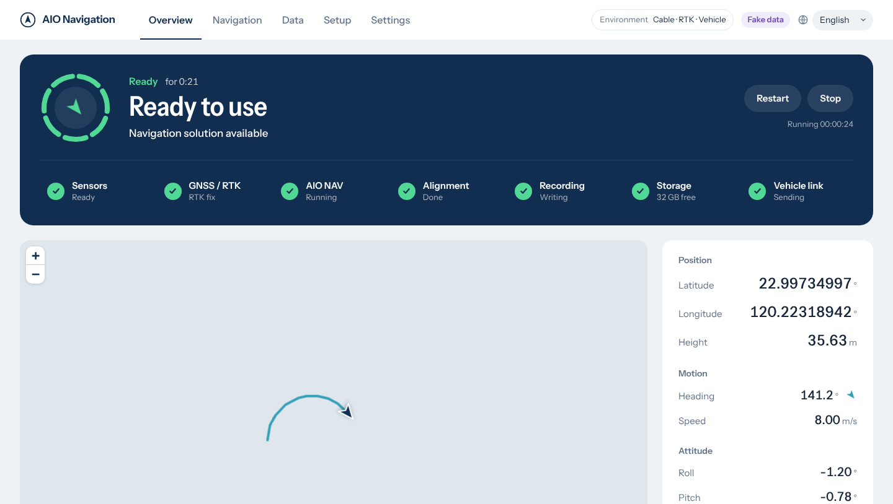
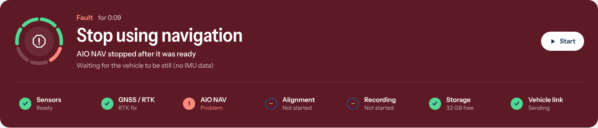
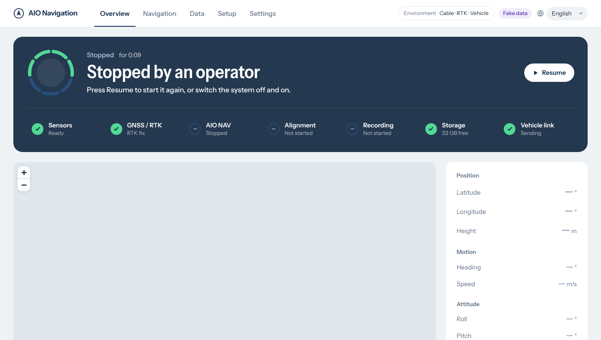
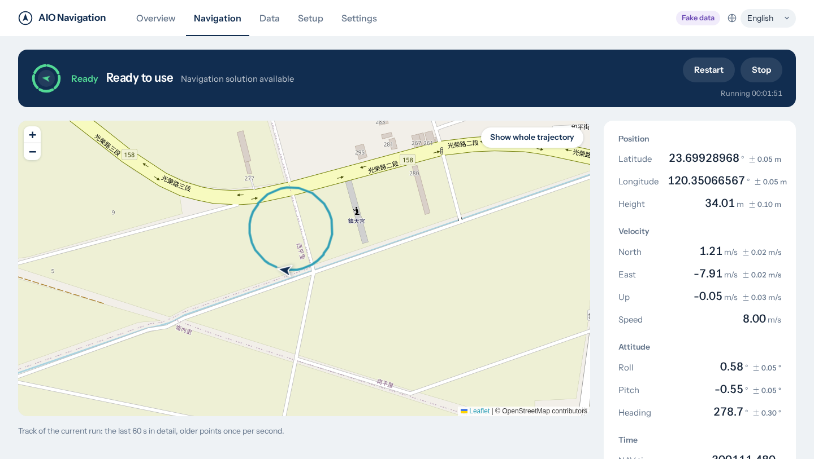
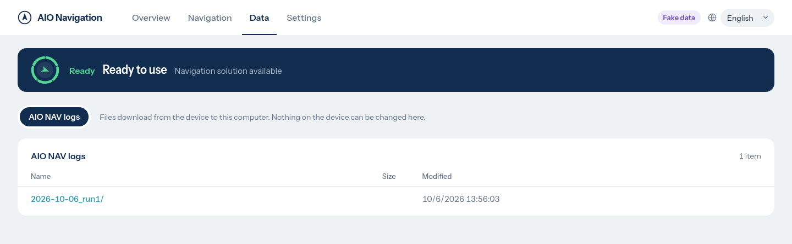
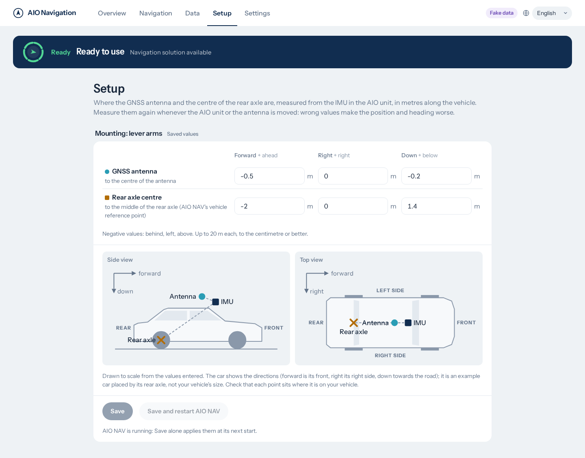
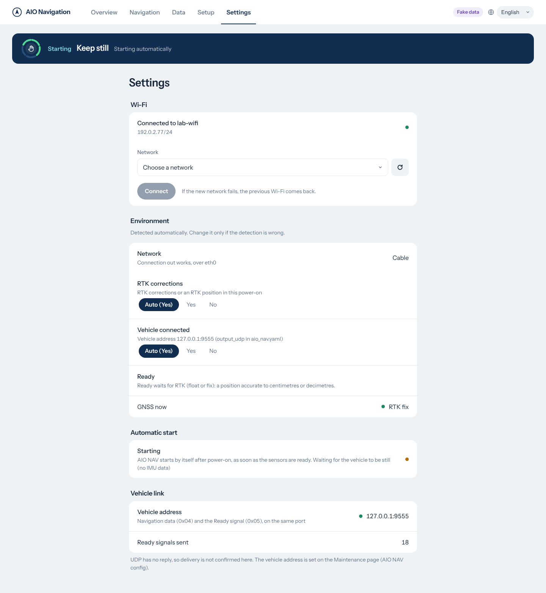
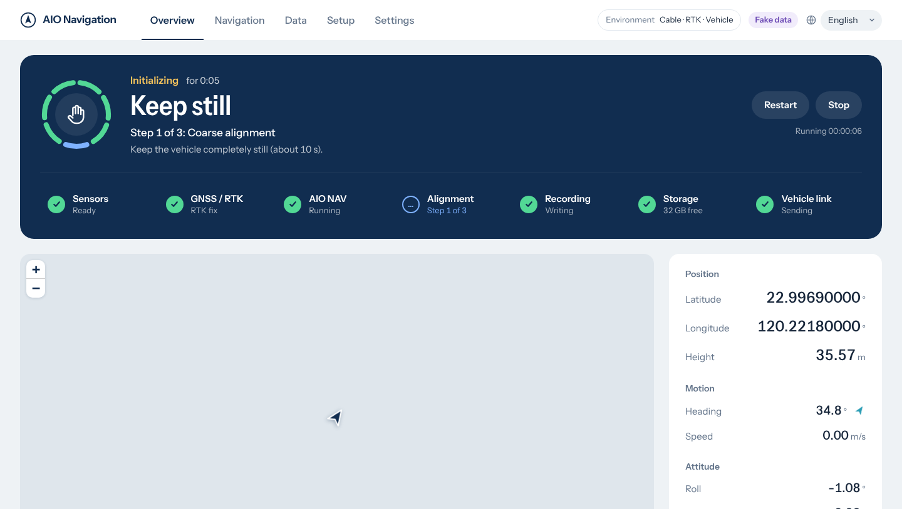

# AIO Navigation — User Guide

This guide is for the people who **use** the AIO navigation device: open its pages, see whether
everything works, collect data and take the data home. Engineers find the Maintenance view in the
[Maintenance Guide](MAINTENANCE.md); software that reads the navigation output is described in the
[Integration Guide](INTEGRATION.md).

Contents:

1. [What this is](#1-what-this-is)
2. [Connecting](#2-connecting)
3. [Reading the status](#3-reading-the-status)
4. [The pages](#4-the-pages)
5. [Collecting data, step by step](#5-collecting-data-step-by-step)
6. [Alignment](#6-alignment)
7. [Getting the data](#7-getting-the-data)
8. [Common situations](#8-common-situations)
9. [Glossary](#9-glossary)

---

## 1. What this is

The device runs **AIO NAV**, a navigation filter that combines an IMU (motion sensors) with GNSS
(satellite positioning). It computes position, velocity and attitude 100 times a second and writes
them, with the raw sensor data, to log files.

The device also serves a **web page** that you open in a browser. It tells you whether navigation
works, shows where the vehicle is, and lets you download the log files. You do not have to start
anything: after power-on the device starts AIO NAV by itself.

## 2. Connecting

**By cable.** Connect your computer to the device's network (usually a direct Ethernet cable or the
sensor switch) and open `http://<device-ip>:8080` in Chrome, Edge or Firefox. Your administrator
gives you the address.

**Over the device's Wi-Fi (hotspot).** If the device has its hotspot on, join its Wi-Fi network
(default name `AIO-NAV`; the administrator gives you the password) and open
`http://10.42.0.1:8080`. This works from a phone or tablet too.

If the page does not open, or shows **403 Forbidden**, see [Common situations](#8-common-situations).

**Language.** The menu at the top right switches between **English** and **繁體中文**. The
browser remembers your choice.

**Map.** The map background needs Internet access on *your* computer or phone. Without it the
vehicle and its track are drawn on a blank background; nothing else is affected.

## 3. Reading the status

Every page has a dark blue **status panel** at the top. It answers one question: *does navigation
work right now, and is anything asked of me?*

*The Overview page: the environment in the top bar, the status panel with its ring and steps, the
map and the current values.*

### 3.1 The headline

The large words say what matters now:

- **What to do**, when something is asked of you: *Keep still*, *Drive straight*,
  *Keep driving* (during alignment, [section 6](#6-alignment)), or *Maintenance needed*.
- **The result**, when nothing is asked: *Ready to use* when the device is connected to a vehicle,
  or *Recording, data usable* when you collect data without a vehicle. *Ready, not recording*
  means navigation works but no log file is being written ([section 8](#8-common-situations)).
- On a vehicle, *Stop using navigation* when the output must not be used any more.

Above the headline is the **state** and how long it has lasted (*Ready for 1:33*); below it, one
or two lines say what is happening.

| State | Colour | Meaning |
|-------|--------|---------|
| **Stopped** | Grey | AIO NAV is not running. Normal after someone pressed **Stop**. |
| **Starting** | Teal | AIO NAV is being started, or the device waits before starting it (for example for the vehicle to be still). |
| **Initializing** | Amber | AIO NAV runs and is aligning. Follow the headline. The data is not usable yet. |
| **Ready** | Green | Aligned and working. The data is usable. |
| **Degraded** | Dark red | It *was* Ready, but something it needs was lost (for example RTK for a few seconds). The data of this period is less accurate. |
| **Fault** | Dark red | AIO NAV has a problem. The lines under the headline say which, and whether it is being restarted by itself. |
| **Unknown** / **Offline** | Grey | The page just opened, or your browser lost the connection to the device. |

*A fault says what happened and what the device does about it: here AIO NAV stopped after it was
ready, and it starts again once the vehicle is still.*

The state changes only after a new condition has lasted a moment (about half a second to get
worse, about 2 seconds to get better), so it does not flicker.

### 3.2 The steps

Below the headline, the Overview lists what navigation and data collection need, one **step**
each. The ring on the left has one arc per step, in the same colours.

| Step | Green when |
|------|------------|
| **Sensors** | The sensor drivers run and IMU data arrives. |
| **GNSS / RTK** | There is a GNSS position, and RTK when this place has RTK. |
| **AIO NAV** | AIO NAV runs and sends its output. |
| **Alignment** | All three alignment stages are done. |
| **Recording** | AIO NAV is writing its log files. |
| **Storage** | The data disk has room. |
| **Vehicle link** | The data is sent to the vehicle. Shown only when a vehicle is connected. |

| Mark | Meaning |
|------|---------|
| Green tick | Done, or OK |
| Blue *…* | In progress (alignment) |
| Amber *!* | Needs attention: the device is waiting for it |
| Red *!* | A problem |
| Grey dash | Not used here, or not started yet |

**Select a step** to see its details; select it again to close them. For example, **Recording**
shows how long this recording has run and how fast it writes, and **Storage** shows the free space
and the recording time it leaves. Each step ends with **View in Maintenance (read only)**, which
opens the matching page of the Maintenance view for an engineer (it usually asks for a password).

In a place **without RTK**, the GNSS step is called **GNSS** and shows a grey *No RTK*: normal there,
not a warning.

### 3.3 The environment

The top bar shows where the device is, for example **Environment Cable · RTK · Vehicle**:

- the network: *Cable*, *Wi-Fi* or *No network*;
- *RTK* or *No RTK*: whether RTK corrections are available here;
- *Vehicle* when a vehicle is connected.

The device finds this out by itself. It decides two things: whether **Ready** waits for RTK
(only where RTK is available), and whether the page speaks of a vehicle or of the data you collect.
Select the chip to open the Environment card of the Settings page, where you can correct it
([section 4.5](#45-settings)).

### 3.4 The connections line

Under the map of the Overview, one line shows what the device talks to, each with a coloured dot:

| Item | Shows |
|------|-------|
| **Navigation output** | The output rate and where it goes, for example *100 Hz to 192.0.2.50:9000*. Grey when AIO NAV is stopped. |
| **Camera** (and **LiDAR** if fitted) | The sensor answers on the network. *Not set up*: no address is configured. |
| **Internet** | The device reaches the Internet. Only RTK corrections need it. |

Amber notes under that line (**advisories**) tell you about problems that do not stop navigation,
for example *Camera not connected* or *GNSS: SPP*.

## 4. The pages

The tabs at the top: **Overview**, **Navigation**, **Data**, **Setup**, **Settings**.

### 4.1 Overview

The status panel with the buttons and steps, a map with the last 60 seconds of track, and the
current position, heading (the arrow points the way the vehicle faces; up is north), speed, roll
and pitch.

The buttons in the status panel:

- **Stop**: ends navigation. AIO NAV then stays stopped until someone presses **Resume**, or until
  the device is switched off and on again.
- **Resume** (or **Start**): starts AIO NAV again. Alignment starts from the beginning.
- **Restart**: stops and starts AIO NAV. **Alignment starts over**, so restart only when the
  vehicle can stand still.

Stop and Restart ask for confirmation (**Stop now** / **Restart now**, or **Cancel**).

*Stopped by an operator: nothing is wrong. Press **Resume** to start again.*

### 4.2 Navigation

A large map with the whole track of this run, and every value with its accuracy (±): position,
velocity, speed, attitude and time. **Show whole trajectory** zooms to the full track;
**Follow vehicle** centres on the vehicle again. The lines at the bottom show the three alignment
stages, the GNSS quality and the aiding the filter uses at the moment
([glossary](#9-glossary): ZUPT, ZIHR, NHC, VUPT).

### 4.3 Data

The folders with AIO NAV's log files. Open a folder and press **Download** to save a file.
Nothing on the device can be changed from this page. See [section 7](#7-getting-the-data).

### 4.4 Setup: lever arms

Where the **GNSS antenna** and the **centre of the rear axle** are, measured from the IMU in the AIO
unit. Measure them again whenever the AIO unit or the antenna is moved: wrong values make the
position and heading worse.

| Field | Meaning |
|-------|---------|
| **Forward** / **Right** / **Down** | Metres from the IMU: + ahead, + right, + below (negative: behind, left, above). |
| **GNSS antenna** | To the centre of the antenna. |
| **Rear axle centre** | To the middle of the rear axle. |

The side view and top view next to the table draw the three points on an example car, to check
that each one is on the right side.

- **Save** keeps the values; they apply the next time AIO NAV starts.
- **Save and restart AIO NAV** applies them at once. It works only while the vehicle stands still,
  because AIO NAV aligns again.

### 4.5 Settings

| Card | What it does |
|------|--------------|
| **Wi-Fi** | Shows the Wi-Fi network in use; choose another one, enter its password and **Connect**. If it fails, the device goes back to the previous network by itself. Wi-Fi can only be changed from a computer connected **by cable**, so a change cannot cut off the page you are using. |
| **Environment** | What the device found out about this place ([section 3.3](#33-the-environment)): **Network** (read only), **RTK corrections** and **Vehicle connected**. Each says how it was detected. Change it only if it is wrong: *Auto (…)* uses the detection, *Yes* and *No* set it by hand. Choosing *No* for RTK asks first, because Ready can then be given with a position accurate to only a few metres. |
| **Automatic start** | Whether AIO NAV starts by itself after power-on, and what it is waiting for. **Resume** here does the same as on the Overview. |
| **Vehicle link** | Where the data goes on the vehicle, and how many Ready signals were sent. Read only. |

## 5. Collecting data, step by step

### Before you start

- [ ] The GNSS antenna has a clear view of the sky.
- [ ] The vehicle is parked where you start, and can stand **completely still** for the first
      seconds.
- [ ] The device is powered and your computer (or phone) opens the page.
- [ ] The top bar shows the environment you expect (for example *No RTK* where there is no RTK).

### Steps

1. **Wait for the start.** After power-on the state goes **Starting** → **Initializing**. If it
   says **Stopped** (someone pressed Stop), press **Resume**.
2. **Align.** Do what the headline says: *Keep still*, then *Drive straight*, then *Keep driving*
   ([section 6](#6-alignment)).
3. **Check that it records.** When the state is **Ready**, the headline reads *Recording, data
   usable* (or *Ready to use* on a vehicle) and the **Recording** step is green. **Storage** tells
   you how much recording time is left.
4. **Collect.** Drive your route. Keep an eye on the state: during **Degraded** or **Fault** the
   data is less accurate or missing; note the time if you need to know later.
5. **Finish.** Stop the vehicle and press **Stop**. Wait until the **Recording** step no longer
   says *Writing*, then download the files ([section 7](#7-getting-the-data)) or switch the device
   off.

Switching the device off while AIO NAV runs is not a fault, and the next power-on starts it again.
Pressing **Stop** first makes sure the last data is written before the power goes.

## 6. Alignment

Before its output can be used, AIO NAV has to find its attitude (roll, pitch, heading). This is
**alignment**, in three stages. The headline tells you what to do; the **Alignment** step is blue
and says which stage it is in (*Step 1 of 3* …).

*Alignment, stage 1: keep the vehicle still.*

| Stage | Headline | What you do |
|-------|----------|-------------|
| 1. Coarse alignment | *Keep still* | Keep the vehicle **completely still** for about 10 s. The engine may run; nobody should move in or on the vehicle. |
| 2. Initial heading | *Drive straight* | Drive off straight at a steady speed under open sky until the stage is done. |
| 3. Fine alignment | *Keep driving* | Drive normally where GNSS is available, with a few turns and speed changes, until the state is **Ready** (at most about 5 minutes). |

Without RTK, alignment and the following minutes take longer and are less accurate; this is
normal in such a place.

**If something goes wrong:**

| Situation | What to do |
|-----------|------------|
| The vehicle moved during stage 1 | Stop the vehicle, press **Restart**, and keep still again. |
| Stage 1 takes much longer than 10 s | Make sure the vehicle is really still and the GNSS step is not red. |
| Stage 2 does not finish while driving | GNSS may be blocked (trees, buildings, a tunnel). Drive in an open area. |
| Stage 3 takes long | Keep driving under open sky; it finishes after about 5 minutes at the latest. |
| **Degraded** after Ready | RTK was lost for a few seconds (under a bridge, between buildings). It returns to **Ready** by itself once RTK is back. |

## 7. Getting the data

AIO NAV writes its log files once it is aligned. Open the **Data** page, open the folder of the
run, and press **Download** for each file you need.

| File | Content |
|------|---------|
| `AIO-NAV.txt` (the name can differ per device) | The navigation solution: time, position, velocity, attitude, accuracy, status |
| `AIO-NAV_imu.txt`, `AIO-NAV_gnss.txt`, `AIO-NAV_odom.txt` | The sensor data the filter used |

The files are tab-separated text. Their columns are described in the
[Integration Guide](INTEGRATION.md).

If the disk fills up, recording stops: the **Storage** step turns amber (*Almost full*) and then
red (*Full*). Download what you need and ask an engineer to clear old data.

## 8. Common situations

What you can see, what it means, and what you can do yourself. For anything else, or if it does
not go away, contact your support contact: an engineer can see the details on the Maintenance view.

| What you see | What it means | What you can do |
|--------------|---------------|-----------------|
| The page does not open | Wrong address, or your computer is not on the device's network | Check the cable or Wi-Fi and the address. |
| **403 Forbidden** | This device only accepts certain computers | Ask the administrator to allow your computer. |
| **Offline** | Your browser lost the connection to the device | Check the network. The device keeps running; the page comes back by itself. |
| A page looks broken right after an update | Your browser still has old page files | Reload the page with **Ctrl+Shift+R**. |
| **Stopped** | Someone pressed Stop | Press **Resume**. |
| **Starting** for a long time: *Waiting for the vehicle to be still* | The vehicle moves | Keep the vehicle completely still. |
| **Starting**: *Waiting for the system clock to match GNSS time* | The receiver has no GNSS time yet | Make sure the antenna sees the sky. It starts anyway after 2 minutes. |
| **Initializing** does not end | Alignment is not finished | Follow the headline ([section 6](#6-alignment)). |
| **Fault** that says it is restarting AIO NAV | AIO NAV stopped and is being started again | Keep the vehicle still if asked. Nothing else to do. |
| **Fault** that does not go away | A problem the device cannot fix by itself | Contact support. |
| GNSS step amber or red (*RTK float*, *SPP*, *No signal*) | Poor sky view, no RTK corrections, or an antenna problem | Move to open sky. If this place has no RTK, the Environment card may say so ([section 3.3](#33-the-environment)). |
| *Ready, not recording*, or **Recording** red *Not writing* | Navigation works but no log file is written | Check **Storage**. Contact support if there is room. |
| **Storage** *Almost full* or *Full* | The data disk is filling up | Download what you need; ask an engineer to clear old data. |
| **Camera not connected** | The camera does not answer on the network | Check its power and cable. Navigation continues without it. |
| The Environment chip shows something wrong | The detection is wrong for this place | Correct it on **Settings → Environment**. |

## 9. Glossary

| Term | Meaning |
|------|---------|
| AIO NAV | The navigation filter that runs on the device. |
| Alignment | Finding the initial attitude and heading before the output can be used. |
| GNSS | Satellite positioning (GPS, Galileo, BeiDou, …). |
| RTK fix / RTK float | GNSS positions that use correction data: *fix* is centimetre level, *float* about 10 cm. |
| RTK corrections | Correction data from a service on the Internet (NTRIP) that makes RTK possible. |
| SPP | Single-point positioning, without corrections: metre level. |
| IMU | Inertial measurement unit: the motion sensors (gyroscopes and accelerometers). |
| Lever arm | The offset between two points on the vehicle, here from the IMU to the antenna or the rear axle. |
| ZUPT | Zero-velocity update: the filter uses "the vehicle is not moving". |
| ZIHR | Zero heading-rate update: the filter uses "the heading is not changing" while stationary. |
| NHC | Non-holonomic constraint: a car does not slide sideways or jump. |
| VUPT | Vehicle velocity update from odometry. |
| σ, ± | The filter's estimate of a value's accuracy (1 sigma). |
| Environment | What the device found out about where it is: network, RTK, vehicle. |
| Hotspot | The device's own Wi-Fi network, for phones and tablets. |
