# Architecture

For developers: how the dashboard is built, as diagrams first. Each section starts with a picture,
then the few rules it shows, then **Details** links to the documents and code to read when
something is unclear. What each feature does and how features relate is in
[FEATURES.md](FEATURES.md) (Traditional Chinese); the run-time sequences are in [FLOWS.md](FLOWS.md).

The diagrams are [Mermaid](https://mermaid.js.org/): GitHub draws them, and they are plain text, so
they change in the same commit as the code they describe.

Contents:

1. [The device at a glance](#1-the-device-at-a-glance)
2. [Layers](#2-layers)
3. [Packages and who imports whom](#3-packages-and-who-imports-whom)
4. [Inside the dashboard process](#4-inside-the-dashboard-process)
5. [One health step](#5-one-health-step)
6. [States](#6-states)
7. [Who restarts what](#7-who-restarts-what)
8. [Where a setting comes from](#8-where-a-setting-comes-from)
9. [A request from a page](#9-a-request-from-a-page)
10. [Optional modules](#10-optional-modules)
11. [Tests that check the documents](#11-tests-that-check-the-documents)
12. [Notes](#12-notes)

---

## 1. The device at a glance

What runs on the device, what it talks to, and over what.

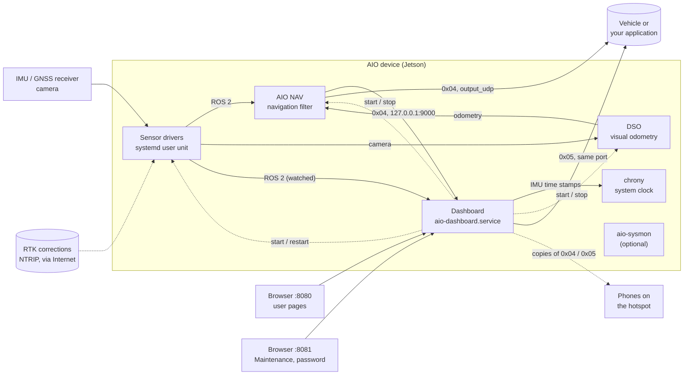

- AIO NAV computes the navigation; the dashboard watches it and everything it depends on. AIO NAV
  sends its output to the vehicle by itself; the dashboard adds the 0x05 readiness packet.
- AIO NAV, DSO and the drivers run in their own processes: a dashboard restart never stops them.
- Dotted arrows are control; solid arrows are data.

**Details:** [Integration Guide](../INTEGRATION.md) (0x04, 0x05), [Installation Guide 5](../INSTALL.md#5-what-the-installer-changes-on-the-system)
(services and system changes), [FLOWS.md 1](FLOWS.md#1-system-and-data-flow).

## 2. Layers

The parts are layered after what the program is for: monitoring first.

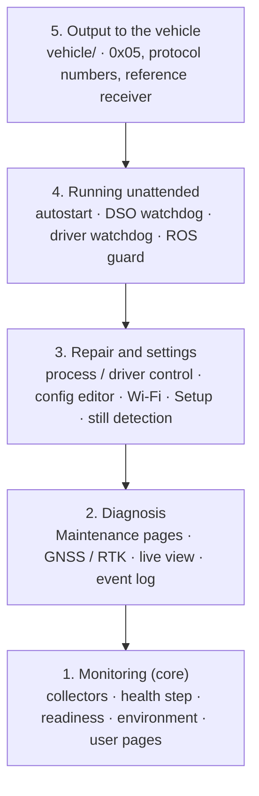

- An arrow means "uses". **A layer only uses the layers below it**: without layers 4 and 5 the
  dashboard still monitors and diagnoses.
- Layer 5 may move to another project one day; that is why it is a package of its own
  ([section 3](#3-packages-and-who-imports-whom)).

**Details:** [DIRECTION.md 2](DIRECTION.md) (why these layers, Traditional Chinese).

## 3. Packages and who imports whom

The import graph of `aio_system_dashboard/`, as it is in the code.

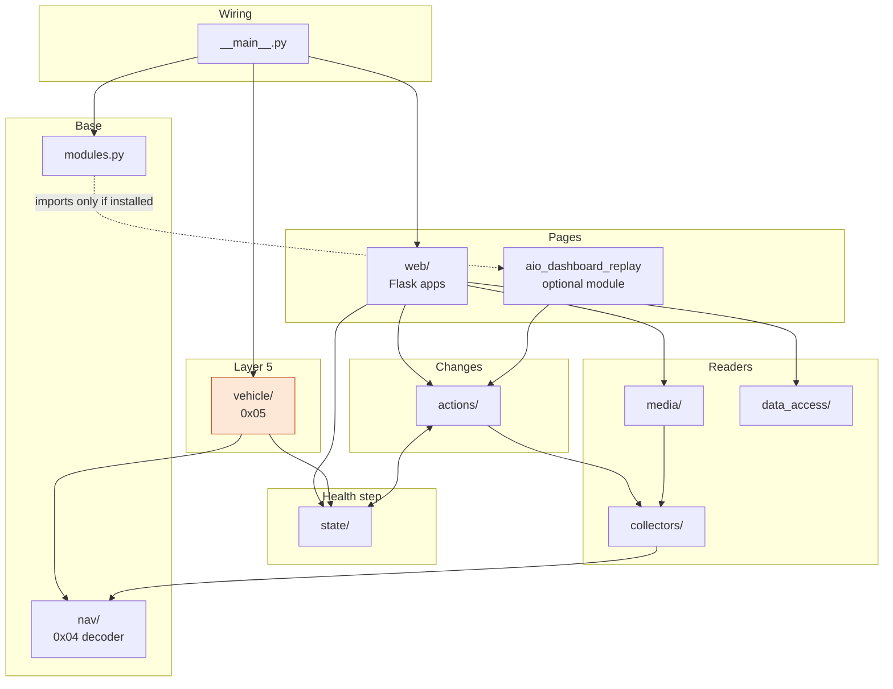

- Arrows point from the importer to what it imports. Not drawn: almost every package imports
  `config`, and `__main__.py` imports everything (it builds the parts).
- **Only `__main__.py` imports `vehicle/`.** The health step hands its snapshot to listeners; the
  wiring connects the vehicle layer to them. `tests/test_vehicle_layer.py` fails if any other module
  imports `vehicle/`.
- **The core never imports an optional module**; it asks `modules.py`
  ([section 10](#10-optional-modules)).
- `state` and `actions` use each other: the health step asks `process_control` whether AIO NAV is
  wanted, and the automatic start uses the readiness conditions. Known; keep it to those two uses.

**Details:** the package list in [section 12](#12-notes).

## 4. Inside the dashboard process

One process. Readers write the shared store; the health step turns it into one snapshot; everyone
else reads.

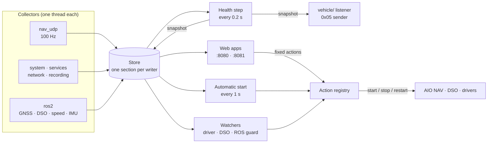

- **One writer per store section.** Readers get copies, so no reader can change another part's data.
- **Every change goes through the action registry**: fixed action names, targets from the settings,
  a time-out, an event in the log.
- The browser asks for `/api/state` five times a second and for the trajectory every 2 s.

**Details:** `state/store.py`, `actions/registry.py`, [FLOWS.md 2 and 4](FLOWS.md).

## 5. One health step

What `HealthEngine.step()` (`state/health.py`) does five times a second.

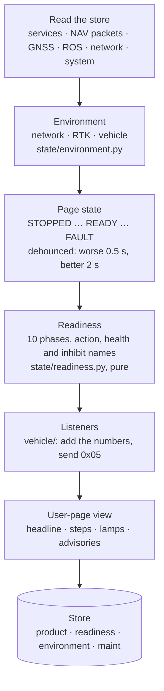

- **One snapshot for everything**: the pages, `/api/readiness`, the automatic start and the 0x05
  packet read the same one, so they never disagree.
- Readiness works **by name**; the numbers on the wire are added by the vehicle layer.
- A listener that fails is logged and skipped; it cannot stop the step.

**Details:** [FLOWS.md 2](FLOWS.md#2-one-health-tick-5-hz), [User Guide 3](../USER_GUIDE.md#3-reading-the-status)
(what the pages show).

## 6. States

The six states the pages show. Readiness splits them into ten phases for the vehicle
([FLOWS.md 3](FLOWS.md#3-readiness-states)).

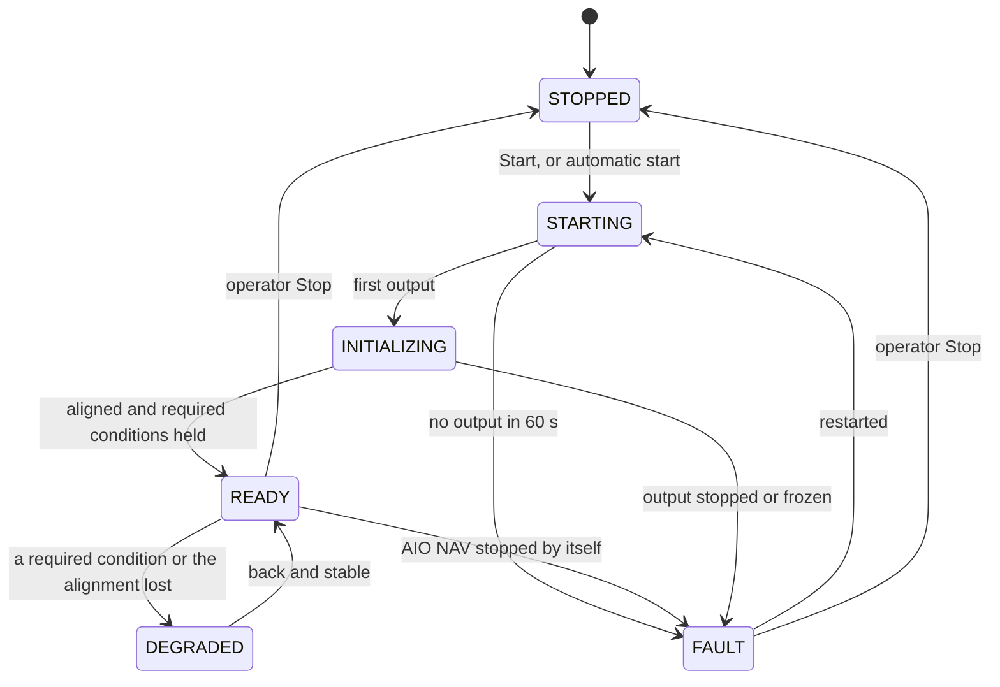

| State | Means |
|-------|-------|
| STOPPED | Not running, nobody asked it to: normal |
| STARTING | Being started, or the automatic start waits |
| INITIALIZING | Running and aligning |
| READY | Aligned, output fresh, required conditions held (RTK where the environment has it) |
| DEGRADED | Was READY in this run; something required was lost |
| FAULT | AIO NAV has a problem (the reason is shown) |

**Details:** [User Guide 3.1](../USER_GUIDE.md#31-the-headline), [Integration Guide 6.3](../INTEGRATION.md#63-states)
(the phases on the wire).

## 7. Who restarts what

Five watchers act on their own. Each touches only its own target.

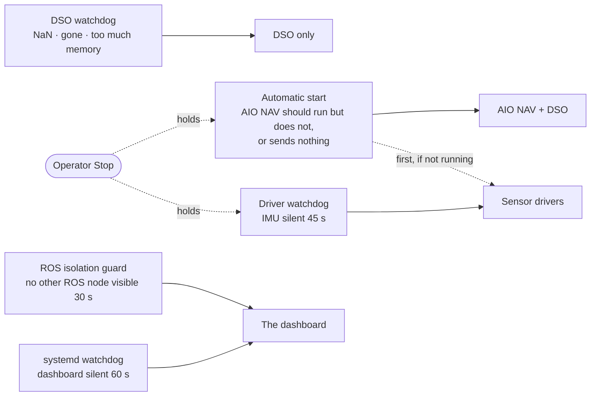

- Every watcher waits longer after each failure and respects an operator Stop.
- **Known overlap:** when the dashboard's own ROS connection is stuck, the IMU also looks silent, so
  the driver watchdog and the ROS guard can both act on the same symptom.
- Check this picture before adding a watcher.

**Details:** [FLOWS.md 7](FLOWS.md#7-who-restarts-what) (timings), [Maintenance Guide 3](../MAINTENANCE.md#3-how-the-device-runs-on-its-own).

## 8. Where a setting comes from

Some answers can come from three places. The first that has one wins. RTK, as the example:

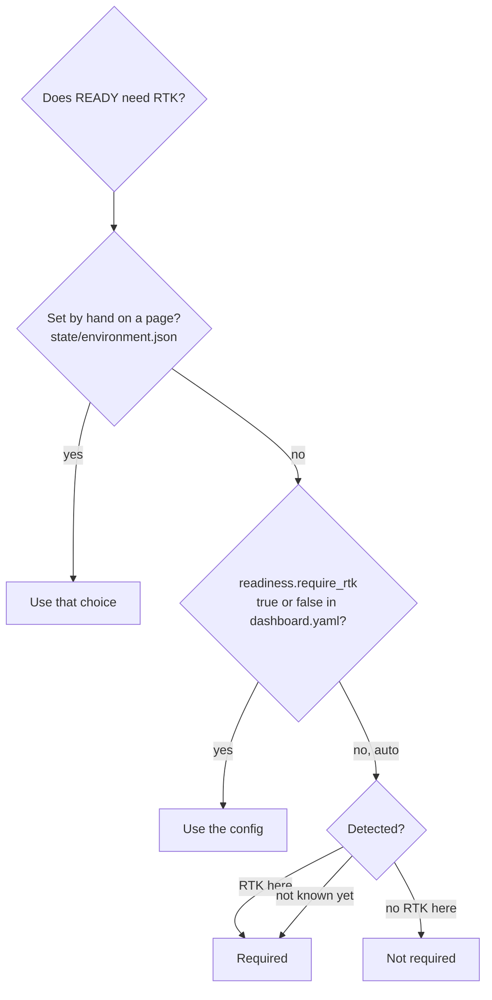

- The same pattern for the other page choices: the page's choice is kept in `state/` and wins over
  `dashboard.yaml`; some last until the next power-on (Live / Bag replay, operator Stop).
- *Not known* counts as required: the careful choice for a vehicle.

**Details:** [FLOWS.md 8](FLOWS.md#8-where-a-setting-comes-from) (every such setting),
[Configuration Reference](../CONFIG.md), `state/environment.py`.

## 9. A request from a page

What happens when someone presses a button, for example **Stop** on the user pages.

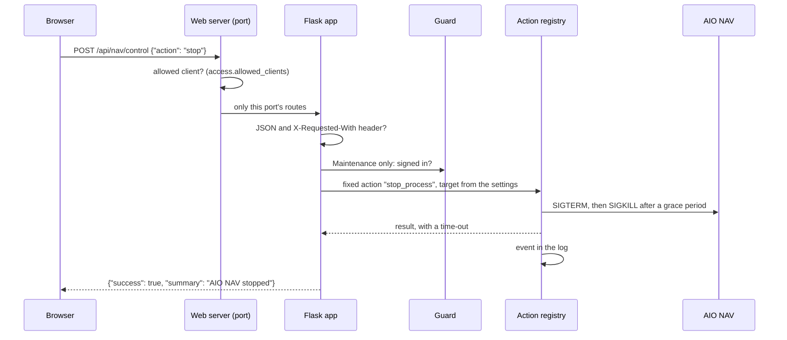

- **No commands from the web**: a request names a fixed action; its target comes from the settings.
  The Maintenance terminal is the one exception, behind the password.
- The user pages need no password; what they can change is listed in
  [Installation Guide 7](../INSTALL.md#7-security).

**Details:** `web/server.py`, `web/access.py`, `web/auth.py`, `actions/registry.py`.

## 10. Optional modules

How a module plugs in without the core knowing it.

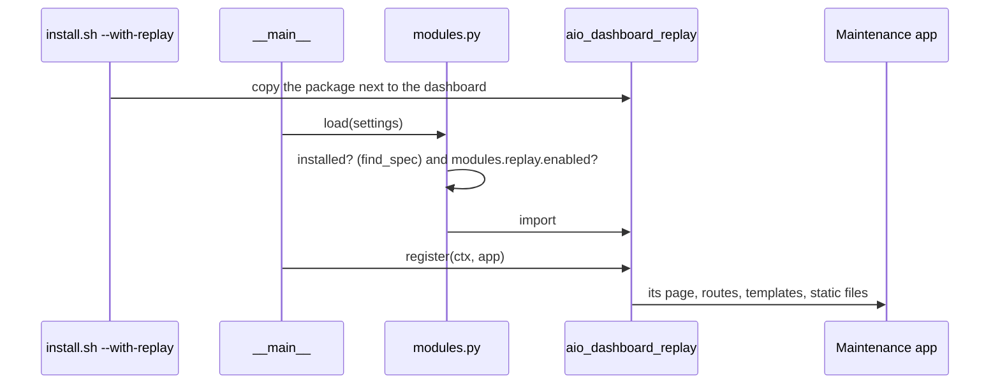

- A module provides `NAME`, `TITLE`, `DEFAULTS` and `register(ctx, app)`, and is listed in
  `modules.py`. A module that fails to load is logged and skipped.
- The installer's other optional parts (`sysmon`, `wifi`, `hotspot`) are system changes, not
  modules.

**Details:** `aio_system_dashboard/modules.py`, [Installation Guide 3](../INSTALL.md#3-optional-parts).

## 11. Tests that check the documents

Some tests read the documents, so the documents cannot drift away from the code.

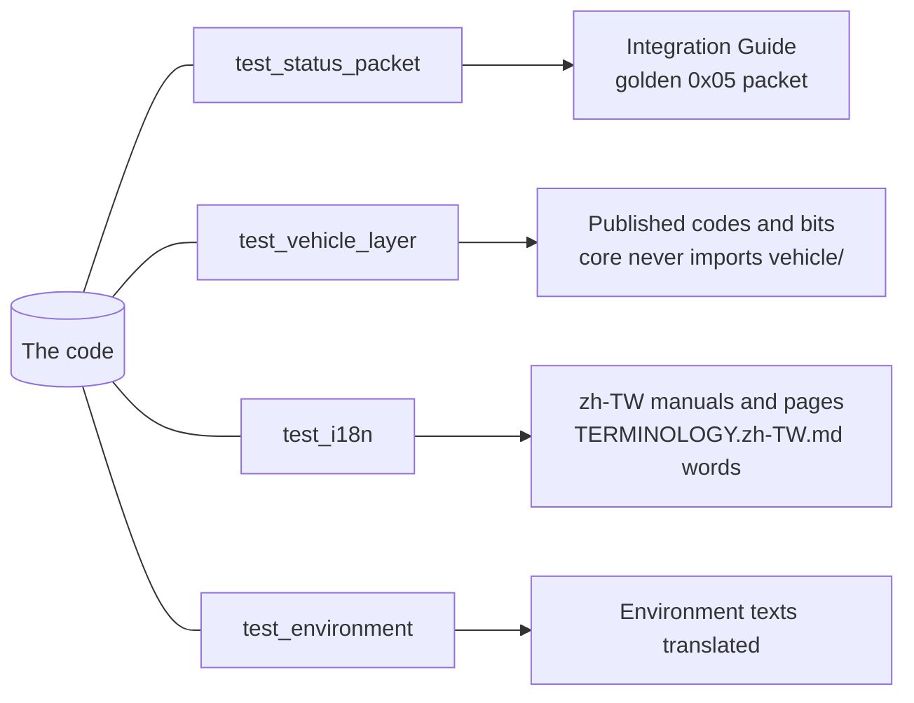

```bash
python3 -m pip install --target .devdeps flask pyyaml psutil   # once
PYTHONPATH=.devdeps python3 -m unittest discover -s tests -t .
```

- The tests need no ROS and no sensors. One test (the config editor's isolated test start) needs
  `unshare -rn` and fails in containers that do not allow it.
- A change that alters what a page shows or what a setting does updates the matching guide in the
  same commit ([DOCS_PLAN.md](DOCS_PLAN.md) lists the guides and their readers).

## 12. Notes

**Packages.**

| Package | Holds |
|---------|-------|
| `__main__.py` | The wiring: builds every part, connects the layers, starts the two servers |
| `config.py` | `dashboard.yaml` and the active aio-nav-ros settings file (re-read when it changes) |
| `nav/` | `decoder.py` (0x04), `trajectory.py` (last 60 s at 10 Hz, older at 1 Hz) |
| `collectors/` | `nav_udp`, `system`, `services`, `network`, `recording`, `ros2` (sampled), `gnss_monitor`, `gnss_diag`, `gnss_time`, `speed`, `dso_watchdog`, `ros_guard`, `hotspot_relay`, `fake` |
| `state/` | `health.py` (the step), `readiness.py`, `environment.py`, `still.py`, `indicator.py`, `store.py` |
| `actions/` | `registry`, `process_control`, `service_control`, `autostart`, `driver_watchdog`, `diagnostics`, `aionav_config`, `terminal`, `wifi` |
| `media/` | The live view: `tap.py`, image and point-cloud decoders, fake frames |
| `data_access/` | Read-only browse and download inside the data folders |
| `web/` | The Flask apps and their helpers; `i18n.py` + `i18n_zh.py` for the user-page languages |
| `vehicle/` | `output.py` (the listener), `protocol.py` (numbers), `packet.py`, `sender.py`, `gate.py` |
| `templates/`, `static/` | Bootstrap, Alpine.js, Leaflet, xterm.js, all vendored (no Internet needed) |

**Decoder fixes compared with setup_env** (`nav/decoder.py`): after the wire bit reversal, wire flag
bit 3 is **VUPT**, not `imu_valid`; the third velocity on the wire is **Up** (`-vel_d`), exposed as
`velocity_up`; the packet is 156 bytes (5 header, 150 payload `<Qdd28fH3f`, 1 checksum).

**Live view** (`media/tap.py`): the dashboard subscribes to a camera or LiDAR topic only while a
page asks for frames, and unsubscribes 10 s after the last request. Messages are received without
deserialization; only the latest one is converted, at the rate the browser asks for. Camera images
are passed through (CompressedImage) or downscaled (Image); point clouds are downsampled to
`max_points`. Needs numpy, which ships with ROS 2.

**Not included:** offline map tiles, trend charts (except the GNSS page's last 10 minutes), deep
IMU / camera / LiDAR diagnostics, ROS message browsing, recording bags. Ideas kept for later:
[IDEAS.md](IDEAS.md).
